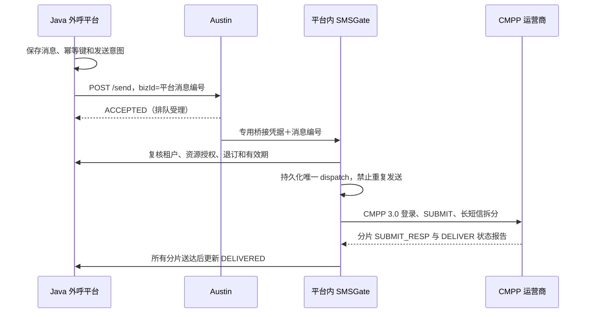

# Austin＋SMSGate 短信模块

短信首选调整为 **Austin＋SMSGate**，开发落在现有 `outbound-mono`（Java 21 / Spring Boot 4 / Vue 3）消息模块。入口 `/admin/messaging` →「短信通道」。保留既有模板、签名、联系人授权、单发、定时、批次、人群活动、退订、应用权限和外呼结束联动。

## 数据链路



Austin 原生没有本项目所需的 SMSGate 桥接接口。仓库提供 `integrations/austin-smsgate/OutboundSmsGateBridge.java` 和可重复执行的安装脚本，在 Austin 的 `SmsHandler` 里接入专用 `OutboundSmsGateScript` 路由。桥接只接受原平台消息编号，正文、签名和号码重新从平台已批准资源读取，调用方不能替换它们。

目前实现 **CMPP 3.0、中国大陆手机号、单运营商账号**。SMSGate 上游还支持 SMPP/SGIP/SMGP，但本项目尚未实现这些协议的账户配置和回执归并，不能视为本次已经接通。

## 配置与使用

1. 按既有文档构建 `outbound-mono`，执行 Flyway 新增迁移 V46；既有迁移不改写。`msg_sms_dispatch` 保存不可重放的发送边界，`msg_sms_part` 关联每个分片的运营商编号，`msg_sms_report` 暂存提前到达的回执。
2. 在 Austin 源码目录安装桥接，然后重新构建 Austin：

   ```sh
   node integrations/austin-smsgate/install.mjs /path/to/austin
   # 以下在 Austin 根目录执行；上游默认使用 Java 8 工具链。
   mvn -pl austin-handler -am -DskipTests package
   ```

   安装器对上游插入点做唯一匹配，结构变化时会拒绝修改。已核对并编译的上游提交为 `8379c029e0ba3c541f1e34cfc9c8401a4355b2f6`。本次用 Java 21 编译上游时额外传入 `-Dlombok.version=1.18.40`；此临时编译覆盖不修改平台依赖。
3. Austin 配置：

   ```properties
   outbound.smsgate.dispatch-url=https://platform.example/internal/messaging/smsgate/dispatch
   outbound.smsgate.token=<独立随机凭据，与平台 SMS_BRIDGE_TOKEN 一致>
   ```

   同机开发可用 `http://127.0.0.1:端口/...`；跨主机必须 HTTPS。创建专用短信账号，`scriptName` 设置为 `OutboundSmsGateScript`，并让 Austin 短信模板**固定绑定该账号**，不使用自动流量分配或其他供应商降级。Austin 模板正文用 `{$content}`，记录模板编号。桥接返回成功只表示任务交接，不是手机送达。
4. 通过现有环境配置/密钥设施设置下列参数，不向 Git 提交实际凭据：

   ```text
   MESSAGING_ENABLED=true
   MESSAGING_WORKERS_ENABLED=true
   MESSAGING_MASTER_KEY=<现有消息模块独立的 32 字节 Base64 主密钥>
   SMS_AUSTIN_ENABLED=true
   SMS_AUSTIN_SEND_URL=https://austin.example/send
   SMS_AUSTIN_API_TOKEN=<如 Austin 反向代理启用了 Bearer 鉴权>
   SMS_BRIDGE_TOKEN=<至少 32 字符独立随机凭据>
   SMS_SMSGATE_ENABLED=true
   SMS_CMPP_HOST=<运营商地址>
   SMS_CMPP_PORT=7890
   SMS_CMPP_USERNAME=<账号>
   SMS_CMPP_PASSWORD=<密码>
   SMS_CMPP_SP_CODE=<接入码>
   SMS_CMPP_SERVICE_ID=<业务代码>
   ```

   默认这些通道开关关闭。允许平台访问 Austin、Austin 访问平台桥接，以及平台连接指定运营商 TCP 地址。CMPP 需要运营商提供账号、白名单和网络通路。
5. SMSGate `sms-core:2.1.13.6` 的 FST 序列化在 Java 21 上需要以下启动参数；Maven 单元测试已配置相同参数：

   ```sh
   java --add-opens java.base/java.lang=ALL-UNNAMED \
     --add-opens java.base/java.math=ALL-UNNAMED \
     --add-opens java.base/java.util=ALL-UNNAMED \
     --add-opens java.base/java.util.concurrent=ALL-UNNAMED \
     --add-opens java.base/java.net=ALL-UNNAMED \
     --add-opens java.base/java.text=ALL-UNNAMED \
     --add-exports java.base/sun.security.x509=ALL-UNNAMED \
     -jar target/outbound-mono.jar
   ```

6. 从管理台「签名与模板」点击「配置短信产品与通道」（`/admin/messaging?section=content`），新建短信产品，选择 Austin＋SMSGate 并填写 Austin 模板编号；编号按字符串保存以避免浏览器大整数精度损失。新建签名主体和短信模板，批准后发送。模板变量沿用平台 `{{name}}` 格式，最终内容为 `【签名】正文`，总长最多 1000 字符。批准只代表平台内部批准，运营商签名和模板审核仍需在运营商侧完成。
7. 外呼联动：配置并批准 `call_rule`，关联短信产品、签名和模板，再打开 `MESSAGING_MIGRATE_CALL_SMS=true`。正常完成且拨号代次匹配后才创建消息；同一通话/代次只创建一次。停用资源、撤销应用、联系人退订或消息过期会在发送前再次校验。

## 状态、计费与查询

- `QUEUED`：待发送，可取消；`SUBMITTING`：已进入外部提交边界；`ACCEPTED`：Austin 或运营商受理；`DELIVERED`：所有分片收到成功回执。
- `REJECTED`：所有分片明确被拒；`FAILED`：分片均已终结且有失败；`UNKNOWN`：提交超时、部分结果不明、进程中断或回执未齐。UNKNOWN 不自动重发，也不按时间释放未知余额。
- Austin 请求有连接超时、总响应期限、64 KiB 响应上限，禁止重定向。Austin 错误、无效/缺失业务编号和超时保守记为 UNKNOWN。
- 先到的回执持久保存，收到提交响应后补关联。重复回执不重复结算，冲突终态不能反转已有送达结果。长短信必须全部分片成功才算送达。
- 「发送记录」展示真实/模拟标记、发送通道和分片回执。`GET /api/v1/admin/messaging/messages/{id}/sms-parts` 受现有租户和 `messaging:write` 权限保护。模拟回执接口不能修改真实通道消息。
- 当前**账本仍是模拟额度**，Austin＋SMSGate 产品的平台模拟价格固定为零；采购成本、运营商账单和真实资金结算没有实现。真实测试发送仍可能产生运营商费用。配置存在不代表真实线路验证成功。
- 原有生产模式保护仍保留：本次交付用于开发和隔离测试环境，尚未开放生产发送。不能用源码更新代替真实通道、计费及生产发布验收。
- 上行 MO/短信回复尚未接入 CRM：当前只处理 CMPP 状态报告，不把未处理的上行内容确认成已接收。已有控制台模拟互动与应用上报互动仍保留，不能当作真实手机回复。

## 验证与回退

功能验证使用 MySQL Testcontainers、本地 Austin HTTP 桩和本地 CMPP 服务端；协议测试运行真实 SMSGate 库，不连接运营商。真实 Austin 部署、真实号码、供应商账单和生产环境没有在本次运行中验证。最终测试数量和结果见 `outbound-mono/SMS-ACCEPTANCE.md`。

复验：

```sh
cd outbound-mono
mvn -B -Dit.test=MessagingIT verify
# 浏览器使用已安装的系统 Chromium 时可明确指定：
PLAYWRIGHT_CHROMIUM_EXECUTABLE_PATH=/usr/bin/chromium mvn -B -DskipTests=false -Dtest=AustinSmsAdapterTest -Dit.test=FrontendBrowserIT verify
```

回退先关闭短信 worker 和外呼迁移开关，再关闭 Austin/SMSGate 开关，停止 Austin 专用账号的任务入口。按现有单实例停旧启新流程回退代码，保留 V46 表、未知消息、分片、回执和主密钥。不要重新排队 UNKNOWN 消息；先核对运营商事实，避免重复发送。
