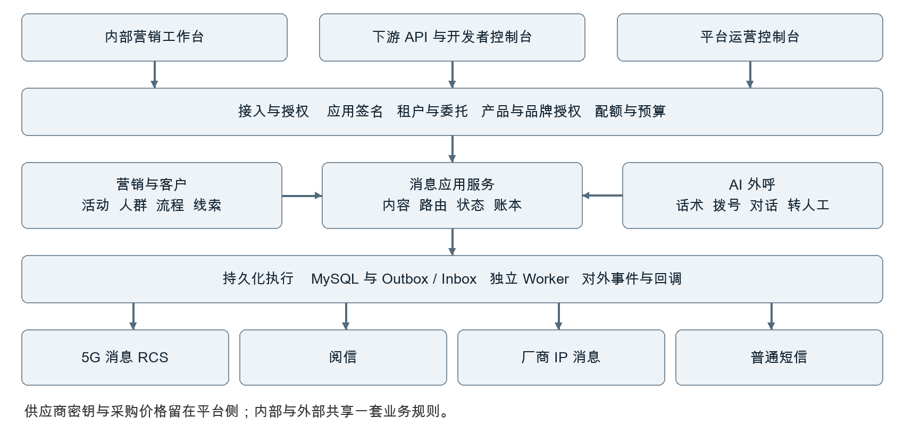
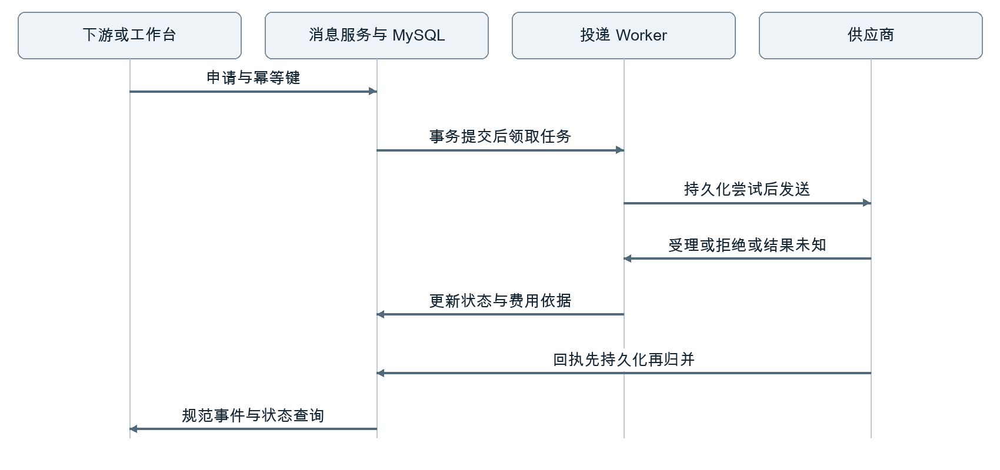

> 此文件为目标架构设计。当前代码能力与尚未开放部分见 [实施说明](messaging-implementation.md)，实际调用使用 messaging-implemented.openapi.json。

# 营销系统消息业务与开放平台技术架构方案

版本 V1.0　日期 2026年10月28日　适用对象 产品 技术 运营 商务及交付团队

建设统一消息能力，支撑公司内部独立开展消息营销，并将获授权的通道通过 API 提供给下游企业。消息营销与 AI 外呼并列，统一客户、营销活动、触达规则和业务结果；内部页面与外部 API 进入同一业务服务，避免形成两套发送和计费逻辑。

## 建设范围

覆盖 5G 消息 RCS、阅信、手机厂商 IP 消息及普通短信兜底。包含人群、内容、任务、互动、营销流程、供应商适配、API 客户接入、配额、计费、回调和运维。厂商 IP 消息同时兼容指定用户发送与人群投放，两种模式分别建模。

| 关键决策 | 设计结论 |
| --- | --- |
| 业务结构 | 营销活动统筹目标；外呼任务和消息任务分别执行；消息任务不依赖通话。 |
| 开放方式 | 对下游提供产品化接口、配额和账单；供应商密钥、原始采购价格留在平台侧。 |
| 隔离边界 | 终端企业拥有业务数据；商业上下级关系与数据访问授权分开。 |
| 可靠性 | 先持久化再返回受理；请求未知先核查；不承诺供应商侧恰好发送一次。 |
| 实施策略 | 先在现有单体中建立清晰模块；对外商用高可用部署需先解除现有 JVM 锁限制。 |

## 使用说明

第 2 至 7 章定义业务与边界；第 8 至 17 章定义开放接口、可靠投递和计费；第 18 至 22 章定义数据、安全、部署和容量；第 23 至 26 章定义迁移、实施、验收与待确认事项。接口附件为核心资源的 OpenAPI 3.0.3 设计草案，不代表已上线接口。

# 02 业务板块与对外服务产品

平台提供内部营销工作台、下游开发者控制台、平台运营控制台三类入口。三类入口共享应用服务，分别执行用户权限、应用权限和平台操作权限检查。

| 入口 | 主要功能 | 责任边界 |
| --- | --- | --- |
| 内部营销 | 客户人群、活动、素材、发送、互动、线索、转化 | 按公司团队和客户归属授权 |
| 下游开发者 | 应用密钥、品牌备案、模板、调试、回调、用量、账单 | 仅访问自身或显式委托的企业资源 |
| 平台运营 | 下游开户、产品授权、供应商、路由、价格、风控、结算 | 敏感操作分权、审批及审计 |

## 消息服务产品

对外销售对象为版本化 service_product，例如消息营销、服务通知或 RCS 会话服务。产品定义允许的消息形态、用途、发送主体、地区、能力、额度、价格和服务等级。客户选择产品及允许形态，不直接指定平台内部供应商账号。专属通道通过授权配置分配。

验证码能力预留独立产品，不默认并入营销发送；其内容、频控、时效和安全策略另行定义。充值、税务发票、支付收单不随本方案自动实现，可通过现有财务系统接入。

## 独立营销闭环

选择人群 → 建立活动和目标 → 创建消息任务 → 制作内容 → 内部及渠道审核 → 测试发送 → 发布 → 接收互动 → 线索或预约 → 转化与成本分析。外部 API 单条发送可不创建营销活动，但必须有产品、发送主体和模板。

## 外部商业模式

第一期支持企业直客和一级合作伙伴管理终端企业。数据模型允许扩展商业关系，暂不开放无限级代理。平台分别与合同付款方及实际发送企业建立映射。BYOC 自带供应商账号作为后续扩展，与平台采购转售的费用和责任严格分开。

# 03 总体架构与服务边界



入口层处理 TLS、认证、请求大小、速率和追踪；应用层负责资源授权、预算和业务规则。内部调用同样使用授权上下文，不能以“内部请求”为由绕过额度和审核。

| 模块 | 拥有的数据与职责 |
| --- | --- |
| 营销与客户 | 活动、人群快照、授权证据、线索、转化；外呼保持既有调度边界 |
| 消息核心 | 模板快照、消息、投递、尝试、状态、任务和路由计划 |
| 渠道执行 | 各供应商协议、限额、发送与查询；不自行决定销售价格 |
| 开放平台与计费 | 应用、委托授权、产品、销售价格、账户、账本与对外事件 |
| 运营分析 | 读取事件和聚合结果，不反向修改发送或财务事实 |

MySQL 保存业务事实；Redis 用于短期限流和唤醒；对象存储保存素材及受控归档。第一期使用事务 Outbox 和持久 Inbox。消息队列在后续吞吐需要时引入，数据库仍负责业务幂等和恢复依据。

# 04 租户与商业关系模型

客户数据归属、商业付款关系和操作身份分别建模。父级合作伙伴不天然拥有子企业的号码、正文、回复和采购成本访问权。

| 对象 | 定义及约束 |
| --- | --- |
| organization | 平台、合作伙伴、终端企业或公司内部组织；保存合同主体信息 |
| tenant | 业务数据隔离边界；内部业务也归入明确 tenant |
| partner_relationship | 商业关系、有效期和结算规则；禁止循环关系 |
| billing_account | 付款与信用责任主体，可与业务数据拥有者不同 |
| application | 归属明确 tenant；区分开发、测试、生产；各自密钥及配额 |
| delegation | 受托应用、目标 tenant、作用域、资源范围、有效期及撤销版本 |
| sender_identity | 实际发送企业、品牌、签名、服务号或 Chatbot 的备案和授权链 |

## 有效权限计算

有效权限取应用 scopes、当前企业权限、委托范围、产品授权、发送主体授权和资源归属的交集。下游请求中的 tenant_id 或品牌名称都不构成授权依据。对外单条发送接口不接受自由填写 tenant_id。

合作伙伴代发时使用服务器签发的 delegation_id。平台验证它绑定的应用与目标企业，再固定业务 tenant 和账单账户；不能由调用方指定扣谁的钱。回调订阅也必须与该有效上下文匹配。

## 运营权限

营销人员创建任务；审核人员审批内容和发布；客服查看获分配会话；财务查看销售账单；平台渠道管理员维护采购合同；采购成本权限独立。额度调整、授信、资金转移和密钥导出采用单独权限及双人复核。平台排障访问敏感数据需短时授权并完整审计。

# 05 通道授权与发送主体准入

“能够调用供应商接口”不等于“允许向下游转售”。每个供应商账号需登记可服务的企业、用途、形态和是否允许转售，以及对应合同或授权凭据。授权状态作为路由的硬条件；未确认的账号不得对外开通。

| 准入对象 | 必须明确的信息 |
| --- | --- |
| 供应商账号 | 协议版本、区域、采购模式、转售范围、额度、回调验证、结算口径 |
| 下游企业 | 业务场景、品牌与发送主体、联系人、合同付款方、生产准入状态 |
| 发送身份 | 签名、端口、Chatbot、厂商服务号的所有者和使用企业 |
| 内容版本 | 内部审核、渠道审核、变量规则、素材和链接域名、有效期 |
| 能力清单 | 单人发送或人群投放、上行、查询、展示、已读、计费、取消、回落 |

## 产品授权对象

entitlement 绑定应用或受托企业、service_product、可用形态、发送身份集合、模板集合、日额度、并发、预算、有效期与区域。停用需阻断新发送，并在 Worker 出站前复核；已受理消息仍继续查询、接收回执和结算。

## 模板映射

template_version 为平台不可变内容版本；provider_template_binding 将其映射到供应商账号、厂商、发送主体和渠道模板 ID。模板审核通过仅对该绑定有效。下游不能直接提交供应商模板 ID 来绕过授权。

## 准入输出

一个账号达到 READY 必须完成合同范围确认、资质和内容审核、签名或服务号关联、测试名单真机验证、回执和账单样例核对。模拟环境通过不能自动解锁生产。不同厂商和运营商分别记录验收矩阵。

# 06 人群内容与素材管理

公共客户库保存客户身份和联系方式；消息任务引用客户或接收端点。外部调用方可以只传号码及外部客户标识，不强制创建 CRM 客户。企业间禁止基于同一手机号自动合并客户档案。

## 人群

支持导入、标签筛选、行为条件、排除集合、静态人群和动态人群。每次执行生成规则版本、数据截止时间、成员和排除原因快照。发送前再次检查退订、禁止联系、频次和业务有效性。厂商人群包记录匹配和投放结果，不虚构个人送达明细。

## 内容

业务模板包含文本、变量、媒体、卡片和 action_code；渠道版本声明自身支持的元素。变量缺失必须配置拒绝或明确默认值，不能由模型临时编造。发布后保存渲染结果及素材摘要，历史发送不跟随模板编辑变化。AI 可生成草稿或选择已批准内容，不能越过发布审核。

## 素材

上传先进入隔离区，校验真实文件类型、大小、恶意内容和媒体规格，再转为可用素材。对外接口使用 asset_id，第一期不支持任意远程 URL 拉取。转码异步执行；记录各供应商的素材 ID、审核状态和过期时间。

| 对象 | 生命周期 |
| --- | --- |
| 内容版本 | DRAFT → INTERNAL_REVIEW → CHANNEL_REVIEW → READY → DISABLED |
| 素材 | UPLOADED → CHECKING → PROCESSING → READY 或 REJECTED |
| 人群快照 | BUILDING → READY → EXPIRED；发布任务固定使用一个快照 |

厂商 IP、阅信和 RCS 的媒体、按钮、回执和终端支持由能力矩阵决定。预览用于内容检查，不能替代真实终端展示验收。普通短信版本必须预先审批；不允许发送失败时临时生成降级文案。

# 07 活动任务与营销流程

营销活动保存业务目标、负责人、预算和转化口径；消息任务保存人群、内容、路由、时间及执行策略。外呼任务作为活动下的另一执行对象，保留现有话术和拨号机制。

| 能力 | 行为约定 |
| --- | --- |
| 任务发布 | 预检人群、模板、额度和预算；固定快照；审批后生成持久计划 |
| 定时与分批 | 保存客户时区和有效时段；分批扩展任务，不一次性载入全部号码 |
| 暂停取消 | 停止尚未提交的部分；已受理部分继续回执和结算；不承诺撤回 |
| 补发 | 明确未受理且可恢复时自动重试；其他补发需新业务申请并关联原消息 |
| 流程节点 | 事件、条件、等待、消息、外呼、人工、退出；节点执行具有幂等键 |
| 退出条件 | 退订、转化、授权撤销、活动停止或过期，阻止尚未发生的营销动作 |

## 持久化执行

journey_instance 固定流程版本、客户和当前节点；节点状态与后续 Outbox 同事务写入。等待保存 wake_at，重启后扫描恢复。事件匹配绑定租户和业务对象，重复事件不重复推进；晚到事件依节点窗口规则处理。人工接管时暂停 AI 自动回复。

## 共同触达规则

在 tenant 和实际品牌的合理作用域内，对同一客户执行跨任务、跨应用、跨渠道频控。全局安全限制与企业自己的频控分层配置；共享平台不得向一个租户泄露另一个租户的客户行为。外呼与消息统一检查拒绝联系及业务退出事件。

首次版本使用预定义流程模板和有限节点，保证可解释、可恢复。复杂可视化编排在持久执行语义稳定后再开放。

# 08 开放 API 资源与契约

对外使用 /openapi/v1，与现有 /api/v1 管理接口隔离。内部工作台调用同一消息应用服务。API 的 202 表示平台已持久受理，不表示供应商已接收或用户已送达。接口附件覆盖核心发送、查询、事件、批次、能力、余额和回调订阅。

| 资源及接口 | 行为 |
| --- | --- |
| POST /messages | 创建一条业务消息；必须有 Idempotency-Key |
| GET /messages/{id} | 查询平台状态、实际形态和账务状态；仅本上下文可见 |
| POST /messages/{id}/cancel | 取消未提交消息；与领取提交原子竞争；不可取消返回 409 |
| GET /messages/{id}/events | 按服务器序号查询该消息事件，支持不透明游标 |
| POST /message-batches | 异步批次；初始建议最多 1000 条，实际限额可配置 |
| GET /message-batches/{id}/items | 逐项受理或拒绝结果；拒绝项保留业务行号 |
| GET /capabilities | 查询已授权产品能力，不等于探测某个号码 |
| POST /recipient-capability-checks | 可选付费能力探测，必须显式授权；结果有有效期 |
| GET /balance | 销售账户可用、冻结、信用和待核对金额 |
| POST /webhook-subscriptions | 创建验证中的回调地址及事件订阅 |
| GET /events | 拉取应用及委托范围内事件，作为回调补偿 |

## 扩展资源

品牌与资质、模板与渠道审核、素材上传、人群投放、账单导出、应用密钥和委托管理属于控制面接口，按单独资源发布。平台运营的采购价格、供应商凭证和路由调试接口不开放给下游。厂商人群投放使用 /audience-campaigns，不能伪装成单条发送。

接口版本遵循兼容扩展；破坏性变更使用新主版本。废弃窗口在合同中约定，建议不少于 180 天。错误码和枚举演进在 SDK 中保留未知值处理。

# 09 API 身份签名与幂等

生产 API 使用 TLS 和平台定义的 HMAC-SHA256 请求签名。access_key_id 定位应用和密钥版本，secret 在 KMS 保护下加密保存以供验签；不是只保存不可逆哈希。密钥仅创建时展示，支持双密钥短时轮换和立即吊销。

## 签名规范

```text
Authorization: HMAC-SHA256 Credential=<key_id>,Signature=<hex>
X-Timestamp: <Unix 秒>
X-Nonce: <至少 128 位随机值>
X-Content-SHA256: <原始请求体 SHA256 小写十六进制>
Idempotency-Key: <写请求必填>
X-Delegation-Id: <可选受托上下文>
```

签名原文为八行，以 LF 连接且无末尾换行：大写方法、规范路径、规范查询串、时间戳、nonce、body_hash、幂等键或空串、delegation_id 或空串。v1 路径只允许 ASCII 资源路径与不透明 ID；拒绝点段、编码斜杠、重复斜杠。查询参数 RFC3986 编码后按键排序，v1 禁止重复参数，空值保留 key=。无请求体按空字节摘要。

建议时间偏差不超过 300 秒。验签通过后，使用 key_id 与 nonce 做原子去重，保留至少 600 秒；nonce 存储不可用时拒绝新的外部写入，不静默放行。网关验签使用约定的原始外部路径，代理重写规则固定并有测试向量。

## 业务幂等

唯一键为有效 tenant、application、operation 和 Idempotency-Key；受托上下文参与有效 tenant。解析并规范化请求后保存 payload_hash；相同键相同内容返回原资源，相同键不同内容返回 409。关键业务记录与幂等记录同事务提交，超时重试必须使用原键和新 nonce。

建议完整幂等记录至少保存 30 天；过期后仍保留去重墓碑至 180 天，期间返回原 ID 或 410，不重发。下游不得把业务重发误当成网络重试。对批次及资金变更也执行独立幂等。

# 10 请求响应与批次语义

```text
POST /openapi/v1/messages
{
  "client_message_id": "crm-appointment-20261028-01",
  "service_product_id": "sp_marketing",
  "sender_identity_id": "snd_example",
  "recipient": {"type":"phone","value":"+8613800000000"},
  "template_version_id": "tv_appointment_v3",
  "variables": {"appointment_time":"2026-10-29 10:00"},
  "channel_policy": {
    "mode":"automatic",
    "allowed_forms":["rcs","yuexin","oem_ip"],
    "allow_fallback":false
  },
  "purpose":"marketing",
  "consent_reference":"consent_example",
  "expires_at":"2026-10-29T01:30:00Z",
  "webhook_subscription_id":"wh_example"
}
```

示例号码和 ID 仅供契约说明。consent_reference 必须指向当前企业已登记且有效的证据或经合同约定的可追溯证据引用，不接受任意字符串自动视为有效授权。下游不传采购价格、供应商密钥或扣费账户。

```text
202 Accepted
{ "request_id":"req_example",
  "data":{ "message_id":"msg_example",
    "status":"QUEUED", "billing_status":"RESERVED",
    "accepted_at":"2026-10-28T08:00:00Z" } }
```

## 批次与错误

批次 202 只承诺批次和输入已持久化。Worker 逐项校验并预占预算，生成消息或拒绝结果。唯一约束为 batch_id 与 client_item_id；必须能查询每项结果。预算不足可导致部分项拒绝，不能把整批显示为已发送。单条预算不足返回 422 INSUFFICIENT_BALANCE。

400 格式错误；401 签名失效；403 无授权；404 不存在或跨租户；409 幂等冲突或不可取消；422 业务前置不满足；429 配额限制并返回 Retry-After；503 暂不可受理。请求响应丢失时先按原幂等键重试。查询分页使用不透明游标，不能拼接其他租户游标扩大范围。

# 11 路由能力与降级策略

路由首先筛选合法可用路径，再考虑成本和质量。路线必须同时满足服务产品、转售授权、企业身份、模板、地域、有效期、预算和容量。终端能力使用 SUPPORTED、UNSUPPORTED、UNKNOWN，并记录来源及 TTL；手机号或品牌不能直接推断终端能力。

| 输入 | 路由处理 |
| --- | --- |
| 业务用途与所需动作 | 排除不支持会话或所需按钮的形态；采用已批准替代内容 |
| 能力信息 | 优先使用有效证据；无探测能力保持未知，遵循产品的未知处理策略 |
| 采购与销售规则 | 销售价格版本固定；选择不突破客户价格上限和产品承诺的路线 |
| 健康与容量 | 共享账号总额度、租户额度和发送频次共同准入 |
| 运营策略 | 允许指定形态或自动选路；专属账号以授权映射实现 |

## 降级判定

明确未受理且可恢复时允许重试；明确不支持且产品允许时选择新路线。ACCEPTED 或 UNKNOWN 不自动跨供应商发送。只有确认原尝试不可能继续投递，或取消已被确认，才可执行补偿路线。无已读、暂时离线、查询暂无记录都不是未发送证明。

阅信文本展示与卡片展示可能属于同一次投递，不重复创建业务消息。供应商自动回落时平台只跟踪其子投递，不能再次启动本地回落。路由计划记录 fallback_owner 为 PLATFORM 或 PROVIDER，并保存所有实际承载和成本事件。

## 路由可解释性

持久化候选、排除理由、策略版本、采购和销售价格版本以及最终选择。对下游仅返回产品承诺的形态和标准原因，不披露其他客户额度、供应商内部身份或采购成本。平台运营可在审计权限下查看完整路线。

# 12 持久化投递与未知结果恢复



受理事务同时写 message、预算冻结、幂等记录和 Outbox；任何一步失败均回滚。事务中不调用供应商。Worker 使用数据库条件更新和 lease_token 领取，出站前再次检查授权、预算、退订及有效期。

请求发出前持久化 SUBMITTING 尝试、请求摘要和关联号。进程崩溃后，遗留 SUBMITTING 转入 UNKNOWN 核查；不能因租约到期直接再发。租约只约束数据库写入，无法撤销已经发出的网络请求。

供应商响应明确受理时记录流水号并进入 ACCEPTED；明确拒绝进入 REJECTED；超时、断连、无法解析或响应丢失进入 UNKNOWN。关闭供应商发送 SDK 的隐式自动重试；查询请求可以按其安全语义独立重试。

重试策略建议为指数退避加随机抖动，受次数和消息有效期约束。对未知尝试先按关联号、号码和时间范围补查；查询结果不唯一则转人工。供应商不支持可靠查询时，平台明确暴露未知状态，保留资金核对，不以“最终一致性”为由盲目重发。

# 13 回执事件与状态模型

供应商回调按账号协议验证来源，先写 Inbox 后应答。回调中的 tenant_id 不可信；通过可信账号配置及平台消息关联找到归属。支持一批包含多条回执，逐条持久处理。

| 维度 | 状态或事件 |
| --- | --- |
| 业务申请 | SCHEDULED、QUEUED、BLOCKED、CANCELLED、EXPIRED |
| 投递尝试 | SUBMITTING、ACCEPTED、REJECTED、UNKNOWN、DELIVERED、UNDELIVERABLE |
| 展示互动 | rendered、read、clicked、replied；事件分别记录，不作为线性发送状态 |
| 账务 | RESERVED、PENDING、SETTLED、RELEASED、ADJUSTED |
| 外部交付 | PENDING、DELIVERING、ACKED、DEAD_LETTER |

## 事件处理

优先按 provider_account_id、供应商流水号和接收对象关联。回执先于响应时保存为待关联事件，后续重放；不能丢弃或靠“取最新一条”匹配。供应商事件 ID 有明确唯一语义时采用它；否则使用规范化字段摘要并保留原始事件审计。

重复事件不重复变更状态或结算。禁止普通乱序事件将已送达回退为处理中。供应商正式更正或账单纠错通过有来源的修正事件处理，保留旧事实和调整链。互相矛盾的终态进入核对队列。

## 可观测性边界

未提供展示、已读或个人明细的渠道标记为 NOT_OBSERVABLE，不能记为零或未读。业务转化独立于点击与送达；短链预取、扫描和重复点击不直接视为有效线索。对外 event_sequence 表示平台入库顺序，occurred_at 表示供应商事件时间，两者分开。

# 14 下游回调与事件拉取

供应商回调和下游回调使用两套独立凭证与队列。对下游只发送规范化事件及其获授权字段；原始供应商报文、密钥、采购价格和内部备注不得透传。

## 订阅与地址验证

订阅绑定有效 tenant、application、可选 delegation 和事件类型。新地址为 PENDING_VERIFICATION。平台校验 HTTPS、域名解析和受限地址，再发送签名挑战；对方回传挑战才激活。第一期不允许跟随重定向；每次连接重新校验解析结果并阻断私网、回环和元数据地址。

## 事件签名与应答

```text
X-Event-Id: evt_example
X-Delivery-Id: whd_example
X-Timestamp: <本次投递时间>
X-Signature: v1=<HMAC-SHA256 十六进制>
签名原文 = timestamp + LF + event_id + LF + SHA256(raw_body)
```

回调密钥与 API 请求密钥分离。事件正文固定，重试时更换 delivery_id 和时间戳但保持 event_id；消费者按 event_id 去重。对方只有在持久化后才返回 2xx。200 到 299 表示交付确认，3xx 不跟随，其他结果及超时进入重试。收到重复事件也应安全返回 2xx。

## 重试与补偿

建议连接超时 3 秒、总超时 5 秒；采用带抖动的退避，最长 24 小时、最多 12 次，具体由产品配置。尊重有界 Retry-After。失败进入死信队列，控制台告警；人工重放保持 event_id。慢订阅使用独立并发和熔断，不占用发送线程。

GET /events 提供同范围事件拉取，建议至少保留 30 天。游标绑定应用和受托上下文；过期返回 410 并给出恢复方式。平台保证持久事件的至少一次交付尝试，不保证到达顺序；消费者可按 message_id、event_sequence 和状态查询补齐。回调失败不重发业务消息。

# 15 互动会话与营销转化

消息营销必须能独立生成线索、预约和服务请求。消息记录不要求 call_id；回传事件可按外部客户标识与业务 ID 建立关联，但关联不能绕过客户所属企业及操作权限。

| 输入事件 | 业务承接 |
| --- | --- |
| 客户回复 | 进入消息会话；按内容和规则分配 AI 或人工；保存上下文及证据 |
| 预约按钮 | 打开受控页面或渠道支持的交互；业务确认后创建预约 |
| 请求回电 | 建立有时效、有来源的回访申请；进入外呼前重新检查触达条件 |
| 退订或拒绝 | 更新对应品牌及用途范围；明确全面拒绝联系时同步外呼限制 |
| 业务成交回传 | 按 tenant、source、business_event_id 幂等入库，触发流程退出 |
| 人群汇总效果 | 归属投放活动，不能反推未经供应商提供的个人行为 |

## AI 与人工

复用知识库、业务工具和内容审核；新增独立文本会话服务，不走语音 ASR/TTS。自动回复有轮数、频率、金额和有效期限制。人工接管采用版本检查阻止 AI 继续发送；业务工具写操作携带幂等键和明确权限。

## 转化与归因

定义转化事件、归因窗口和去重范围。第一期提供可解释的首次或末次有效触达归因及协助触达明细，不把归因当作因果增量。A/B 分组按客户稳定分配；跨任务实验互斥。需要证明增量时使用合理对照组。

下游可上报转换事件，但平台区分 VERIFIED、REPORTED 和 UNKNOWN 来源可信度。客户销售额与供应商采购费用不混入平台营业收入。多个消息和通话关联同一成交，只保留一个业务事实，分配归因权重并展示规则版本。

# 16 计费账户与资金账本

分别记录上游采购成本、下游销售费用和内部营销分摊。供应商扣费不能直接等同于下游应付金额。每次受理固定销售价版本和计费触发点；每次实际投递固定采购价版本。金额使用整数最小记账单位或 DECIMAL，禁止浮点数。

| 对象 | 设计 |
| --- | --- |
| 价格版本 | 币种、计费单位、阶梯、税口径、有效期、取整规则、退费条件 |
| 资金账户 | 预存款、信用额度、占用、已结算应收、可用额度和状态 |
| 冻结单 | 业务消息或批次项维度的额度预占；有幂等键和原因 |
| 账本 | 不可变凭证与分录；每个凭证按币种借贷平衡；禁止直接改历史金额 |
| 计量记录 | 消息、分片、会话、展示、点击等合同计费事件及来源 |
| 调整记录 | 退款、补扣、人工调整均生成新凭证并引用原凭证 |

## 原子预占

账户余额投影和冻结记录在同一数据库事务更新。预付费场景将可用余额转入冻结余额；结算从冻结转为已消耗；明确不计费后冻结转回可用。预算是独立控制维度，不能用预算替代资金账本。跨账户转账使用平衡分录及幂等凭证。

可用额度 = 已入账资金 + 已批准信用额度 - 已结算占用 - 未释放冻结，具体账户类型保持不重复计算。授信和充值只能来自经过验证的财务操作或支付通知，API 客户不得自行修改。

## 价格与降级

自动路由按获授权候选路径的销售计费上界预占。降级若会增加费用，必须受产品价格条款和客户上限控制；需要追加预占而余额不足时停止新的投递。已受理或未知费用不能简单释放。没有有限成本边界的按点击投放，使用独立活动预算和硬停止规则。

# 17 采购结算与下游对账

支持预付、授信后付和内部成本中心。第一期建议直客预付与内部成本中心先行，信用结算在限额、账龄和催收流程齐备后开放。渠道采购和下游销售分别出账。

## 多级商业结算

平台向合作伙伴计费与合作伙伴向终端企业计费是两笔商业交易，不在一个字段中覆盖价格。第一期平台默认向合同付款方出账；若提供伙伴代记账，需为双方建立独立应收应付及价格版本。父子账户额度分配是额度转移，不凭空生成资金；禁止同一费用在两个付款方重复扣款。

## 费用确认

业务消息、实际投递和可计费事件分别记录。长短信拆分、增强服务、RCS 会话及厂商投放由产品计费插件解释。供应商暂扣、后续退款、晚到回执和周期账单可能导致调整；销售是否同步调整由销售合同决定，不能机械镜像采购退款。

| 对账步骤 | 处理方式 |
| --- | --- |
| 导入账单 | 保存原文件摘要、账号、账期、币种和导入幂等键 |
| 匹配 | 按账号、流水、接收对象、计费项和时间匹配；不唯一进入差异队列 |
| 差异分类 | 漏单、重复、数量差异、单价差异、状态差异、无法关联 |
| 处理 | 自动处理确定性差异；有争议记录人工复核；所有调整留凭证 |
| 关账 | 固定账期快照；晚到更正进入下一期调整，不静默改已出账单 |

下游账单含服务产品、时间、计费单位、数量、销售单价、金额、调整和关联 message_id；不含平台采购价。查询余额、计量明细和下载账单分别授权。原报表的 smslog 数量乘以输入单价只保留为历史估算，不作为新结算依据。

# 18 核心数据模型

| 数据域 | 核心表 | 主要关系 |
| --- | --- | --- |
| 组织与接入 | organization、tenant、application、api_credential、delegation | 应用归属企业；委托约束受托企业和权限 |
| 产品与账号 | service_product、entitlement、channel_account、sender_identity | 授权连接下游与可售通道，不暴露供应商密钥 |
| 内容 | message_template、template_version、template_binding、message_asset | 一个业务版本映射多个已审核渠道版本 |
| 客户与人群 | recipient_endpoint、consent_evidence、suppression、audience_snapshot、audience_member | 端点、证据和快照均带租户 |
| 营销 | marketing_campaign、message_task、journey_definition、journey_instance | 活动可拥有消息和外呼任务；流程版本不可变 |
| 消息 | message_intent、message_delivery、message_attempt | 一个意图可有明确授权的多次投递，每次保留独立尝试 |
| 事件 | provider_inbox、message_event、webhook_delivery、consumer_receipt | 原始事件、规范事件、对外交付分别持久化 |
| 互动 | message_conversation、message_action、conversion_event | 关联客户、消息、线索及外部业务 ID |

## 关键字段

message_intent 包含 tenant_id、application_id、delegation_id、billing_account_id、client_message_id、product_id、sender_identity_id、template_version_id、recipient_endpoint_id、purpose、consent_reference、expires_at 和路由策略快照。call_id、campaign_id 均可空。

message_delivery 保存 requested_form、actual_transport、actual_presentation、provider_account_id、route_version、fallback_owner、parent_delivery_id；attempt 保存 lease_token、attempt_no、request_hash、provider_request_id、submit_started_at 和 uncertain_reason。公共资源 ID 使用不可预测标识，避免对外暴露自增主键。

# 19 事务唯一约束与数据治理

| 约束或索引 | 用途 |
| --- | --- |
| UNIQUE tenant app operation idempotency_key | API 网络重试不重复创建；冲突内容返回 409 |
| UNIQUE batch_id client_item_id | 批次逐项恢复和结果稳定 |
| UNIQUE message_id delivery_no attempt_no | 投递与尝试序号无重复 |
| UNIQUE provider_account event_dedupe_key | 供应商事件重复不重复处理 |
| UNIQUE consumer_id event_id | 内部业务消费幂等 |
| UNIQUE billing_account charge_key | 同一计费事实不重复记账 |
| INDEX state next_run_at tenant_id | 有界扫描到期任务；避免全表轮询 |
| INDEX tenant created_at id | 查询记录和稳定游标；读模型可独立扩展 |

## 财务表

billing_account、price_plan_version、usage_event、fund_hold、journal、journal_line、supplier_statement、customer_statement、reconciliation_item。每个 journal 的币种、分录总额和平衡结果必须可核验；余额投影可由账本重建，不允许依赖 Redis 余额作为最终事实。

## 跨模块一致性

同数据库阶段使用本地事务保存消息、冻结、幂等和 Outbox。拆分计费服务后改为受理状态 RECEIVING、幂等冻结命令、确认入队和可恢复补偿；未知冻结先查询，不能盲目重做。补偿释放前需确认消息未进入不可撤回发送阶段。不得使用双写并假定网络调用同时成功。

## 保留与清理

消息正文、号码、原始回执、事件游标、素材、幂等墓碑和财务记录分别配置保留期。建议正文 90 天、可拉取事件 30 天作为初始产品参数，最终按业务和合同确定；财务记录遵循单独留存要求。删除请求不直接破坏账务引用，使用去标识化与受限保留。新清理机制必须覆盖无 call_id 的独立消息。

# 20 安全隐私与下游治理

数据库所有业务访问显式携带有效 tenant；资源查找、批量导出、缓存键、对象存储路径、事件游标和搜索索引都要执行相同隔离。商业父子关系不自动扩大查询范围。平台运营跨租户操作使用独立角色、用途和审计。

| 风险面 | 技术控制 |
| --- | --- |
| 凭证 | KMS 加密、最小权限、按环境隔离、轮换吊销；日志不输出密钥 |
| 客户资料 | 号码与正文加密、界面脱敏、受控导出；号码匹配使用带密钥摘要 |
| 回调与素材 | HTTPS、受控出站、DNS 重绑定防护、大小限制、禁止任意跳转 |
| 接入滥用 | 企业与应用准入、模板审核、用途授权、跨渠道频控、异常停发 |
| 退订与投诉 | 按品牌和用途执行；明确全局拒绝联系时同步相关触达能力 |
| 人工操作 | 资金、授信、代发授权与敏感导出独立权限，关键操作双人复核 |
| 模型工具 | 上行文本视为不可信输入；工具写入有业务权限、参数校验及幂等 |

## 授权与撤销竞态

受理及出站前都检查授权和 suppression_version。以短事务完成提交资格判定；撤销后禁止后续新提交。网络请求已开始后无法保证撤回，需记录判定时间和请求时间，避免承诺绝对即时取消。共享频控资源故障时按产品 fail closed 或经确认的保守本地额度处理，不无上限放行。

## 下游治理

提供应用总开关、企业停用、产品停用、模板停用和供应商熔断。风险停发只影响新投递，历史回执和账单继续处理。对外标准错误避免泄露某号码属于其他企业或其他租户发送情况。供货转售范围、发送主体授权和业务触达依据属于生产准入材料，本方案不替代具体合同及资质确认。

# 21 部署与高可用演进

现有工程为 JDK 21、Spring Boot、MySQL、Redis 的单体，事务串行化部分依赖 JVM 内 PlatformLock；当前明确仅支持单实例。增加网关或多开 Worker 不能自动解除这一限制。

| 阶段 | 部署方式 | 进入条件 |
| --- | --- | --- |
| 阶段一 | 单体内分包；短信专用线程池、HTTP 池、限额；原平台单实例 | 功能验证、隔离验证；不宣称达到对外高可用 SLA |
| 阶段二 | 独立消息 API 与 Worker；外呼保持原单实例；消息域数据库并发控制 | 任务租约、资金锁、幂等、回执归并及迁移一致性通过 |
| 阶段三 | 消息 API 多实例；按供应商或租户隔离执行池；必要时引入消息队列 | 容量和故障恢复达到合同目标，运维能力到位 |

## 多实例改造

所有消息域排他操作改为数据库唯一约束、行锁或 CAS；任务领取使用有界事务、租约和 fencing token。账户更新采用账户行锁或版本号；多账户固定锁序。将原 PlatformLock 依赖逐项列账，不能只替换入口锁。已发出的外部请求仍按未知状态恢复。

## 高可用与恢复

MySQL 备份、增量日志及恢复演练；Redis 不保存唯一业务事实；对象存储配置版本和生命周期。建议目标 RPO 不超过 5 分钟、RTO 不超过 60 分钟，均是待实测的设计目标。恢复后先隔离真实发送，重建账本投影、核对未知尝试和队列，再人工解除发送冻结。

消息队列用于事件传播时采用 Outbox Relay 或 CDC；按需要使用 message_id 分区，消费者继续幂等。旧外呼系统与独立消息服务只通过接口和事件交换，不跨库直接更新对方业务表。

# 22 容量目标与可观测性

容量以每秒业务消息数、供应商请求数、回执数、事件交付数和媒体流量分别测量。供应商 API QPS、短信分片和业务消息数不能混用。实际目标需根据合同配额、平均内容、批量比例和峰值确定。

| 建议验收目标 | 口径及条件 |
| --- | --- |
| API 受理 P95 小于 300 毫秒 | 仅平台校验及持久受理；不含供应商或终端时延；目标负载下测试 |
| 平台可用性 99.9% | 成熟部署阶段的候选月度目标；尚非当前能力或合同承诺 |
| 回执归并 P95 小于 5 秒 | 从 Inbox 入库至业务状态更新；不含供应商回执等待 |
| 队列与未知结果 | 监控最老任务年龄、过期占比、UNKNOWN 数量及账务占用 |
| 业务与账务完整性 | 受理记录可恢复；重复回执不重复入账；账本借贷平衡 |

## 示例容量计算

假设日业务消息 100 万、峰值 200 条每秒、供应商响应 P95 为 0.8 秒，保守初算在途请求约 160；该数只是量级规划，不是线程数或实测吞吐结论，仍受上游限额约束。若每条产生 4 个规范事件，峰值事件约 800 条每秒，回调重试需另计放大。

假设每条核心记录合计 2 KB，日增约 2 GB，90 天约 180 GB，均未计索引、回执正文、副本与备份。素材独立估算存储与 CDN。负载测试需同时覆盖热点租户、共享供应商、长短信、批次扩展和回执风暴。

## 告警与追踪

统一 request_id、message_id、delivery_id、attempt_id、event_id 和 trace_id。监控限流、拒绝、未知、预算冻结、回调积压、账单差异、DB 锁等待及外呼延迟。指标标签不使用手机号等高基数敏感值；租户明细放受控日志和分析表。大客户以公平调度和独立配额避免挤占其他客户。

# 23 现有代码改造与迁移

本地源码基线为 ai-outbound-platform-java 提交 30217e3。本文件记录设计基线。代码实施、测试及发布状态以随代码交付的验收报告为准，部署状态不得从源码推断。

| 现有位置 | 改造方向 |
| --- | --- |
| AiRuntime | 从直接生成 send_sms 改为生成发送意图；挂机场景由确认终态触发 |
| IntegrationTasks 与 TaskWorker | 保留迁移期旧任务处理；新链路使用消息专用执行器及 UNKNOWN 恢复 |
| AdminOperations 重试 | 停止同步直接发送；统一新申请或核查接口并重新执行策略 |
| Webhooks 与 VoiceCallbacks | 短信回执迁入持久 Inbox；按账号和可信关联处理 |
| SmsLog 与 Reports | 历史只读兼容；新消息事实与费用账本独立，报表区分估算与结算 |
| Auth 与 Tenant | 新增应用密钥、产品授权、委托、付款方和发送主体；不复用管理员权限 |
| DataRetention 与前端路由 | 清理覆盖无通话消息；增加消息营销、开发者和平台运营入口 |

## 迁移步骤

新增 Flyway 迁移，不修改已执行版本；建立新模型与 feature flag；先在模拟环境验证。盘点旧 send_sms 的待执行、执行中、失败、已受理记录。每个租户切换前停止旧发送，确认在途请求，未决尝试进入核对；同一时刻只能有一个真实发送执行方。

新旧列表通过兼容查询展示，避免双写发送。旧任务如需迁移，创建唯一 migration_key 并保留原任务 ID；不把未知旧任务当作待发送。灰度先内部测试名单，再获准下游小流量；校验回执、费用和降级后扩大。

## 回退

回退首先冻结新发送，继续处理既有回执及财务记录。不能把新消息重新投入旧发送器，也不能删除新表恢复旧版。原工程升级仍遵循停旧进程后启动新进程，直到相应域完成多实例改造。

# 24 实施工作包与交付物

| 工作包 | 交付范围 | 进入下一阶段条件 |
| --- | --- | --- |
| A 基础建模 | 租户与商业关系、产品授权、消息模型、价格及账本设计、API 契约 | 领域评审通过，未知状态和付款方责任明确 |
| B 内部消息闭环 | 人群、内容、任务、审批、发送、回执、互动、基础报表 | 独立于通话完成任务，关键故障场景通过 |
| C 三类通道 | RCS、阅信、厂商 IP 适配与能力矩阵；普通短信兜底 | 每个宣称可用的通道完成真实接口与真机验收 |
| D 下游 API | 应用、签名、授权、幂等、沙箱、SDK 示例、回调、账单、配额 | 外部客户可独立接入并核对发送及费用 |
| E 商用可靠性 | 多实例改造、恢复演练、压力测试、审计和运营告警 | 达到约定容量和服务目标，授权及合同齐备 |
| F 营销协同 | 外呼联动、流程编排、实验和归因、更多供应商 | 共同频控及退出规则通过回归 |

## 交付组织

产品负责场景、页面、计费解释和验收；架构与后端负责领域、事务、API 和渠道；前端负责三类控制台；测试负责故障、兼容和权限矩阵；运维负责部署、监控和恢复；商务及财务确认转售范围、价格、账期和差异处理。

## 交付清单

每个工作包交付代码、数据库迁移、接口契约、状态与错误码、页面入口清单、自动化验证、部署回退说明和已知限制。通道文档必须附真实请求、脱敏回执、真机结果和费用对账样例，不能仅以 SDK 调用成功作为验收。

排期以接口获取、资质审核、开发资源和目标容量确认后估算。首版 API 先覆盖本方案附件的核心资源，控制面和人群投放接口分资源补齐；未交付的接口在产品能力清单中标为未开放。

# 25 验收矩阵与发布门禁

| 类别 | 必测内容 |
| --- | --- |
| 独立营销 | 登录、人群导入、内容审核、任务发布、发送、互动、线索、报表、退出 |
| 下游接口 | 签名、重放、密钥轮换、委托撤销、幂等冲突、游标隔离、错误码 |
| 资金正确性 | 并发预占、余额不足、重复扣费、未知冻结、退款、账单调整、账本重建 |
| 投递恢复 | 进程在发送前后崩溃、超时、回执先到、重复乱序、查询无记录、旧租约恢复 |
| 租户与安全 | 跨租户 ID、模板越权、供应商凭证泄露、回调 SSRF、文件上传及导出权限 |
| 真实通道 | 三类消息的实际终端、网络开关、展示、回复、回落及计费 |
| 外呼回归 | 导入、任务、拨号、AI 对话、转人工或预约、质检、跟进和报表 |
| 运维 | 目标负载、供应商故障、回调风暴、数据库恢复、Redis 故障及混合负载 |

每次功能修改建立页面、入口和状态清单，逐项实际验证点击、跳转、完整内容、表单填写、保存回显、返回、登录退出及异常。商城的门店、购物车和支付链路不适用于当前外呼营销系统。

## 本次交付状态

本文件为架构设计，不作为功能上线证明。代码实施报告须分别列明源代码、静态检查、开发环境功能测试、测试发布、真机和生产发布状态。已核实本地源码结构及官方资料；文档排版和接口草案检查不能替代业务验收。供应商尚未确定，真实通道与终端能力均待接入验证。

## 发布前置条件

供应商转售和发送主体授权确认、下游生产准入、模板审核、真实投递及费用核对、故障恢复、隔离测试、目标容量和外呼混合负载通过。对外高可用承诺必须在相应部署改造与实测后签订；未验证项明确保留为未验证。

# 26 待确认事项与依据

| 事项 | 默认设计及待确认内容 |
| --- | --- |
| 下游商业模式 | 先直客及一级合作伙伴；确认是否需要伙伴自定售价和代记账 |
| 三类通道供应商 | 分别取得发送、查询、回执、审核、计费与转售范围文档 |
| 厂商 IP 产品 | 明确逐人发送或人群投放；确认接收标识和数据回传粒度 |
| 量级与时效 | 确认日量、峰值、客户数、素材大小、最长排队和回执窗口 |
| 收费模式 | 确认预付或授信、价格单位、未知结果计费、退费和账期 |
| 数据政策 | 确认授权证据、品牌退订范围、保留期、导出及删除处理 |
| 服务承诺 | RPO、RTO、可用性、回调保留期及事故响应须经实测和合同确认 |

## 源码依据

基线仓库 ai-outbound-platform-java，提交 30217e3。核查位置：outbound-mono/README.md；auth/domain/Identity.java 与 Tenant.java；campaign/domain/Campaign.java；job/service/Outbox.java 与 IntegrationTasks.java；job/worker/TaskWorker.java；call/controller/Webhooks.java 与 VoiceCallbacks.java；operations/controller/AdminOperations.java 与 Operations.java；system/dao/SmsLogMapper.xml；frontend/src/router.js。以上 Java 路径均相对于 src/main/java/com/duozhi/outbound，Mapper 相对于 src/main/resources/mapper。

## 公开资料

[1] 阿里云 SendSms 接口：说明超时需核查、发送接口不提供幂等能力。https://help.aliyun.com/zh/sms/developer-reference/api-dysmsapi-2017-05-25-sendsms

[2] 阿里云短信计费概述：计费单位与内容长度、回执等有关。https://help.aliyun.com/zh/sms/product-overview/billing-overview

[3] 华为智能信息简介：特定版本下卡片展示与接收开关说明；不作为所有鸿蒙版本覆盖证明。https://consumer.huawei.com/cn/support/content/zh-cn16092811/

[4] OpenAPI 3.0.3 规范：用于随附核心接口草案的格式。https://spec.openapis.org/oas/v3.0.3.html

资料核查日期 2026年10月28日。供应商产品名称、接口能力、配额、费用和授权范围以实际接入账号及有效协议为准。设计中的目标、示例和建议默认值均需通过项目评审及验收后生效。
