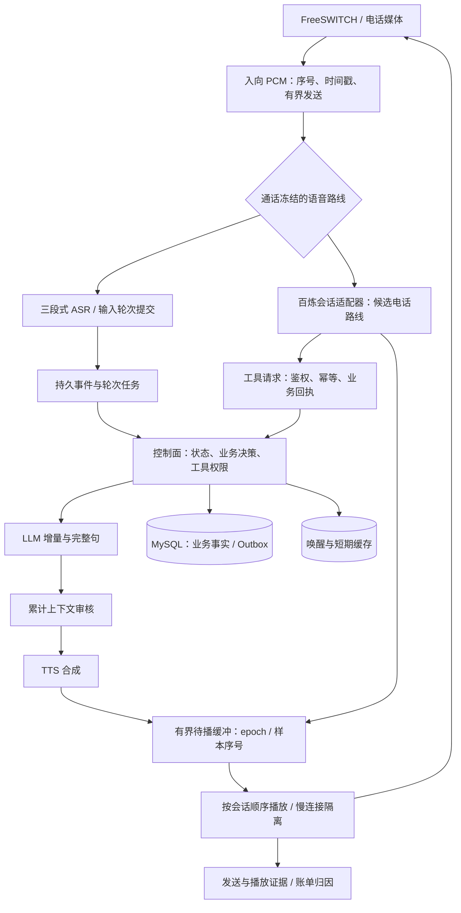

# AI 外呼平台稳定性与流式语音架构优化技术方案

版本：v2｜日期：2026-10-28｜用途：架构评审、研发拆分与分阶段验收

| 项目 | 本版口径 |
| --- | --- |
| 输入方案 | 《AI外呼平台_稳定性与流式三段式架构评估_20261028.md》；原文件保留 |
| 本地代码基线 | `ai-outbound-platform-java`，HEAD `30217e3e6e71f4b85445cde6553bc76d5936b992` |
| 核查范围 | 单体活动代码 `outbound-mono` 的媒体、供应商适配、审核、回调、任务与百炼试聊关键路径；仓库容量和验收记录 |
| 技术栈依据 | `outbound-mono/pom.xml` 声明 Java 21；根 README 中仍有 JDK17 历史描述，以活动模块构建配置为准 |
| 本次工作 | 文档分析与更新、关键代码静态核查、历史结果交叉核对、官方协议核对；未修改应用代码、未调用付费接口、未发布环境 |
| 证据限制 | 本地 HEAD 不等于已核验远端最新 main；历史测试不等于该 HEAD 的重新验收；当前部署状态未查询 |

文中“代码事实”“历史实测”“设计建议”“待验证”分别表示不同证据等级。所有新组件、参数、SLO 和实施周期均为建议，除明确标记的现有实现外，不表示已经完成。

## 1. 评审结论与本版决策

原方案找到了正确的优化方向：语音播放和供应商接收相互牵制、回复工作线程长期占用、客户端重复创建、SSE 读取开销、审核过载、持久化链路等待，以及单实例部署限制，都值得处理。现有取消、代际隔离、先审后合成和播放证据分级应保留。

需要调整的是结论强度和实施方法。原方案把风险路径直接写成必然发生的生产故障，把历史控制面模拟结果外推成电话端时延，还提出了会改变现有审核和持久化语义的优化。照原稿直接实施，可能在降低等待的同时引入丢事件、重复业务动作、串音或审核边界变化。

本版建议按以下顺序推进：

1. **先建立可重复测量，再修运行时风险。** 优先解耦接收与播放、复用客户端、修正流读取和截止时间、控制各级队列与额度。
2. **再压缩控制面等待。** 采用“事务提交后唤醒 + 持久任务补偿”，保留幂等和租约；partial 从持久业务事件中分流。
3. **自建三段式与百炼原生通过同口径实测选型。** 保留现有三段式审核契约，继续百炼试聊和电话原型。百炼尚未具备成为默认生产主路线或三段式热备的验收证据。
4. **最后拆分媒体部署、改造多实例。** 先解决状态归属、配额和写入隔离，再增加节点。媒体进程是有状态的，增加节点不能自动恢复旧节点中的通话。

本版不再承诺“两周达到 1.6 秒”“六周达到 P95 1.8 秒”或“季度达到 500 CPS / 2000 路”。这些分别属于研发排期假设、体验目标和容量目标，必须独立验证。

## 2. 对原方案的主要修正

### 2.1 容量证据需要按版本、硬件和链路分开

| 记录 | 环境与范围 | 仓库保存的结果 | 可以支持的结论 |
| --- | --- | --- | --- |
| `VALIDATION.md` 的旧 R5 | 共享 macOS 开发机；旧 Jar；规则 AI、模拟语音控制路径 | 窗口内 42.9 轮/秒，回复 P95 10110 ms，未通过 | 该旧构建在该环境下未达标 |
| `reliability-validation.json` 的 `capacity.final_e891.profiles.x64` | 历史候选构建；x64 4 逻辑 CPU；500 通在途的独立规则 AI 模拟 | 计划、发送和持久回复 6000 轮；P95/P99 1031/1268 ms；模拟 SLO 通过 | 曾有特定构建和配置通过该专项模拟 |
| 同一记录的 ARM 项 | ARM 独立运行，不能与 x64 混合 | 5716 轮，P95/P99 10059/13311 ms；未通过 | 该 ARM 环境专项未达标 |
| 同一历史候选的 CPS 项 | x64、ARM 各两轮拨号控制模拟 | x64 平均 100/120 CPS，ARM 140/240 CPS；逐秒目标均未通过 | 500 CPS 尚无合格证据 |
| 本次 HEAD 的真实语音 | SIP/RTP、云 ASR/LLM/TTS、录音、真实电话 | 本次未执行 | 不得声明 500 路或电话首音时延达标 |

历史记录中保留的“PR 草稿、未合并”等文字只描述当时状态，本版不将其当作当前 GitHub 状态。旧源码标识也只用于追溯原记录，不作为当前提交链的证明。原始 Jar 哈希和 JSON 路径见附录。

`VALIDATION.md` 已明确自身是历史基线，并指向后续可靠性记录。原稿只引用其中的失败值，遗漏了后续 x64 专项通过，导致容量判断不完整。同时，任何一项规则 AI 模拟都没有覆盖实时 PCM 和云模型，不能据此确定媒体并发上限。

### 2.2 需要替换的判断和设计

| 原稿表述或建议 | 本版修正 | 原因 |
| --- | --- | --- |
| 6 个 P0 缺陷在 100～500 路下会先崩 | 区分已确认路径、触发条件和待复现后果；按修复顺序列优先级 | 静态风险不能证明具体崩溃路数或线上发生概率 |
| 播放 sleep 阻塞供应商 Socket 接收线程 | 阻塞的是每连接独立的事件消费虚拟线程；JDK 网络监听回调继续向有界队列入队 | 线程归属不同，但消费落后导致队列溢出的风险仍在 |
| 每轮 HttpClient 导致线程不会释放 | 重复创建妨碍连接复用，存在资源周转和回收滞后风险；泄漏需长稳和引用证据 | 没有显式关闭不等于线程永久存活 |
| 超过 128 路同时说话就 503 | 最多 128 个回复工作线程先形成排队；达到任务队列上限才拒绝 | 128 是该执行池工作线程上限，不是所有路线的全局通话上限 |
| 超过 64 通审核就按比例挂断 | 64 是同一实例同时执行的审核请求上限，按请求到达率、服务时间和突发计算 | 通话数、审核并发和审核 QPS 不能互换 |
| 阶段估算相加得到 P50/P95 | 只能形成预算假设；分位数来自同一完整链路的样本 | 阶段存在重叠、相关性与排队，分位数不能直接相加 |
| 2～4 个定时线程遍历并发送所有会话 | 调度只发信号；每会话单写者发送，慢连接独立超时和隔离 | 同步网络发送放入共享定时器会重新造成跨通话阻塞 |
| final 先投递内存，再异步写 outbox | 持久事务提交成功后再唤醒；补偿扫描领取同一持久任务 | 先执行后落库可能已播音但无记录，崩溃后无法可靠恢复 |
| 审核上下文缩成前一句，之后异步复审 | 保留当前累计回复和有界确认历史；缩减上下文另做策略评审 | 异步发现问题不能撤回已经播出的内容 |
| 审核与 TTS 同时执行 | 本期继续“先审核后合成”；只并行连接准备和已批准内容的后续处理 | 现有契约明确未审核文本不得提交 TTS |
| 逗号或 40 字直接强切 | 优先要求模型输出短的完整首句；切句规则变化须有语义完整性验证 | 否定、条件、金额和业务承诺可能被切断 |
| S2S 可开放 direct 模式免审 | 保持现有 `sentence_review`；`direct_s2s_enabled` 只影响输入触发 | 当前代码和验收均未允许用该开关绕过输出审核 |
| 百炼原生默认成为快速上线主路线 | 将其作为有潜力的候选路线，通过真实账号和电话验收后再决定 | 四路 push2talk 试聊尚不代表外呼引擎 |
| 媒体面无状态，滚动和故障均零中断 | 媒体面有状态；计划维护可排空，崩溃中在途连接不保证恢复 | WebSocket、缓冲、ASR 状态和电话媒体连接均驻留进程 |
| 更换 ZGC 保证亚毫秒停顿 | G1 与 ZGC 在相同负载、堆和 CPU 条件下对照选择 | GC 目标不等于电话媒体截止时间保证 |

Java 21 官方说明指出，HttpClient 通常拥有自己的连接池，重复创建通常妨碍复用；资源可通过关闭提前回收。因此本版将“线程泄漏”改为需要测量的资源风险。[Java 21 HttpClient](https://docs.oracle.com/en/java/javase/21/docs/api/java.net.http/java/net/http/HttpClient.html)

## 3. 架构边界与保留的约束

### 3.1 当前需要保留的行为

- 三段式：LLM 增量 → 完整句与累计上下文审核 → TTS → 播放。现有 `CascadePipeline` 已将模型读取、审核和 TTS 分开运行，不能把本版改造描述为“从完全串行改成流式”。
- S2S：实际输出 PCM → 独立 ASR final 与音频边界 → 审核 → 批准音频播放。模型自带文本不能替代实际音频证据。
- `ResponseScope` 负责取消资源；`SessionCoordinator` 使用 epoch 拒绝旧响应；保留该语义并扩展到新的队列和发送边界。
- generated、sent、模块播放确认、电话接收、声学播放分别记录。任何上一级证据都不自动提升为下一级。
- 业务动作继续经过冻结策略、权限、幂等和持久事务。模型可以提出意向，不能绕过确认直接承诺业务动作已成功。

### 3.2 目标结构

以下是目标职责划分。第一阶段在单 JVM 内完成边界整理，后续满足分布式条件才拆部署。



百炼到播放缓冲的通路仅适用于单独批准的原生策略；若场景要求平台二次审核，必须显式经过独立审核路径。图中两条路线不能在一轮中同时向电话播放。

### 3.3 组件责任

| 组件 | 负责 | 不应承担 |
| --- | --- | --- |
| 控制面 | 准入、禁呼、话术版本、任务状态、意向与转人工、持久事件 | 每 20 ms PCM 处理 |
| 媒体会话 | 输入音频、打断、播放时钟、缓冲、epoch、供应商连接 | 跨租户业务写入、无边界重试 |
| 供应商适配器 | 协议状态、错误分类、采样率、配额占用、用量记录 | 擅自降低审核要求或改变业务状态 |
| 审核组件 | 固定策略下的判定、证据、批准范围和期限 | 将本地关键词命中结果冒充云审核结果 |
| 持久任务组件 | 至少一次领取、幂等、租约、补偿 | 承诺网络调用天然“恰好一次” |

## 4. 首音时延：统一测量与预算

### 4.1 先定义起终点

| 指标 | 起点 → 终点 | 说明 |
| --- | --- | --- |
| 电话首个有效回答 | 客户侧最后一段有效语音结束 → 客户侧收到或声学听到首个有效回答音频 | 客户侧接收与声学测量分别出表 |
| 网关首音 | 网关输入有效语音结束 → 网关发出首个有效回答音频 | 不包含全部运营商网络和听筒播放延迟 |
| 平台生成首包 | LLM/套件请求开始 → 首个音频包到达平台 | 供应商指标，不能叫电话首音 |
| 插话停止 | 客户起声 → 旧响应最后一帧在对应测量端消失 | 平台 flush 与电话停止分开测量 |
| 垫话时延 | 客户说完 → 预制等待提示开始 | 单列；不能用“嗯，我确认一下”代替有效回答达标 |
| 控制面时延 | final 接收 → 幂等 speak 命令被媒体接受 | 不含模型生成；与持久回复口径分开 |

使用同一捕获时钟测量端到端。跨主机单调时钟不能直接相减；分布式追踪记录时钟误差，端到端优先采用同端双向录音或同一捕获点。PBX 侧 PCAP 只能证明该捕获点的 RTP/音频时序；运营商末端和耳机的真实体验还需要接收端录音或声学环回验证。

保留现有 `tools/voice-phone-measure.mjs`，先用已知偏移的音频夹具检验测量误差，再采真实样本。浏览器排期回执继续标记为非声学证据。

### 4.2 用依赖图计算关键路径

以收到已提交 ASR final 为起点，简化的三段式首音模型为：

```text
客户说完到首音
≈ 判停与 ASR final 延迟
 + 控制面处理
 + max(LLM 请求到完整首句 + 审核排队 + 审核处理, TTS 连接准备)
 + TTS 首音生成
 + 平台播放排队与电话传输
```

判停与 ASR final 若由同一供应商指标覆盖，不能重复相加。TTS 连接准备已与生成并行，不应再完整串行计入。各阶段要记录真实开始和结束时间，后续用逐轮轨迹判断实际关键路径。

以下数值仅为优化后的一组**工程预算示例**，不是预测 P50 或厂商承诺：

| 阶段 | 示例预算 |
| --- | ---: |
| 判停与 final 形成合计 | 450 ms |
| 控制面处理 | 80 ms |
| LLM 请求至首 token | 350 ms |
| 首 token 至完整首句 | 180 ms |
| 审核排队与处理 | 180 ms |
| 已准备连接上的 TTS 首包 | 220 ms |
| 播放调度与电话传输 | 140 ms |
| 串行示例合计 | 1600 ms |

该例已经说明：在保留先审后合成的前提下，P50 1.2 秒需要更快的模型、判停或上下文处理，不能靠去掉轮询就直接保证。供应商阶段的真实分布、跨区网络和模型选择是预算成立的前提。

### 4.3 建议验收目标

| 指标 | 首轮受控试点建议门槛 | 后续优化目标 |
| --- | --- | --- |
| 电话首个有效回答 | P50 ≤ 2.0 s、P95 ≤ 3.0 s | P50 ≤ 1.2 s、P95 ≤ 1.8 s、P99 ≤ 2.5 s |
| 插话停止 | P95 ≤ 300 ms；首字保留单列检查 | 结合真实线路继续收紧 |
| 正常轮次中途失败 | ≤ 0.1%；排除用户明确打断，但单列系统主动取消 | 同时降低原因集中度 |
| 控制面 final → speak 接受 | P95 ≤ 300 ms | 根据瓶颈继续优化 |
| 月度服务可用性 | 目标 99.9%，按端到端服务成功率定义 | 需要持续运行数据，演练不能代替月度结果 |

这是本版建议的分阶段门槛，不替换已有更严格且已约定的测试断言。采用试点门槛需要在实施评审中明确；若业务要求首发即达到 P95 1.8 秒，则未达标不得上线。

无回答、超时、漏发槽位不能从样本中删掉。分位数统计与成功率同时提供，另列超期占比。按路线、模型、网络、并发、工具调用、冷暖连接分别分组；总体结果保留实际流量权重。

## 5. 第一阶段：修运行时与资源边界

### 5.1 接收与播放分离

**已核查路径：** `VendorSocket` 用容量 128 的事件队列和独立虚拟线程调用业务处理；`VendorPlayer.send()` 逐帧发送并 sleep 定速。TTS 数据到达快于实时播放时，事件处理可能持续落后，队列满会失败。具体触发长度、帧数和厂商行为未复现。

建议拆成接收、转换、待播、发送四段：

1. 网络监听只完成有界分片聚合与入队；限制消息字节数，避免大包在复制阶段消耗过多内存。
2. 转换任务完成解码、重采样和连续 PCM 拼帧；保持跨包余样本，避免把厂商任意包边界直接当成 20 ms 播放帧。
3. 每会话待播缓冲按**音频时长 + 字节数**双限额。初始候选：低水位 200 ms、高水位 1500 ms、硬上限 3000 ms；用实际合成突发调整，不预设 30 秒库存。
4. 每会话只允许一个发送者；调度器计算下一次应发时间并唤醒发送者，不在共享调度线程内执行 `sendMessage`、重采样或持久化。
5. 出向写入设单次期限和会话级积压期限。一个慢 PBX 连接只影响该会话；全局缓冲达到预算后停止新准入。

不能把简单暂停 `request(1)` 当成完整的流量控制方案。JDK 的 demand 控制监听回调交付，文本和二进制事件共享该通道；暂停可能延迟后续业务终态到达，不能假设仍能读取排在音频后的 DONE。适配器需要验证厂商流控、完成期限和长停顿行为，保留本地独立取消/超时通道。[Java 21 WebSocket](https://docs.oracle.com/en/java/javase/21/docs/api/java.net.http/java/net/http/WebSocket.html)

若厂商不能安全暂停，应优先减少已批准句子的提前提交量、使用其支持的下发限速，并在硬上限前终止当前生成。不能任意丢弃有效的出向语音帧来维持播放；必须记录中断原因并进入受控降级。

**关键完成语义：** 供应商生成结束、缓冲入队结束、平台发送结束、模块播放结束分别有独立状态。后台生成任务返回后，不能立刻调用 `drained()` 或关闭仍被播放器使用的 `ResponseScope`。等待所有已批准帧处理完和有效模块确认后，才释放本轮播放所有权；不支持确认的传输只能记录 sent。

新增缓冲帧绑定 `attempt、epoch、segment_id、sample_start/end、approval_id`，入队和真正发送前都核验所有权。插话先推进 epoch、阻止旧帧发送，再取消生成、清空待播和请求 PBX flush。新输入可以继续采集，但新输出应等待旧播放已隔离的证据；flush 超时进入明确失败状态。正常新轮次早于旧轮次 drain 到达时，用有界 pending 状态等待，不直接把 `begin()` 拒绝当成需要重发付费模型的信号。

### 5.2 回复编排使用虚拟线程，但保留准入

现有平台线程池最多 128 个线程，任务会等待整轮合成和定速输出完成。调整为有并发许可的虚拟线程编排，CPU 密集处理仍由有界工作池承担。

- 每通话同时最多一个有效输出 epoch；全局、租户、供应商分别有许可。
- 不再依赖 `limit * 2` 的长任务队列吸收超额流量。进入付费模型前先做短队列准入，超过排队预算转预制提示或拒绝新任务。
- 不在 `synchronized(session)` 中等待网络、回执或线程结束；锁内只做状态与 epoch 更新，锁外执行副作用并在结果回来后复核。
- 虚拟线程不是额度上限，也不是 CPU 容量扩容。用 JFR 检查固定线程、虚拟线程、锁等待与 GC。

Java 21 中，虚拟线程在 `synchronized` 内阻塞可能钉住载体线程；本项目应按 Java 21 行为检查，不能套用其他 JDK 版本的结论。[Java 21 虚拟线程](https://docs.oracle.com/en/java/javase/21/core/virtual-threads.html)

### 5.3 客户端复用与供应商生命周期

增加由应用生命周期管理的客户端注册表，通过构造注入给 `VoiceAiBackends` 和百炼适配器。按代理、TLS、连接配置等传输属性分组；认证头按冻结租户凭据绑定到请求，不能把单租户密钥放入跨租户可变共享状态。

响应体、WebSocket、Future 归本轮/本通话管理；共享 HttpClient 归进程管理。取消一轮只能关闭它拥有的资源，不能关闭共享客户端。进程退出先停止准入、排空会话、关闭响应体和 socket，再在期限内关闭客户端。

不向未经确认支持的供应商路径自动发 HEAD 或 keepalive；HTTP/2 也不强制作为所有 WebSocket 的条件。连接预热和多 task 复用必须有协议支持、配额和计费证据。

### 5.4 SSE 读取与超时

现有 `generate()` 逐字节读取 `Support.timed()`，每次 read 都向共享定时器注册并取消任务。这一代码路径已确认；实际 CPU 占比和尾延迟影响未测。

改为有界分块读取和增量 UTF-8/SSE 解析，保留当前总字节数、行长度、事件长度、文本长度、DONE 和非正常 finish_reason 的保护。不能只替换成 `ofLines()` 而丢失取消、总量和协议校验。

| 截止类型 | 候选配置 | 处理要点 |
| --- | --- | --- |
| 请求至首个有效 token | 1500 ms | SSE 注释/心跳不算有效 token；从发起请求时计时 |
| 有效内容空闲 | 2000 ms | 心跳不能无限延长内容等待；记录平台自身背压与上游空闲的区别 |
| 生成总期限 | 15000 ms | 独立于逐次读取；按回复长度和业务场景配置 |
| 播放完成期限 | 音频样本时长 + 有界余量 | 与生成期限分开，不能对长回复统一套用 15 秒 |

以上为故障截止候选值，不是正常时延预算。每响应维护固定数量的 deadline，不再每字节分配计时任务。定时器只发取消信号，可能阻塞的资源清理交给有界清理机制。取消与完成的竞争要保证只报告一个主因。

### 5.5 输入音频发送与供应商异常收尾

每会话建立有界异步发送队列，串行发送，最多一个未完成发送。禁止在共享入向处理线程上等待 `sendBinary().get(5s)`。

新队列必须拥有自己的 PCM 数据或显式持有缓冲引用，直到异步发送完成后才归还内存池。不能直接复用当前 dispatcher 回调返回后会释放的 ByteBuffer。

音频积压按时长计量，达到硬上限后记录缺失区间，停止将该轮识别当作完整输入；必要时重建识别并请客户重述。丢帧不是正常调速策略，涉及号码、金额、否定词的缺口不能静默接受。

`VendorSocket.onError()` 应进入统一终止流程：设置原始失败、唤醒消费者、使相关 Future 失败、释放配额。与 `onClose()`、显式取消同时发生时保证幂等，避免只留一个 failure 字段等待上层发现。

## 6. 第二阶段：减少持久化等待，保留可恢复性

### 6.1 final 采用“提交后唤醒”

首期只改变调度方式，不一并删除所有持久层：

```text
接收 final
  → 保留现有账本/回执持久化与校验
  → 业务事务：幂等检查 + 转写 + 轮次状态 + AI Outbox
  → COMMIT 成功
  → afterCommit 发唤醒信号
  → Worker 按现有租约和前驱条件领取同一任务
  → 媒体幂等接受命令
```

唤醒只携带任务/分区提示，不携带唯一的业务事实。信号丢失时由扫描补偿；重复信号只增加一次无效检查，不产生重复回复。事务失败不唤醒、不发模型请求。

同 JVM 内可逐步用内部受控调用替代 HTTP 自调用，但必须保留原始事件、身份来源、租户边界、幂等和审计。外部 HTTP 回调继续鉴权；不能借内部快速路径取消对外验证。

### 6.2 统一事件字段与三种版本号

建议事件封装包含：

```text
tenant_id, call_id, attempt, event_id, event_seq,
input_turn_id, turn_sequence, response_epoch,
owner_fence, policy_revision, payload_hash, trace_id, occurred_at
```

- `attempt`：一次呼叫尝试，防止旧拨号回调串到重拨。
- `response_epoch`：一次输出所有权，防止插话后旧音频继续播放。
- `owner_fence`：节点/分区所有权代数，防止旧 owner 恢复后继续写入。

三者不能合并。事件幂等键包含租户和尝试范围；同一键不同 payload 必须冲突并留下证据。媒体 `operation_id` 固定绑定轮次、epoch 和内容摘要。

### 6.3 必须覆盖的崩溃窗口

| 发生时点 | 恢复方式 |
| --- | --- |
| 持久事务提交前崩溃 | 不产生已提交轮次；来源按原协议重送 |
| 提交后、唤醒前崩溃 | 扫描补偿领取持久任务 |
| 已领取、未发出命令时崩溃 | 租约到期后重新领取；检查 fence 和截止时间 |
| 命令已发出、ACK 未落库 | 查询同一 operation 的状态；无法确认时标记 unknown，不盲目重复播放 |
| 工具提交成功、供应商未收到回执 | 返回同一幂等结果；不能重复预约、转接或保存正式结果 |

网络边界无法仅靠 outbox 保证所有外部动作恰好一次。需要供应商/网关幂等、结果查询或业务补偿；不支持查询的未知结果必须显式呈现。

### 6.4 partial 分流

当前 partial 会写 `speechturn`、指标、事件与 webhook，但普通 AI 轮次仅由 final 触发。因此修正原稿“partial 抢同一批 AI 生成任务”的表述：主要争用在回调、数据库和锁，不能直接等同于多发模型请求。

设计上 partial 进入有界短期状态，供监听页面和输入判停使用；final 才成为业务事实。每会话只保留最新版本或有限窗口，Redis 可选，不能把原来每次落库改成每次写 Redis 后宣称开销消失。

涉及外部 partial webhook 的已有契约，必须按版本/开关迁移：新订阅提供合并推送和序号，旧订阅保持原语义直到迁移。页面明确“识别中、可修订”，刷新后不把 transient 内容当最终转写。禁呼、挂断、转人工等关键事件不能随 partial 一起丢弃。

### 6.5 首句、判停与连接准备

这三项会影响交互质量，排在运行时和时序测量之后实施，不能只以平均首音更快作为通过标准。

| 优化项 | 实施方式 | 同时约束的质量指标 |
| --- | --- | --- |
| 短完整首句 | 提示词引导模型先给直接、完整的短回答；保留累计审核；遇到缺标点长句按预算结束或降级 | 无无意义垫话堆积；否定、条件、金额和事实关系完整 |
| 切句规则 | 保留现有句末规则作为基线；若扩展边界，用人工标注样本验证完整性，结合引号、列表、数字和条件句保护 | 审核漏放、语义截断、异常停顿不劣于基线 |
| VAD / 语义判停 | 新模型先 observe，记录建议端点，原逻辑仍做最终提交；电话样本 A/B 后再小流量 enforce | 错误抢话率、漏端点率、首尾字保留、方言/噪声识别质量 |
| TTS 提前准备 | 客户起声后只在许可与协议允许时建立连接；设置空闲期限并在取消时释放 | 空闲连接数、无效预热费用和账号限流；不提前发送未审核文本 |
| 连接多 task 复用 | 每个供应商逐项确认 task 顺序、结束/取消语义、凭据版本和超时；不支持则保持每轮任务连接 | 上一轮迟到音频隔离；错误后可安全重建；费用可追踪 |

VAD 计算预算需在目标 CPU、实际音频帧长和全部并发上测量，不沿用“每帧 <1 ms”的通用断言。输入端点只能有一个最终提交者，避免本地语义判停与供应商 final 重复创建轮次。Token 上限和字符上限继续分别控制，不能用固定比例把中文字符机械换成 Token。

### 6.6 投机生成暂不进入首期

基于稳定 partial 提前调用 LLM 可以减少命中时的等待，也会增加费用和上下文误判。建议等基础链路达标后再实验，且仅允许无副作用的文本生成；不执行工具、不提交 TTS、不记录成已确认历史。

复用候选输出须核对最终规范化文本、轮次、业务上下文版本和策略版本。手机号、金额或否定词即使只差一个字也可能改变意思，不能使用“差异少于两字”作为通用命中规则。不匹配就取消并记录浪费的 Token；未获复用的候选不进入播放路径。上线依据是命中率、有效回答改善和每成功通话成本，而非预设节省 300～600 ms 或额外费用百分比。

## 7. 审核、降级与重试边界

### 7.1 审核过载的处理

不直接调大 64，也不把所有请求改成无限等待。增加供应商 QPS 令牌、并发许可、按租户公平的有界等待队列和单轮总预算。

候选审核排队预算 100 ms；最终根据真实服务时间和首音目标调整。排队耗时计入本轮 deadline，拿到许可时重新检查取消和预算。故障期间停止接纳新的自由生成通话，优先让已经在途的会话完成安全收尾。

审核缓存只允许明确批准的固定模板。缓存键至少包含租户/场景、完整文本及允许的上下文条件、策略版本、有效期和批准来源。动态姓名、金额、时间或槽位变化不得复用旧文本的批准。不可把普通模型输出按一句话 hash 跨上下文永久放行。

本期不采用“关键词通过即替代审核”“异步全文复审补救已播放内容”或“未审文本先给 TTS”。若未来改变“先审后合成”的契约，必须另立策略变更和数据流评审，不能作为时延优化的隐含副作用。

### 7.2 故障矩阵

| 故障 | 当轮处理 | 后续动作 | 禁止行为 |
| --- | --- | --- | --- |
| LLM 首 token 超时，尚无有效回答发送 | 取消当前 epoch；可播放一次预批准等待提示 | 在总预算、费用策略和备用配额允许时，最多发起一次备用尝试 | 原请求和备用请求同时出声；无限重试 |
| 已发送部分 LLM 回答后失败 | 停止剩余生成，保留已发送/已播证据 | 预批准说明、转人工或结束；下一轮重新建立上下文 | 从头重放整段回答 |
| TTS 失败，当前句确认零发送 | 保留已审核文本和版本 | 按显式重试策略重建任务一次 | 不计重复费用，或未经批准自动切音色 |
| TTS 失败，已部分发送 | 取消该段 | 仅有可信文本—音频进度才能续播，否则转受控收尾 | 根据猜测跳字、接句或重放 |
| 审核风险命中 | 不合成、不播放该内容 | 记录策略和请求 ID，按业务规则结束/转人工 | 换一家审核或模型直至通过 |
| 审核超时、未知、限流 | 暂停自由生成；停止发起依赖同一故障审核的新会话 | 仅可用预批准静态音频解释并收尾，或经确认转人工 | 用本地规则临时批准新生成内容 |
| ASR 断流/输入缺口 | 标记当前输入不完整 | 受控重连并请客户重述；已知停止联系意图按现有控制优先处理 | 将缺口前后的文本无证据拼成完整指令 |
| 工具调用超时 | 持久记录 pending/unknown | 幂等查询或人工核对，恢复同一业务请求 | 再次创建预约、扣费、发送消息等副作用 |
| PBX/媒体发送失败 | 立即停止本会话输出和付费生成 | 上报终态，释放配额 | 用别的媒体会话继续推送同一音频 |

任何自动重试都会增加请求和可能的费用，必须有明确开关、次数上限、可重试错误分类、幂等条件和用量记录。本版不改变当前默认“不自动重试付费模型”的行为；实施时逐项启用已验收的策略。

“降级成功”必须细分为恢复有效回答、成功转人工、预批准提示后结束。不能把电话没有立即挂断算成业务成功，也不承诺审核全故障时仍保持 99% AI 自由对话。

## 8. 两条语音路线的选择与百炼电话化

### 8.1 路线定位

| 维度 | 自建流式三段式 | 百炼原生套件 |
| --- | --- | --- |
| 当前工程状态 | 已有电话媒体适配与先审后合成路径；真实容量仍未验收 | 浏览器 push2talk 试聊；默认原生、可选二次审核；四路限制 |
| 本期工作 | 修公共媒体、超时、审核准入、持久调度 | 保持试聊闭环，完成真实账号协议验证，再开发电话适配 |
| 优势假设 | 各段可观测、可替换；平台审核契约明确 | 供应商内部衔接可能减少平台编排等待 |
| 待证据事项 | 真实端到端时延、稳定性、费用和供应商限流 | 同左，加上审核范围、双工语义、工具调用和会话恢复 |
| 主路线选择条件 | 满足同一场景质量、时延、安全和成本门槛 | 满足相同门槛，并明确接受原生审核责任边界 |

百炼在原生模式下减少了一些平台环节，并不自动证明更快、更便宜或审核充分。S2S 的独立识别也会引入额外工作，但其分句识别和播放已有重叠；不能据静态相加断言时延优势必然消失。

### 8.2 已修复与仍未验证的事项

本地代码已校验百炼 `user_id` 不超过 36 字符，并按 `VOICE_AI_BAILIAN_TOOL_TARGET` 包裹业务透传参数；`LATENCY-COMPLETENESS-ACCEPTANCE.md` 记录了相应夹具与集成回归。不能再把这两项列为尚未编码的缺陷。

但真实账号是否接受具体应用、插件目标、参数结构和业务回调，仍未验证。现有修复只能证明代码行为和模拟协议匹配，不能代替真实联调。

### 8.3 电话适配的协议要求

按当前官方协议，双工需持续上传音频；收到 `Started` 后还要等待 `Listening`。打断回答使用 `RequestToSpeak`；`CancelSpeech` 用于 push2talk/tap2talk 的输入取消，不可混用。播放完成再报告 `LocalRespondingEnded`。下行采样率取决于具体模型；`incremental_response` 描述大模型结果返回方式，不能据此判断音频是否整段缓存。[百炼多模态交互协议](https://help.aliyun.com/zh/model-studio/multimodal-interaction-protocol)

电话改造建议分成以下独立工作包：

1. **媒体桥接。** PBX 解码后的 PCM 接入公共输入、待播和播放组件。8/16/24 kHz 按实际模型协商；8 kHz 上采样不能恢复原本缺失的频率信息，必须用电话音频测识别质量。
2. **双工和回声。** 以真实线路验证服务端判停、插话、远端回声和首字保留。起步保持供应商规定的输入节奏，与电话 20 ms 输出帧分别配置；不能把两者强制设成相同包长。
3. **输入/输出归属。** 将套件 turn、dialog、response 标识映射到平台 attempt/turn/epoch；对迟到的开始、音频、结束事件统一隔离。
4. **业务工具。** 稳定话术与允许披露的客户资料按版本注入；动态状态经授权工具查询。保存意向时先写幂等草稿，正式确认仍沿用平台规则。不要把所有意向延迟到挂机才保存，避免异常断线丢失。
5. **准入。** 四路试聊限制保留到电话路线单独验收。生产容量按账号配额、模型、工具 QPS、媒体资源共同计算，不能删除一个常量就宣称扩容。
6. **恢复。** 重建会话只携带可信的客户 final、已确认业务结果和可证明的播放历史；未确认播出的模型文本不得当作客户已听过。连接恢复能力和计费行为以真实账号验证为准。
7. **原生策略。** 单独记录路线、审核模式和应用版本，明确适用场景。选择二次审核时显示额外识别、审核等待和费用；不能在失败后静默改成原生。

### 8.4 切换边界与验证方法

第一阶段只支持**新通话择路**，不承诺通话中无缝切换。后续允许切换时，必须满足旧 epoch 已取消、PBX 缓冲清理完成、业务工具无未知写入、备用额度有效、上下文可重建；优先在下一轮开始处切换。

“热备”需要提前准备的连接、明确备用额度、上下文同步、故障演练和实际费用预算。只有配置了第二个模型不构成热备。

比较试验使用同一批电话音频、相同业务规则和工具条件，交替运行三段式、百炼原生、百炼二次审核。分别测无工具、一次只读工具、一次业务写入、打断、长句、噪声和弱网；不能用浏览器原生首包与电话三段式末端首音比较。

## 9. 多实例演进与高可用

### 9.1 媒体节点有状态

每通电话固定归属一个媒体 owner。会话注册表记录 `call_id、attempt、media_node、owner_fence、lease_until、profile_revision`；实际 socket、PCM、VAD 和供应商状态留在该节点。

一致性哈希只用于新会话选址，不能在扩缩容时重算并迁移所有现有通话。重连按已存 owner 查找；新 owner 接管前必须隔离旧 owner。FreeSWITCH/PBX 是独立故障域，也需要容量、维护和故障方案。

### 9.2 控制面多实例的前置条件

不能只把 `JvmPlatformLock` 换成 Redis 锁。需要先列出共享写入不变量：租户额度、号码禁呼、任务状态、预约、人工坐席、业务用量、拨号和回调前驱顺序。

- 通话内写入用通话行锁和版本 CAS；跨通话的租户额度用明确的数据库事务边界。
- 分区租约使用数据库时间，领取时增加单调 fence；更新时附带 owner/fence/版本条件。
- 跨分区共享事实建立单独的锁/额度所有权，不能按 campaign 分区后忽略同租户竞争。
- 发往 PBX/媒体的命令也必须校验 fence，或通过能拦截旧 owner 的唯一命令网关；仅数据库拒绝旧写入仍挡不住旧进程拨号。
- 失去租约或无法证明所有权时停止产生新副作用，避免双写。失去数据库时只允许有界完成已批准的在途输出，不继续新增业务动作。

Redis 用于唤醒、短期状态和可重建缓存。若承担供应商配额发放，必须定义重启、故障转移和丢计数的保守恢复；不能在键丢失后把额度全部重新发一遍。可采用集中配额服务或从持久预留向节点分配不重叠的小批许可，并在网络隔离时停止新增借用。

### 9.3 计划升级与非计划故障分别验收

| 场景 | 可实现目标 | 限制 |
| --- | --- | --- |
| 计划媒体升级 | 标记 drain，拒绝新分配，等待在途自然结束，再退出 | 超过窗口时应推迟升级；若强退，必须计入被中断通话 |
| 控制面切换 | 提交事务、释放/等待租约、由新 owner 领取 | 必须完成旧 owner 隔离和重复回调测试 |
| 媒体进程崩溃 | 新通话路由健康节点，已受影响通话明确失败/人工接管 | 不能保证现有 TCP/WS、PCM 和厂商会话无损迁移 |
| 单供应商故障 | 新通话按批准的备用路线分配，部分在途受控收尾 | 未预留备用容量时不能承诺全量承接 |
| 数据库故障 | 停止新业务副作用，保留有界在途处理 | 数据恢复、RPO/RTO 和终态补偿另行演练 |

数据库变更采用 expand → migrate → contract，新旧代码必须兼容过渡结构。配套演练备份恢复、消息补偿、孤儿会话和配额回收。媒体缓存预热按已批准音频版本和内容哈希校验，缺少身份告知或兜底文件时阻止相应新会话准入。

## 10. 容量、配额与成本模型

### 10.1 不混用 CPS、并发和对话轮次

设拨号速率为 `C`，接通率为 `p`，平均接通占用时长为 `D` 秒，平均每通对话轮次间隔为 `T` 秒：

```text
接通媒体并发约 N = C × p × D
未接通/振铃资源另计，PBX 总占用还需加入这些状态
对话轮次到达率约 λturn = N / T
审核请求率约 λreview = λturn × 每轮平均审核句数 + 其他审核请求率
平均审核在服并发约 Lreview = λreview × 平均审核耗时（秒）
```

例如 500 通、每通每 10 秒一轮、每轮 2 句、平均审核 0.2 秒，则审核约 100 QPS、平均在服并发约 20；若平均耗时涨至 1.2 秒则约 120。还要计入突发、QPS 上限和其他路线。这个例子解释了为什么“500 通必定超过 64 审核并发”不成立，也说明服务抖动会快速压满同一上限。

500 CPS 若接通率 30%、平均通话 120 秒，接通媒体并发约 18000，显著超过 2000。若目标仅 2000 并发，在同样假设下对应约 55.6 CPS。业务必须先确定接通率、时长、振铃时间、补呼节奏和转人工比例，再定集群目标。

### 10.2 媒体资源估算

单声道 PCM16 的理论载荷：8 kHz 为 16 KB/s，16 kHz 为 32 KB/s，24 kHz 为 48 KB/s。按 500 通满负荷单方向计算，分别约 8/16/24 MB/s；供应商上行、下行、PBX、录音及协议开销需分别累加。

24 kHz 下每通保存 3 秒 PCM 为 144000 字节；500 通约 72 MB。若保存 30 秒则约 720 MB，仅指一份裸 PCM，尚未包含复制、对象、堆外池、录音和 TLS 缓冲。因此所有缓存必须同时设每会话和全局预算。

20 ms 连续输出等于每会话每秒 50 次发送；500 个同时输出的会话为每秒 25000 次发送。该数值是调度工作量估算，不是单机吞吐证明。准入应由 CPU、发送截止违约、缓冲、水位、供应商额度共同决定。

### 10.3 配额治理

分开记录平台通话数、ASR 连接数、LLM 请求/Token 速率、TTS 任务、审核 QPS/并发、工具并发、PBX CPS 和人工坐席。S2S 二次审核要额外占用输出 ASR，不能只按客户侧识别计算。

备用路线只有在备用配额已经预留时才可自动切换。对共享供应商账号，所有节点和租户必须共同守住批准额度。准入失败应发生在拨号/付费连接之前，优先防止已经接通后才发现资源不足。

### 10.4 成本账本

每通成本按实际账单归因：线路时长 + 客户侧 ASR + LLM Token + TTS + 额外输出 ASR + 审核 + 套件调用 + 工具 + 录音存储/传输 + 失败与重试成本。

记录供应商 request/task/dialog ID、租户、call/turn/epoch、模型版本、原始用量与账单修正。供应商计费边界、取消计费、预热计费和最低计费单位均待真实账号确认。原稿“优化额外增加 10%～30%”缺乏账单支持，本版不保留为预测。

## 11. 可观测性与运行控制

| 指标组 | 关键指标 | 用途 |
| --- | --- | --- |
| 用户体验 | 有效回答首音、无回答率、插话停止、首字缺失、错误抢话、转人工成功 | 判断业务体验是否改善 |
| 阶段时延 | final 接收、持久提交、任务领取、LLM 首 token/首句、审核等待/处理、TTS 首包、发送/播放确认 | 定位关键路径 |
| 资源 | 每级排队时长、PCM 缓冲 ms/bytes、发送在途、线程/FD/堆外内存、CPU、GC、锁等待 | 发现容量拐点 |
| 供应商 | 限流、错误、超时、取消、连接重建、主备切换与用量 | 管理外部依赖 |
| 正确性 | 旧 epoch 拒绝数、重复任务、fence 拒绝、unknown 副作用、待补偿终态 | 发现重复执行和状态分裂 |

使用可聚合直方图而非只累计平均值。指标标签限于环境、路线、厂商、阶段和有限错误类别；call_id、turn_id、request_id 放在追踪和日志中，避免高基数。

报告首音时同时展示超时/失败样本和垫话占比，防止用提示音改善表面指标。报警须关联明确动作：先减少新准入，再切换新通话路由，最后进入静态收尾；不能让熔断与自动恢复在每轮之间来回切换。恢复使用少量探测、冷却时间与滞回条件。

转写、录音和工具参数沿用租户隔离与脱敏要求；诊断不记录密钥。新增队列、日志、缓存和证据均定义保留时间、删除与异常退出补偿，避免媒体优化引入无期限数据留存。

## 12. 实施拆分、验收与回退

### 12.1 建议里程碑

按至少 2 名后端/媒体工程师、1 名测试人员、运维支持，以及真实账号与线路按时可用的假设排期。下表为评审估算，不是承诺；每阶段以退出条件放行。

| 阶段 | 估算 | 工作包 | 退出条件 |
| --- | --- | --- | --- |
| M0 证据基线 | 3～5 个工作日 | 固定构建/硬件/配额；阶段埋点；回归样本与故障夹具 | 可以复现队列压力、超时和取消，拿到同口径基线 |
| M1 运行时修复 | 约 2～3 周 | 客户端生命周期、分块 SSE、deadline、异步输入、播放解耦、错误收尾 | 正确性不变量通过；慢会话不拖累其他会话；资源有界 |
| M2 控制与质量 | 约 2～3 周 | 提交后唤醒、partial 分流、审核准入、短完整首句、有限降级 | 无事件丢失/重复副作用；目标负载下控制链路通过；真实语音体验达到阶段门槛 |
| B 百炼验证线 | 账号就绪后按门禁推进 | 真实试聊 → 电话原型 → 双工/工具/账单 → 同口径比较 | 满足该场景的安全、体验和费用要求，再决定是否主用 |
| M3 多实例 | M1/M2 稳定后另行估算 | 媒体独立部署、owner/fence、共享配额、计划排空、数据库恢复 | 多节点故障与回退演练通过，再逐级扩容 |

建议提交拆分：客户端复用；SSE 与 deadline；输入发送；播放状态机；审核准入；持久事件唤醒；partial 契约；观测；百炼电话适配；多实例。每项都要有独立开关或清晰回退边界，避免一个提交同时改变媒体、审核和数据库语义。

### 12.2 测试矩阵

| 层级 | 必测场景 | 通过依据 |
| --- | --- | --- |
| 协议/单元 | SSE UTF-8 跨块、心跳无有效 token、缺 DONE、超长消息；取消与完成竞争 | 输出和错误类型可重复，边界不放宽 |
| 媒体组件 | 1×/3×/10×实时速度及突发 TTS；长/无标点回复；慢 PBX；重采样尾样本 | 队列时长和内存有界；无串音/重复；明确的受控失败 |
| 播放完成 | 生成完成但缓冲未空、回执迟到/丢失、旧 epoch PCM/回执、flush 超时 | 不提前 drained；证据等级准确；旧输出不能恢复 |
| 输入组件 | 慢 ASR、乱序、断流、异步缓冲归还、输入丢帧 | 会话有序，内存所有权正确；缺口不伪装为完整输入 |
| 真实数据库 | commit 前后崩溃、唤醒丢失、重复 final、同键异载荷、跨租户请求 | 无丢失已提交任务，无重复业务副作用，隔离正确 |
| 审核 | 风险/未知/429/5xx/超时、64 许可压力、取消后迟到批准、跨句风险 | 未批准文本零 TTS 提交；无未批准音频输出；降级符合矩阵 |
| 页面/接口 | 配置、试聊、任务、话单、报表、权限与退出 | 逐入口点击、填写、保存、刷新回显、返回、异常均验证 |
| 真实供应商 | 冷暖连接、短长回答、多轮、工具、打断、限流、费用 | 原始音频与请求 ID、账单、逐轮时序可以追溯 |
| 电话链路 | SIP/PCM/RTP、接收端音频、回声、丢包、抖动、弱网 | 首音/停止/首字保留按相同端点测量 |
| 混合容量 | 拨号、振铃、接通、说话、监听、转人工、录音、报表并行 | 同一构建/硬件/配置达到各项门槛，不拼接独立结果 |
| 高可用 | drain、强杀、网络隔离、失租约、供应商故障、DB/Redis 故障 | 新流量恢复、在途影响、重复动作、RPO/RTO 分开报告 |

复用已有 `VoiceStreamingTest`、`S2sContentSafetyTest`、`GatewayLifecycleTest`、`QueueConcurrencyIT`、`DurableQuotaCoordinatorIT`、`VoiceAiHttpIT`、`BailianTrialIT`、`FrontendBrowserIT`；这些测试存在不代表本次已执行，新增场景也不能由旧用例名称代替。

先做协议模拟，逐级升至 1/10/50/100/200 路，再在额度和目标硬件允许时测 500 路。每级先完成稳定窗口和故障恢复再升级。供应商真实测试与模拟并发分别报告，不用模拟请求数量冒充真实付费连接容量。

50 轮可用于联调排错，不适合承诺 P99。正式比较建议每个主要场景先采集至少 1000 个完整计划轮次，尾部容量验收累计至少 10000 个计划轮次，覆盖冷启动和多个时间段；罕见中断率结合样本数给出置信区间。先 8 小时，再 24 小时长稳，记录预热后线程、FD、内存、配额和积压趋势。

### 12.3 页面、入口和状态清单

下表是未来功能修改必须实际执行的验收清单。本次只更新技术文档，未操作页面。

| 页面/入口 | 状态与动作 |
| --- | --- |
| 登录 / 首页 / 退出 | 正确与错误凭据、角色、保护页面、退出失效、返回路径 |
| `/admin/voice-ai` | 原路线回显、新配置合法性、保存刷新、缺额度/缺审核配置、比较与试听 |
| `/admin/bailian-trial` | 原生/二次审核、开始/结束、打断、超时、历史、工具草稿、费用和指标 |
| 客户搜索与资料 | 搜索、填写、保存回显、禁呼/停止联系、权限 |
| 话术与任务 | 草稿/发布、冻结版本、启动/暂停/停止、准入失败、重复操作 |
| 通话与录音/质检 | 进行中、终态、部分播放、未知结果、录音缺失、取消与错误原因 |
| 线索与转人工 | 意向草稿、确认、幂等跟进、无坐席、转接成功与失败恢复 |
| 报表与账单 | 已完成与失败/重试的统计，录音和模型用量归因，跨页汇总 |

每次实现变更重新跑：**登录 → 首页 → 客户搜索/保存 → 话术发布 → 任务创建/启动 → 模拟或受控通话 → 录音/质检 → 线索跟进/转人工 → 报表/账单 → 退出**。商城规则中的门店、房型、购物车、支付链路不适用于本项目，不能标为“已通过”；应明确标记不适用并执行上述外呼链路。

### 12.4 灰度与回退

1. 同一代码先在隔离环境验证，发布开关按租户、路线和新通话比例启用；在途通话固定策略版本。
2. 从单个受控场景开始，再扩大新通话比例。每档观察有效首音、失败率、审核、重复动作、缓冲和费用。
3. 出现未批准输出、旧 epoch 串音或重复业务副作用立即停止新准入；其他阈值按基线确定，禁止边测边放宽断言。
4. 回退先切新通话路由、排空受影响节点，再回代码；保持数据库向后兼容。回退不能把未验收的备选路线设为默认。
5. 单实例阶段仍执行仓库规定的停旧启新，不能因设计中写了多实例就启用滚动部署。计划排空本身也需新实现和验收。

## 13. 本次交付状态、限制与上线条件

### 13.1 本次已验证与未验证

| 状态 | 本次结论 |
| --- | --- |
| 技术方案 | 已更新为本 v2；保留原文件，内容有实质修订 |
| 源代码已修改 | 否；本次未修改应用源码 |
| 静态检查通过 | 仅文档结构、引用定位和数字口径检查；未重新运行编译、格式或代码静态检查 |
| 开发环境功能测试通过 | 未验证；引用的历史记录不能计作本次测试 |
| 测试环境已发布 | 本次未发布；现有环境版本未查询 |
| 真机测试通过 | 未验证 |
| 生产环境已发布 | 本次未发布；现有生产状态未查询 |

已验证项：本地源码基线与 Java 21 配置；关键接收/播放、客户端、SSE、审核、回调和任务路径；百炼参数修复与试聊边界；历史容量记录的不同结果；官方 API 的相关语义。

未验证项：本文风险在目标负载下的实际触发概率、长稳资源泄漏、当前构建真实时延、全部供应商协议与额度、电话音频质量、自动恢复、跨节点能力、实际费用、页面操作及当前测试/生产部署。

已知问题：当前模块仍声明单实例限制；回复执行池、播放与事件消费耦合、逐字节超时调度和同步输入发送路径仍在；审核过载会失败关闭；百炼电话化未完成；既有文档存在旧版本描述，必须按构建和运行记录辨别。

环境限制：本次只做本地文件和公开官方资料核查，没有启动负载、数据库、供应商连接或电话线路；没有检查当前账号权限和网络条件。因此没有本次性能提升数据，也没有完成实现验收。

### 13.2 正式上线前置条件

- 明确首发场景、峰值并发、拨号速率、接通率、通话时长、对话轮次、转人工与录音比例。
- 固定实际构建、容器、JDK、硬件、数据库参数、供应商模型/地域/配额以及电话线路。
- 保留并通过审核、取消、幂等、租户隔离和播放证据不变量；完成涉及页面和外呼全链路验收。
- 真实供应商与受控号码联调通过；首音、打断、误识别、风险覆盖和账单均有证据。
- 相同目标环境通过混合容量、8/24 小时长稳、故障与回退演练；以实测安全容量设置准入上限。
- 需要百炼原生时，先确认该场景接受的审核边界、工具权限和数据处理范围，不能由本技术方案默认批准。
- 需要多实例时，先完成共享不变量、owner/fence、命令隔离、额度和数据库恢复验收。

### 13.3 实施评审需确认的决策

| 决策 | 本版建议 |
| --- | --- |
| 优先级 | 先媒体运行时与证据，再调度优化；不先扩容掩盖排队 |
| 审核契约 | 本期保持先审后合成与 S2S 实际音频审核 |
| 首发目标 | 明确采用阶段门槛，或要求直接满足 P95 1.8 秒；不能含糊 |
| 百炼定位 | 实测候选路线，通过门禁后再决定主用范围 |
| 自动重试 | 默认维持关闭；按错误类别、账单和副作用逐项批准 |
| 扩容目标 | 先验证目标并发，再独立评估 CPS；不给 500 CPS 与 2000 路绑定承诺 |

## 附录 A：代码与记录索引

所有文件路径均指向本次核查的本地仓库；源码行号对应文首 HEAD，后续修改可能移动。

| 主题 | 证据 |
| --- | --- |
| 回复线程池、入队拒绝、播放定速 | [NativeMedia.java](/Users/lixiaomei/Documents/ChatGPT/AI外呼系统/ai-outbound-platform-java/outbound-mono/src/main/java/com/duozhi/outbound/media/service/NativeMedia.java:88)：88–104、440–468、984–1069、1076–1149、1173–1224 |
| 网络监听与消费队列、发送等待、错误收尾 | [VendorSocket.java](/Users/lixiaomei/Documents/ChatGPT/AI外呼系统/ai-outbound-platform-java/outbound-mono/src/main/java/com/duozhi/outbound/voiceai/service/VendorSocket.java:15)：类内队列、consume/send/enqueue/onError/close |
| 客户端构造与逐字节 SSE | [VoiceAiBackends.java](/Users/lixiaomei/Documents/ChatGPT/AI外呼系统/ai-outbound-platform-java/outbound-mono/src/main/java/com/duozhi/outbound/voiceai/service/VoiceAiBackends.java:83)：83–90、223–315 |
| 定时器与 HTTP 客户端 | [Support.java](/Users/lixiaomei/Documents/ChatGPT/AI外呼系统/ai-outbound-platform-java/outbound-mono/src/main/java/com/duozhi/outbound/integration/support/Support.java:136)：timeouts、timed、client |
| 已存在的流水线重叠 | [CascadePipeline.java](/Users/lixiaomei/Documents/ChatGPT/AI外呼系统/ai-outbound-platform-java/outbound-mono/src/main/java/com/duozhi/outbound/voiceai/service/CascadePipeline.java:24)：24–163 |
| 完整句、累计审核、先审后合成 | [TextCommitter.java](/Users/lixiaomei/Documents/ChatGPT/AI外呼系统/ai-outbound-platform-java/outbound-mono/src/main/java/com/duozhi/outbound/voiceai/service/TextCommitter.java:24)、[SegmentSafetyGate.java](/Users/lixiaomei/Documents/ChatGPT/AI外呼系统/ai-outbound-platform-java/outbound-mono/src/main/java/com/duozhi/outbound/voiceai/service/SegmentSafetyGate.java:32) |
| 审核并发与期限 | [ContentSafety.java](/Users/lixiaomei/Documents/ChatGPT/AI外呼系统/ai-outbound-platform-java/outbound-mono/src/main/java/com/duozhi/outbound/voiceai/service/ContentSafety.java:36)：36–62、105–213 |
| 输入缓冲所有权 | [DirectAudioDispatcher.java](/Users/lixiaomei/Documents/ChatGPT/AI外呼系统/ai-outbound-platform-java/outbound-mono/src/main/java/com/duozhi/outbound/media/service/DirectAudioDispatcher.java:109)：109–191 |
| epoch 与 drained | [SessionCoordinator.java](/Users/lixiaomei/Documents/ChatGPT/AI外呼系统/ai-outbound-platform-java/outbound-mono/src/main/java/com/duozhi/outbound/voiceai/service/SessionCoordinator.java:16)：16–78 |
| partial 持久化、final 才创建普通 AI 轮次 | [业务回调 VoiceCallbacks.java](/Users/lixiaomei/Documents/ChatGPT/AI外呼系统/ai-outbound-platform-java/outbound-mono/src/main/java/com/duozhi/outbound/call/controller/VoiceCallbacks.java:142)：speech 方法 |
| 轮询与满批继续消费 | [网关回调 VoiceCallbacks.java](/Users/lixiaomei/Documents/ChatGPT/AI外呼系统/ai-outbound-platform-java/outbound-mono/src/main/java/com/duozhi/outbound/voice/service/VoiceCallbacks.java:50)、[TaskWorker.java](/Users/lixiaomei/Documents/ChatGPT/AI外呼系统/ai-outbound-platform-java/outbound-mono/src/main/java/com/duozhi/outbound/job/worker/TaskWorker.java:1057) |
| 百炼协议参数 | [BailianDialog.java](/Users/lixiaomei/Documents/ChatGPT/AI外呼系统/ai-outbound-platform-java/outbound-mono/src/main/java/com/duozhi/outbound/voiceai/service/BailianDialog.java:28)：28–32、72–120 |
| 单实例部署边界 | [活动模块 README](/Users/lixiaomei/Documents/ChatGPT/AI外呼系统/ai-outbound-platform-java/outbound-mono/README.md:5) |
| 旧 R5 的适用范围 | [VALIDATION.md](/Users/lixiaomei/Documents/ChatGPT/AI外呼系统/ai-outbound-platform-java/outbound-mono/VALIDATION.md:1)：1–7、20–56 |
| 后续历史容量 | [RELIABILITY-ACCEPTANCE.md](/Users/lixiaomei/Documents/ChatGPT/AI外呼系统/ai-outbound-platform-java/outbound-mono/RELIABILITY-ACCEPTANCE.md:5)、[reliability-validation.json](/Users/lixiaomei/Documents/ChatGPT/AI外呼系统/ai-outbound-platform-java/outbound-mono/reliability-validation.json) |
| 最新改动的仓库验收记录 | [LATENCY-COMPLETENESS-ACCEPTANCE.md](/Users/lixiaomei/Documents/ChatGPT/AI外呼系统/ai-outbound-platform-java/outbound-mono/LATENCY-COMPLETENESS-ACCEPTANCE.md)、[BAILIAN-TRIAL-ACCEPTANCE.md](/Users/lixiaomei/Documents/ChatGPT/AI外呼系统/ai-outbound-platform-java/outbound-mono/BAILIAN-TRIAL-ACCEPTANCE.md) |
| S2S 审核契约 | [S2S-CONTENT-SAFETY-ACCEPTANCE.md](/Users/lixiaomei/Documents/ChatGPT/AI外呼系统/ai-outbound-platform-java/outbound-mono/S2S-CONTENT-SAFETY-ACCEPTANCE.md) |

容量证据机器路径：`capacity.final_e891.profiles.x64.results.ci-ai500` 与 `capacity.final_e891.profiles.arm.results.ci-ai500`。前者 Jar SHA-256 为 `7171ee1a3cc2e57cda7b294d134f7bc4df91f60947f44e7f4603734b1152952c`，后者为 `16395fc753f0b43197f869f98303bef3d0480d41e8f8c2ab5a52622a78874299`。这些是历史构建，不是文首 HEAD 的容量认证。

## 附录 B：本版变化说明

- **修正了什么：** 旧 R5 与后续容量记录的关系、P50/P95 推导方式、线程与客户端风险定性、partial 竞争路径、百炼协议及已修复参数状态。
- **补充了什么：** 播放完成状态、异步内存所有权、提交后唤醒、崩溃恢复、审核降级矩阵、主备切换条件、共享配额、CPS/并发测算、成本归因、验收与回退。
- **保留了什么：** 现有取消与 epoch 语义、先审后合成、S2S 独立音频审核、业务幂等和证据等级；原始文件及应用源码保留。
- **内容是否变化：** 有。本次是技术方案完善，包含事实纠正、建议调整与新增设计，非纯排版修改。
- **交付性质：** 可供评审与拆分实施的设计文档；不代表方案已实现、已部署或性能已经达标。
