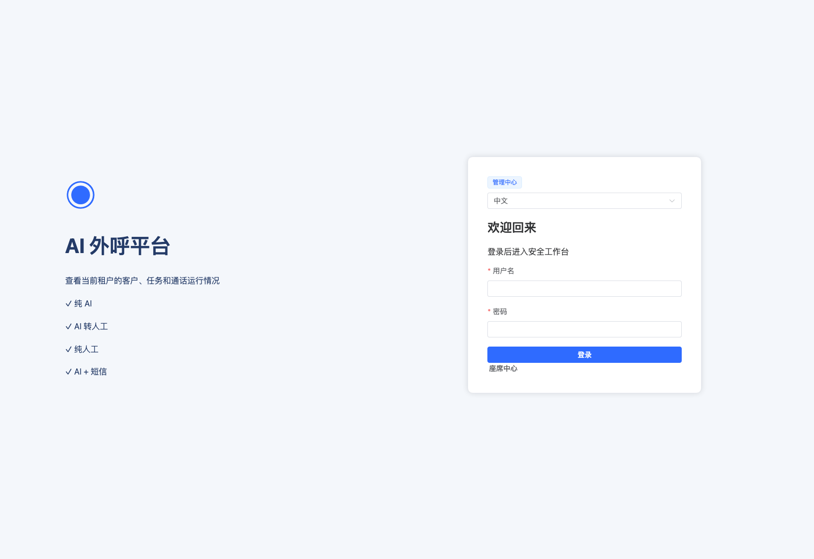
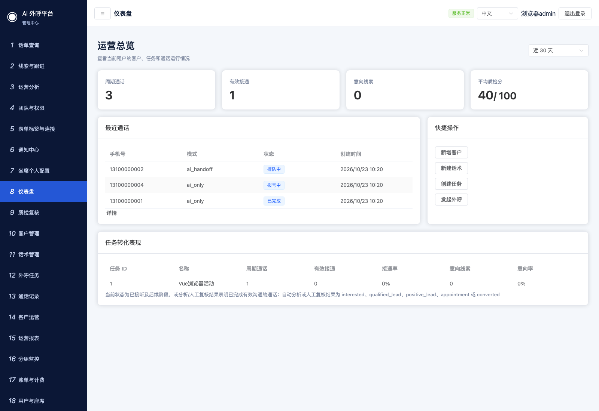

# 开始使用

[返回目录](README.md) · [下一章：客户、话术与外呼任务](02-campaigns.md)

## 1. 登录管理员端

入口：平台域名后接 `/admin/login`。

1. 输入管理员开通的用户名和密码。
2. 点击“登录”。成功后进入管理员首页，左侧显示管理导航，右上角显示当前用户。
3. 如果仍停留在登录页，阅读错误提示，核对账号、密码、账号是否启用及是否被锁定。不要反复猜测密码。

## 2. 认识首页和导航

- 左侧导航切换工作页面。菜单较长时在导航区域滚动；点击顶部“☰”可收起导航。
- 顶栏显示当前页面、语言、当前用户和“退出登录”。
- 首页用于查看总体指标。任务处理到哪一步，继续到“外呼任务”“通话记录”或“运营分析”确认。
- “通话记录”用于单次会话管理和证据查看；“话单查询”用于组合筛选、保存视图和导出。
- “运营报表”是基础汇总页；“运营分析”提供自定义维度、话单下钻和任务运营台。

右上角在线状态仅反映应用探测。电话线路、WebRTC、模型、录音存储仍需分别确认。

## 3. 先用一条客户走通流程

1. 打开“客户管理”，新增一条已获授权的测试客户，保存后搜索并核对。
2. 打开“话术管理”，保存话术；需要画布时完成发布。
3. 打开“外呼任务”，创建任务，选择该客户、模式与话术，保存。
4. 核对任务名称、客户数、并发与模式，再点击“启动”并确认。
5. 打开“通话记录”，查看状态；出现结果后打开事件或通话证据。
6. 打开“线索与跟进”，记录跟进结果与下一次动作。

本轮已在模拟环境验证客户保存、话术发布、任务启动、模拟通话证据与线索跟进。真实号码试呼须在已完成线路和费用确认的环境执行，真实通话验收不由截图代替。

## 4. 保存后确认结果

表单提交后先看成功或错误提示，再回到列表确认新增记录。编辑现有记录时，重新打开表单或刷新页面，确认字段仍为刚才保存的值。

如果界面提示版本冲突，先刷新并重新读取记录，核对其他人的修改后再提交。

## 5. 返回和退出

关闭详情抽屉或弹窗，可回到原列表。话单证据关闭后保留当前查询范围；报表下钻后可用浏览器返回。

工作结束点击右上角“退出登录”。退出后回到对应登录页，再访问受保护的管理入口应要求重新登录。
