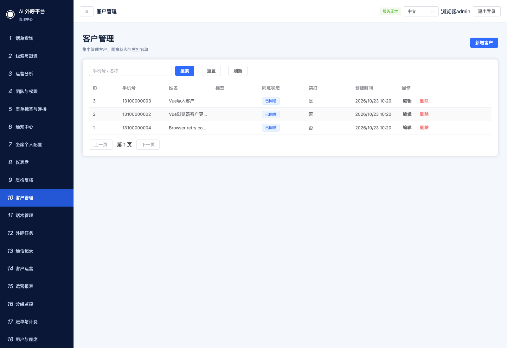
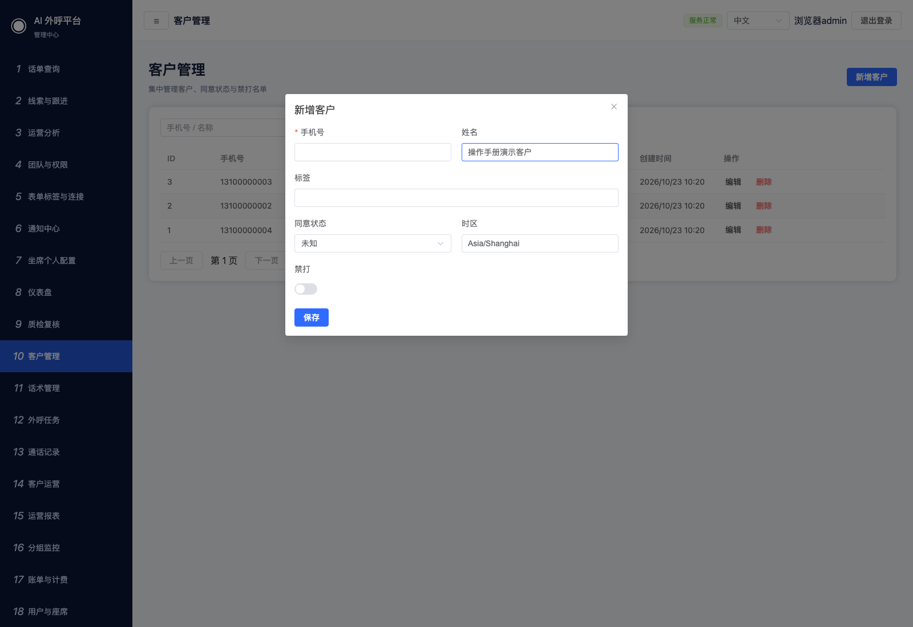
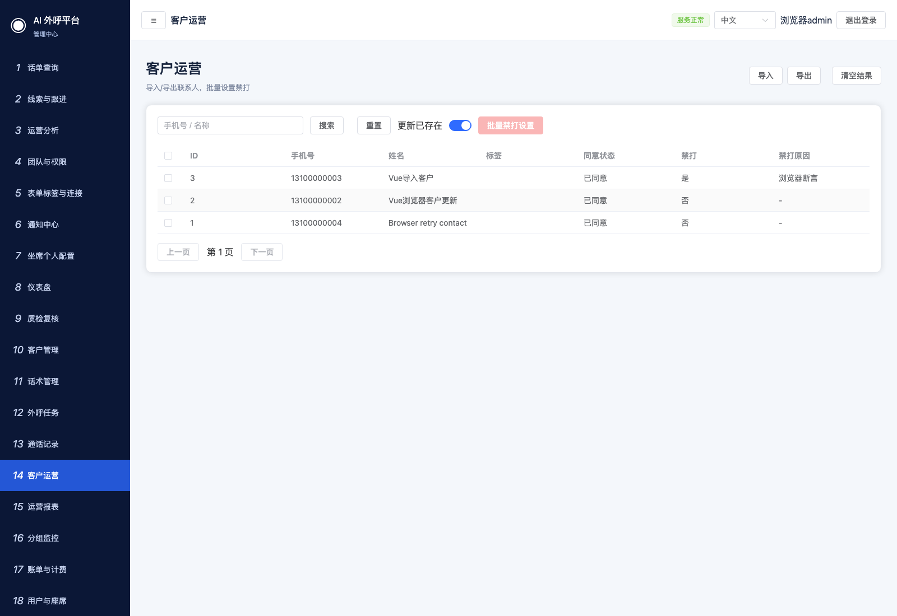
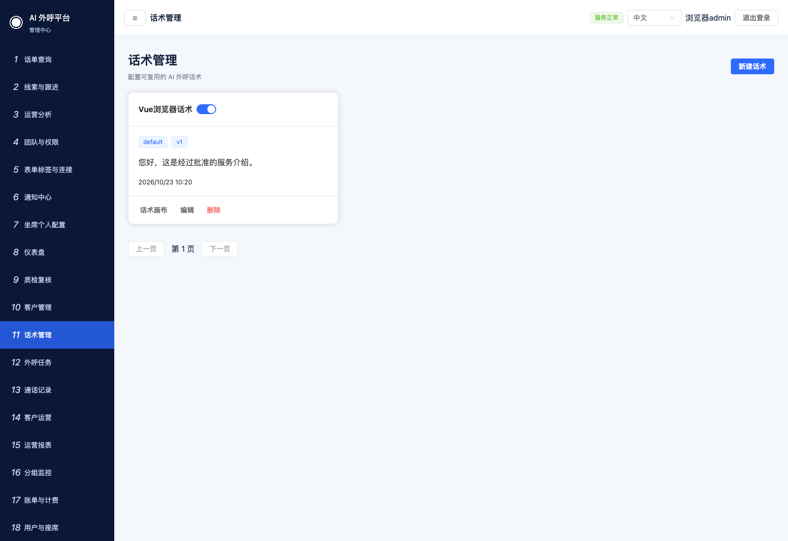
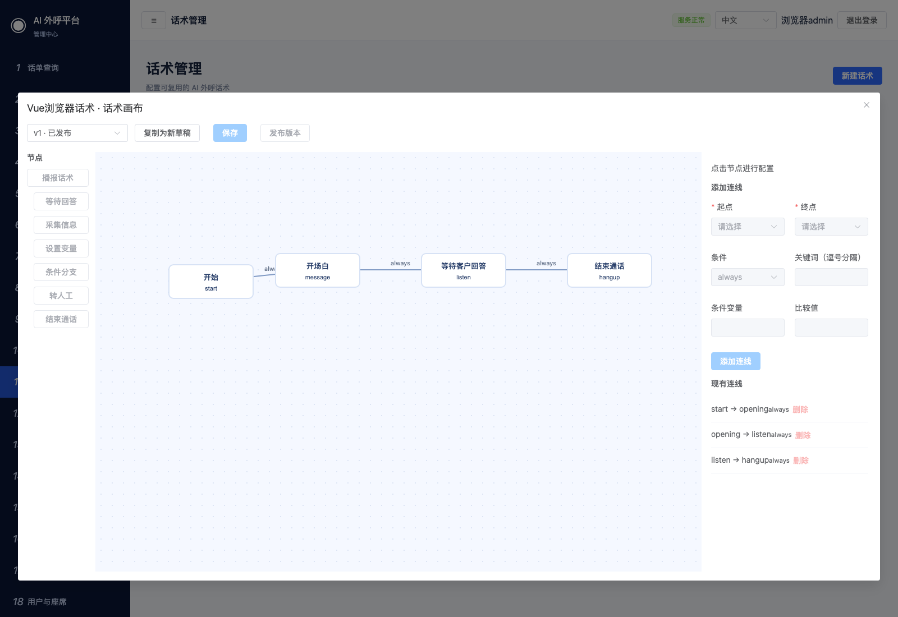
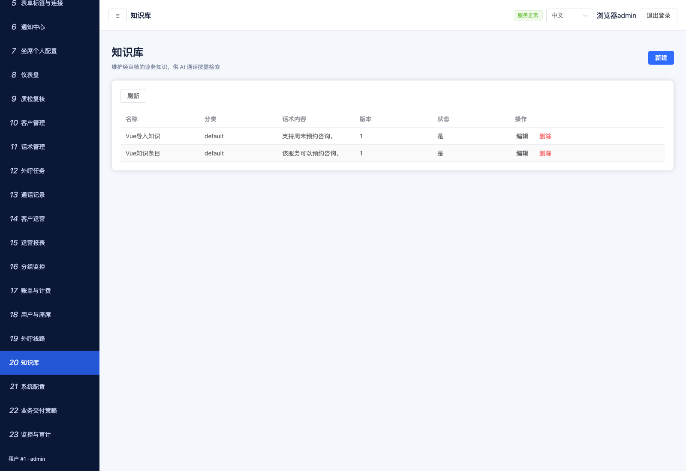
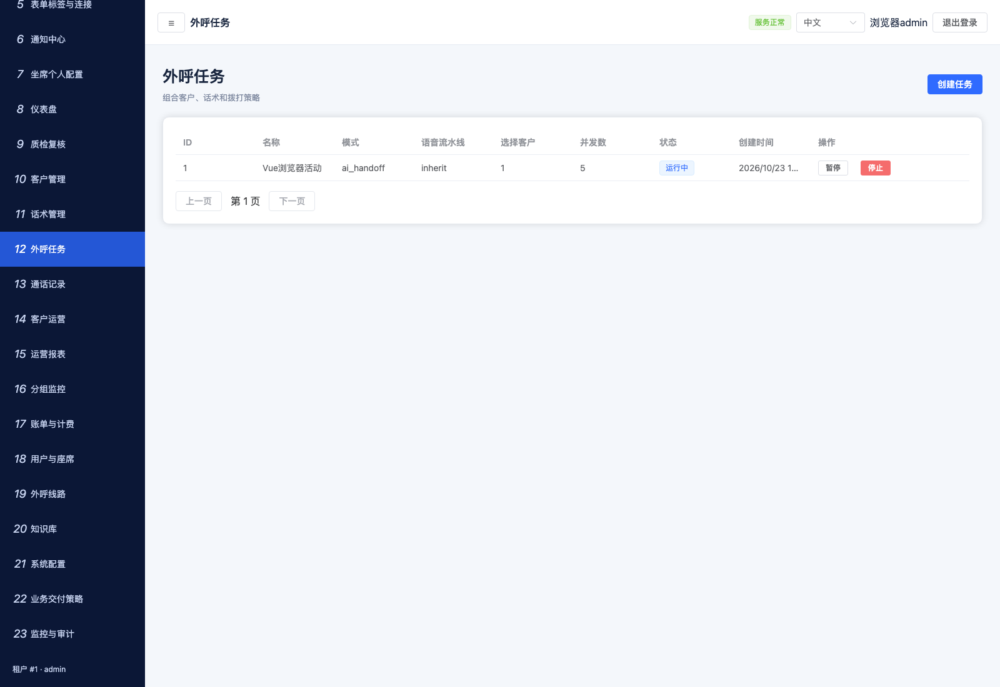
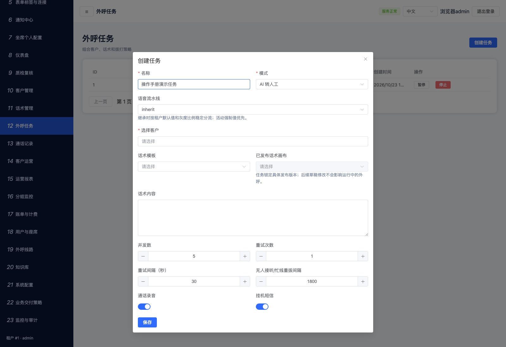

# 客户、话术与外呼任务

[返回目录](README.md) · [下一章：通话、线索与运营](03-operations.md)

## 1. 新增和编辑客户

入口：管理员 → 客户管理，路径 `/admin/contacts`。



1. 点击“新增客户”。
2. 填写手机号、姓名；按实际情况填写标签、同意状态和时区。
3. 核对“禁打”开关。客户拒绝或撤回授权时，按实际业务规则记录状态，不应为了使任务启动而修改成“已同意”。
4. 点击“保存”，回到列表后按手机号或姓名搜索。
5. 编辑时点击行内“编辑”，保存后重新打开或刷新确认。已有客户手机号在编辑框内不可修改。



**完成标志：**列表出现客户，搜索可找到；刷新后姓名、授权状态等字段仍正确。手机号未填时应出现必填提示。

## 2. 批量导入、导出和禁打

入口：管理员 → 客户运营，路径 `/admin/contacts-operations`。



1. 将名单保存为 UTF-8 CSV，首行使用字段名。最小示例：

```csv
phone,name,consent_state
13100000003,演示客户,consented
```

示例号码仅用于隔离演示，使用时替换为已授权的测试号码。`consent_state` 可使用 `consented`、`not_consented`、`revoked`、`unknown`；按实际授权证据填写。

2. 核对“更新已存在”开关，再点击“导入”选择文件。开启时会更新已有客户，导入前先核对名单。
3. 等待导入结果，查看总数、新增、更新、跳过和错误明细。修正错误行后再处理。
4. 导出客户名单点击页头“导出”。该入口导出客户数据，不应把它当成当前列表搜索结果的精确导出；组合筛选的话单请使用“话单查询”。
5. 设置禁打时先勾选客户，再点击“批量禁打设置”，填写原因，保存后核对列表。

**完成标志：**导入后能搜索到对应客户；禁打设置保存后，列表显示禁打状态和原因；导出生成 CSV 文件。

## 3. 新建话术

入口：管理员 → 话术管理，路径 `/admin/scripts`。



1. 点击“新建话术”，填写名称、分类、话术内容及需要的说明。
2. 点击“保存”，确认话术卡片或列表出现。
3. 普通文本话术可供任务选择；需要分支流程时进入“话术画布”。

## 4. 编排和发布话术画布



1. 在对应话术点击“话术画布”；没有画布时点击“创建画布”。
2. 在草稿中调整节点位置，核对节点、分支条件与连接关系。
3. 先点击“保存”，再点击“发布版本”，阅读确认框后确认。
4. 发布后该版本变成只读。后续修改使用新的草稿或版本。
5. 创建任务时选择具体的“已发布话术画布”，避免运行任务随草稿变动。

**完成标志：**发布版本可供任务选择，已发布画布的保存按钮禁用。

## 5. 准备知识库

入口：管理员 → 知识库，路径 `/admin/knowledge`。



点击“新建”，填写名称、内容及页面要求的字段，保存后核对列表。需要导入文本并测试检索时，使用“业务交付策略 → 知识导入与检索测试”，详见[管理配置](04-administration.md)。

## 6. 创建外呼任务

入口：管理员 → 外呼任务，路径 `/admin/campaigns`。



1. 点击“创建任务”。
2. 填写名称与外呼模式，在“选择客户”中搜索并勾选客户。
3. 选择话术模板；需要画布时选择已发布版本。按页面需要补充任务话术内容。
4. 设置并发数、重试次数、重试间隔、无人接听/忙线重拨间隔，以及录音、挂机短信开关。
5. 点击“保存”，在列表核对名称、客户数、模式、并发和状态。



| 字段 | 怎么填写 |
| --- | --- |
| 外呼模式 | 按业务选择 AI 接待、AI 转人工、纯人工或带短信的模式 |
| 语音流水线 | 没有专项配置要求时使用继承；切换前由管理员确认已接入对应媒体链路 |
| 选择客户 | 从已维护客户中选择；没有目标客户时先回客户管理检查 |
| 已发布话术画布 | 先选话术模板，再选其已发布的画布版本 |
| 并发 | 同时执行的通话数，受系统有效容量约束；不是每秒拨号数 |
| 重试次数与间隔 | 根据业务策略填写，注意同号间隔与禁打限制 |
| 录音、挂机短信 | 按实际需要开启，依赖对应服务与配置 |

## 7. 启动、暂停、恢复和停止

1. 核对任务和客户范围，点击行内“启动”，在确认框确认。
2. 列表显示“运行中”后，到通话记录或任务运营台观察执行结果。
3. 运行中可点击“暂停”；暂停后可点击“恢复”。需要结束时点击“停止”并确认。
4. 编辑和删除按钮是否出现取决于任务当前状态。删除前确认目标任务。

**完成标志：**启动后任务显示运行中；后续拨号、接通、完成情况通过话单与任务明细核对。运行中不等于所有号码已拨打，也不等于真实线路已接通。

启动失败时保留错误提示，检查客户授权与禁打、呼叫时段、有效容量、线路和策略。不要通过反复启动绕过错误。

本轮实际验证了任务创建、保存和模拟环境启动；暂停、恢复、停止等状态操作的本轮点击验证范围见[验证记录](VALIDATION.md)。
