# 通话、线索与运营

[返回目录](README.md) · [下一章：管理配置](04-administration.md)

## 1. 查看通话记录与重拨

管理员入口：`/admin/calls`；坐席入口：`/agent/calls`。

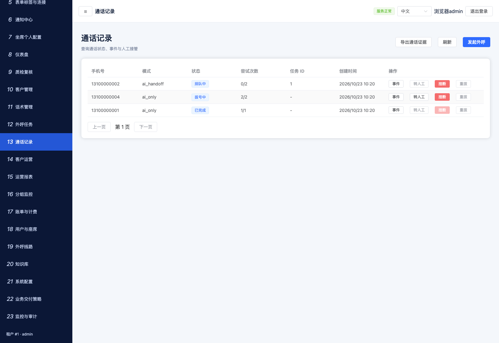

1. 打开“通话记录”，找到目标号码和会话，核对状态、模式、尝试次数及时间。
2. 点击行内“事件”等详情入口，查看这次通话的证据。
3. 对已结束且仍有剩余尝试次数的记录，可点击“重拨”并确认。提交后观察尝试次数与状态变化。
4. 重拨按钮禁用时，先检查是否已经耗尽次数或当前状态不允许，不要重复提交。

**本轮验证：**模拟记录从第 1/2 次进入第 2/2 次，状态变为拨号中，刷新后仍保留；这不代表真实号码已接通。

## 2. 查看转写、结果、录音和事件

打开通话详情后，通过顶部标签切换证据。

| 标签 | 重点看什么 |
| --- | --- |
| 结构化转写 | 对话内容、说话方与轮次，判断意向时对照原始对话 |
| 结果与质检 | 摘要、意向、结果与质检；管理员或授权主管可进入纠正分析 |
| 录音资产 | 资产状态、轮次、格式、时长与存储位置 |
| 阶段指标 | 各阶段处理耗时与指标 |
| 事件 | 状态变化与过程事件，排查失败和重拨问题 |

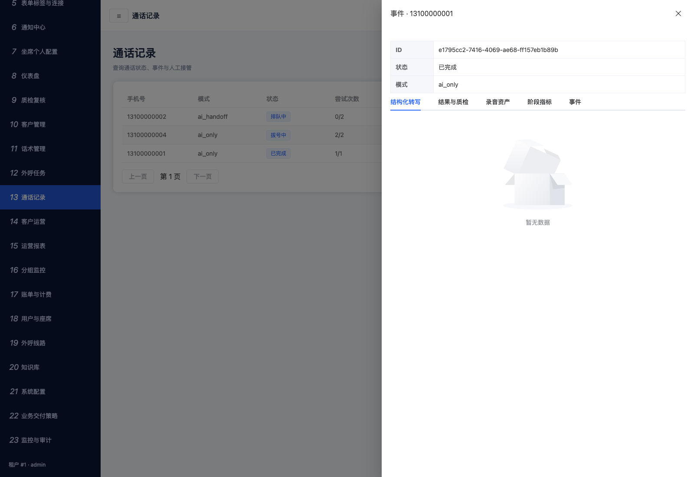

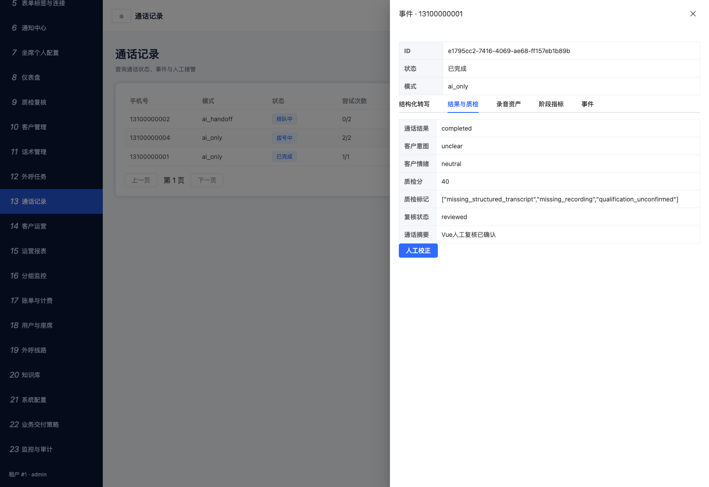

录音资产页展示元数据和位置；不能仅凭资产记录判定录音可以播放、可以下载或音频完整。本轮未进行真实录音试听与下载验收。

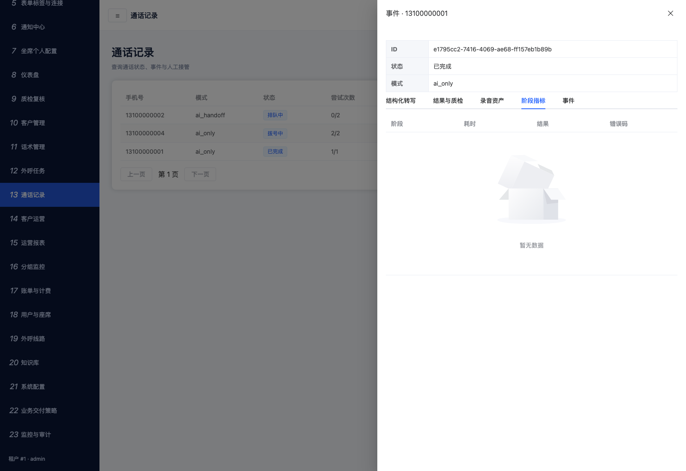

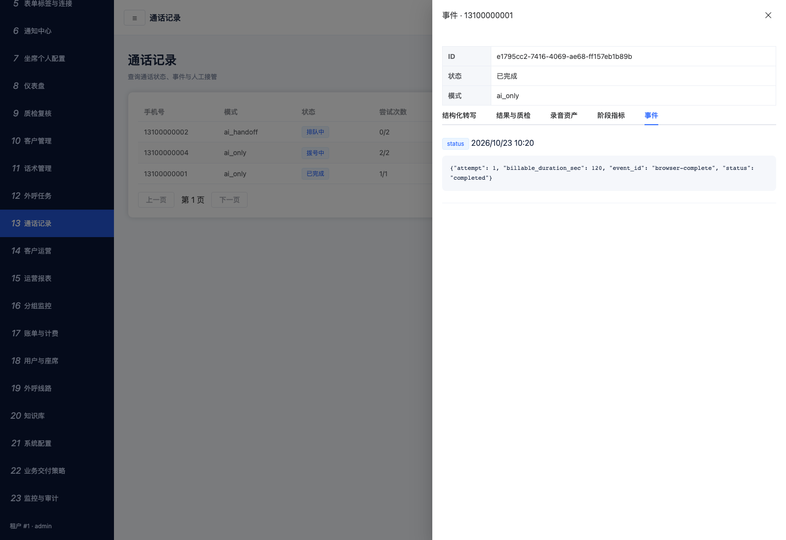

关闭详情返回列表。无数据时先确认会话是否结束、对应分析是否完成，以及账号的数据与录音权限。

## 3. 组合筛选话单并导出

入口：管理员 → 话单查询，路径 `/admin/operations/calls`；坐席对应 `/agent/operations/calls`。

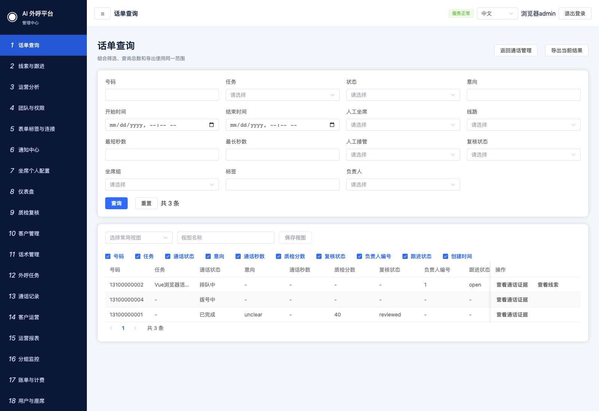

1. 填写号码，按需要选择任务、状态、意向、开始与结束时间、坐席、线路、时长、转人工、复核状态及团队等条件。
2. 点击“查询”，核对结果总数与列表。
3. 点击“查看通话证据”，关闭后回到原查询范围；点击“返回通话管理”进入通话记录页。
4. 需要复用时填写视图名称，点击“保存视图”，下次从常用视图中选择。
5. 有导出权限时点击“导出当前结果”。导出按当前查询范围生成 CSV。
6. 查询不到数据时点击“重置”，先清除条件再逐项增加。

**完成标志：**查询条件保留在地址中，刷新后仍能回显；常用视图恢复对应筛选；导出生成 `filtered-calls.csv`。

## 4. 领取和分配线索

入口：管理员 → 线索与跟进，路径 `/admin/operations/leads`；坐席对应 `/agent/operations/leads`。

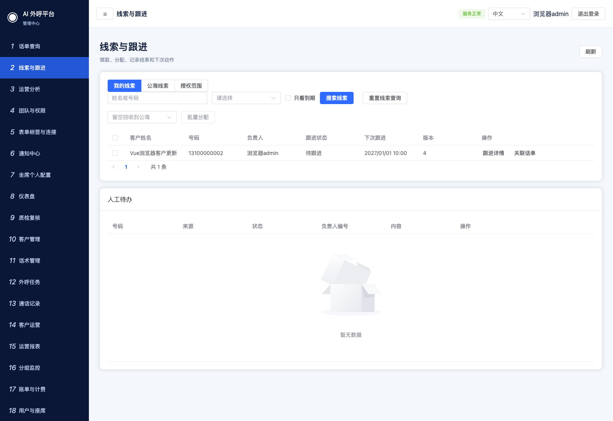

1. 在“我的线索”查看本人负责的客户；在“公海线索”查看可领取范围。
2. 输入号码或姓名，配合阶段、逾期等条件搜索。
3. 未分配线索可点击“领取线索”。有管理权限时，勾选目标记录，选择负责人，点击“批量分配”。
4. 分配后切换对应范围，确认负责人和目标记录。
5. 点击“关联话单”查看该客户的通话记录；点击“跟进详情”录入后续动作。

可见线索受角色、团队和负责人范围约束。坐席看到空列表时，先确认是否已经分配，不应直接判断名单丢失。

## 5. 保存跟进记录

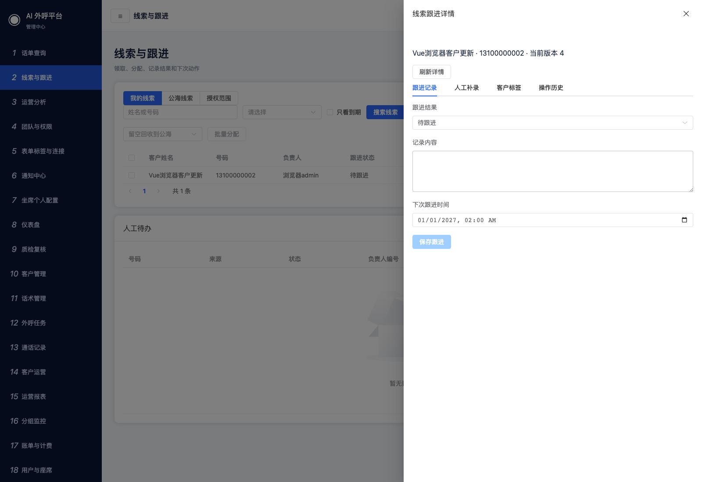

1. 打开“跟进详情”。
2. 选择阶段：待跟进、跟进中、已完成或无效。
3. 填写“记录内容”，写清客户反馈与下一次动作；需要继续联系时填写下次跟进时间。
4. 点击“保存跟进”。保存成功后输入框清空，可切到“操作历史”核对记录。
5. 关闭详情、刷新列表后再次查看，确认阶段与跟进安排。

不要用空泛的“已跟进”代替具体结果，例如可以记录“客户要求明天下午联系，需补充报价范围”。

## 6. 人工补录、客户标签与历史

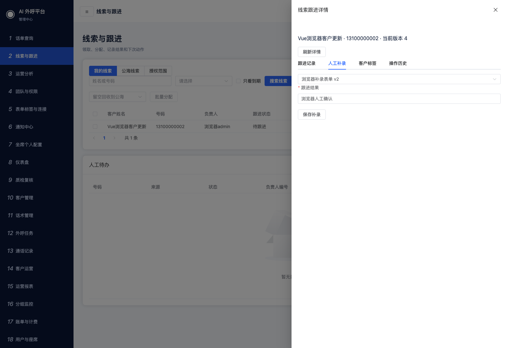

在“人工补录”选择已发布的表单版本，填写字段后点击“保存补录”。必填字段按表单要求填写，版本由管理员在“表单标签与连接”维护。

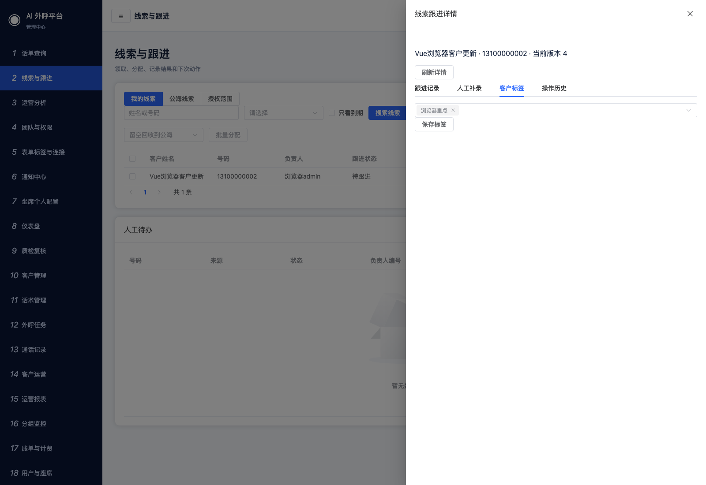

在“客户标签”选择字典中已有标签，点击“保存标签”。没有合适标签时联系管理员维护字典。

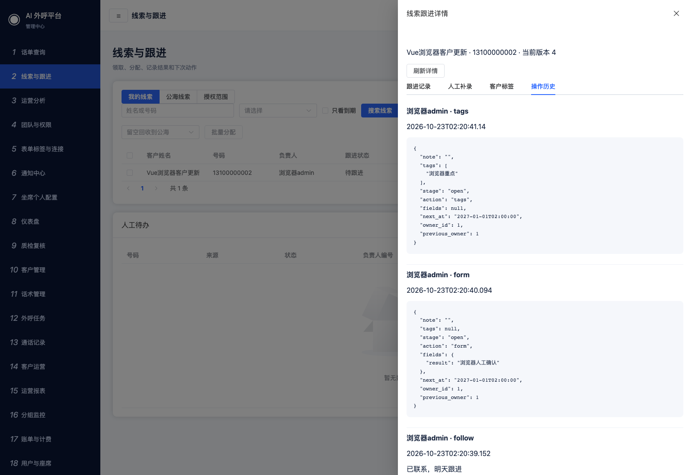

在“操作历史”核对操作者、时间、动作和跟进内容。并发修改发生冲突时，刷新记录再操作。

页面下方“人工待办”显示需要人工处理的事项；管理人员可按授权调整负责人，处理动作应与实际业务结果一致。

## 7. 质检复核

入口：管理员 → 质检复核，路径 `/admin/quality`；获授权的主管坐席使用 `/agent/quality`。

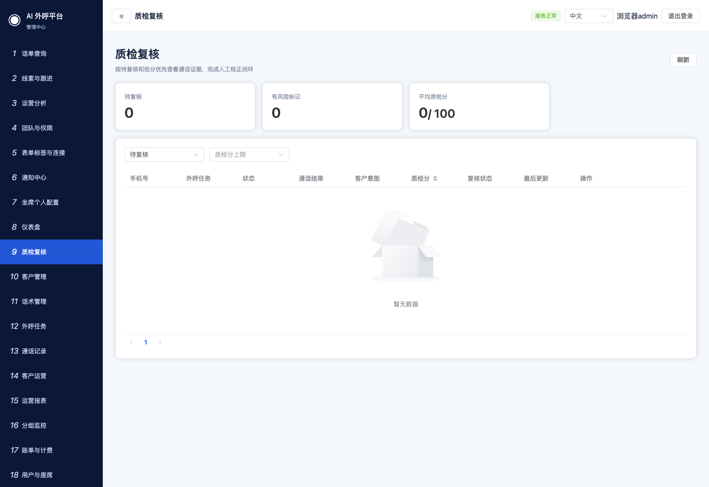

1. 查看待复核、标记和评分情况，按页面条件找到记录。
2. 打开证据入口核对转写与录音资产。
3. 点击“复核”，按实际证据修正摘要、意向、结果等表单字段。
4. 保存后重新查看记录。证据不足时保留人工判断，不凭模拟结果确认真实业务质量。

本轮验证了摘要修改与保存，真实音频内容与人工质检一致性未验证。

## 8. 运营分析、常用视图与话单下钻

入口：管理员 → 运营分析，路径 `/admin/operations/reports`；坐席菜单名为“运营报表”，路径 `/agent/operations/reports`。

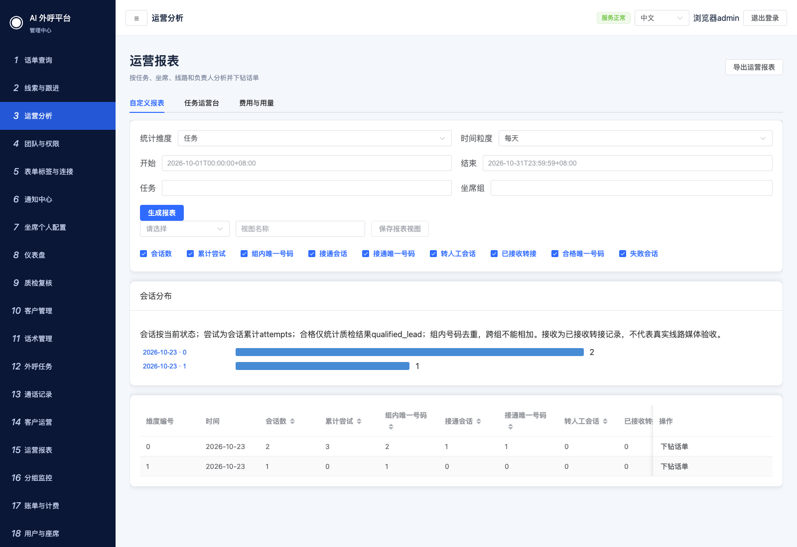

1. 选择任务、坐席、线路或负责人维度，设置时间粒度和筛选条件。
2. 点击“生成报表”，阅读页面显示的统计口径。
3. 勾选需要展示的列；经常使用的组合可填写视图名称，点击“保存报表视图”。
4. 点击“下钻话单”查看该组明细，再通过浏览器返回。
5. 有权限时点击“导出运营报表”，得到 `operations-report.csv`。

| 指标 | 阅读方式 |
| --- | --- |
| 会话数 | 按会话当前状态统计 |
| 累计尝试 | 累加会话的尝试次数，可能大于会话数 |
| 组内唯一号码 | 在当前分组内去重，跨组不能直接相加 |
| 合格唯一号码 | 仅计入质检结果为 `qualified_lead` 的号码 |
| 已接收转接 | 已接收的转接记录，不等于真实桥接音频验收通过 |

不同筛选、分组、时间与数据范围下的数字不能直接比较。默认报表查询未指定开始时间时取近 30 天。

## 9. 任务运营台

管理员在“运营分析”切换到“任务运营台”。

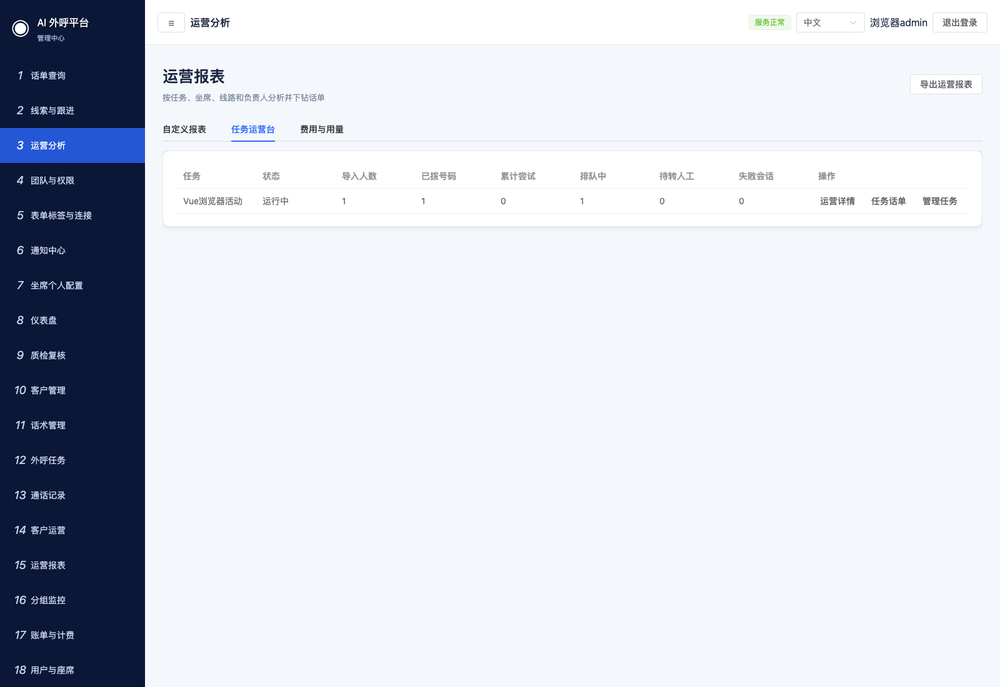

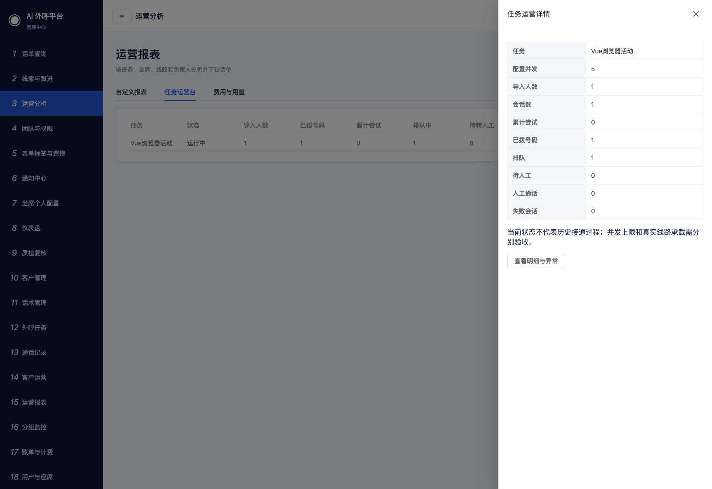

找到任务，查看导入人数、已拨号码、累计尝试、排队、待人工和失败会话；点击“运营详情”查看会话、人工通话等详细数值。需要调整任务状态时核对操作对象和确认提示。

## 10. 基础报表、分组监控与费用

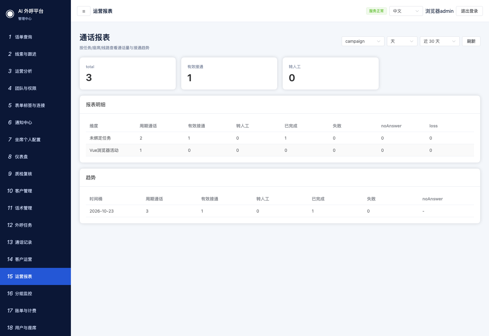

“运营报表”入口 `/admin/reports` 用于基础通话汇总。

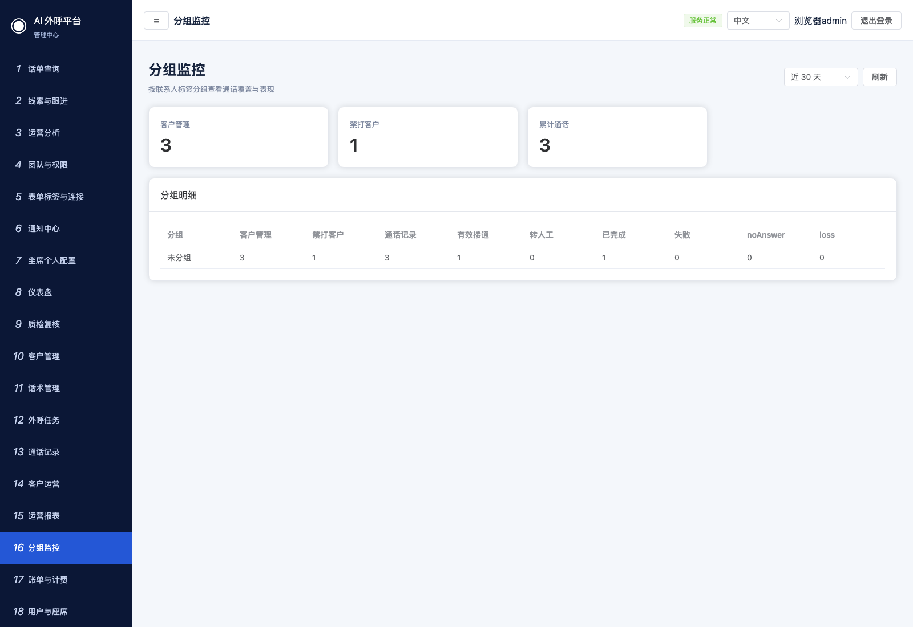

“分组监控”入口 `/admin/group-monitor` 用于观察分组情况。

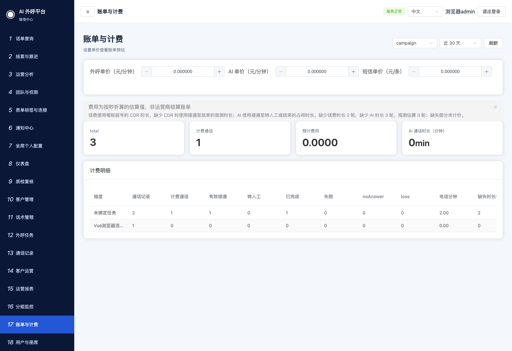

“账单与计费”入口 `/admin/billing` 展示用量和按秒折算的估算费用。该数字不是运营商结算账单，实际费用以服务商对账结果为准。
