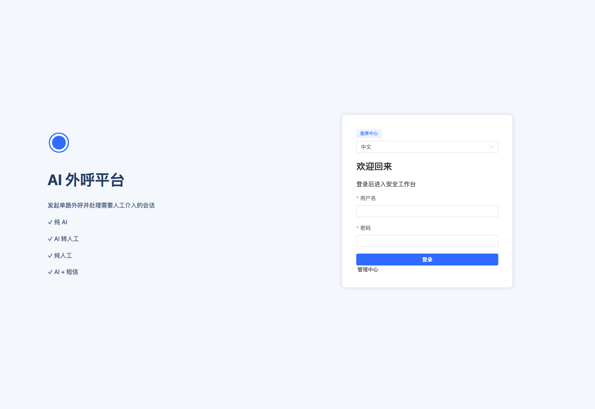
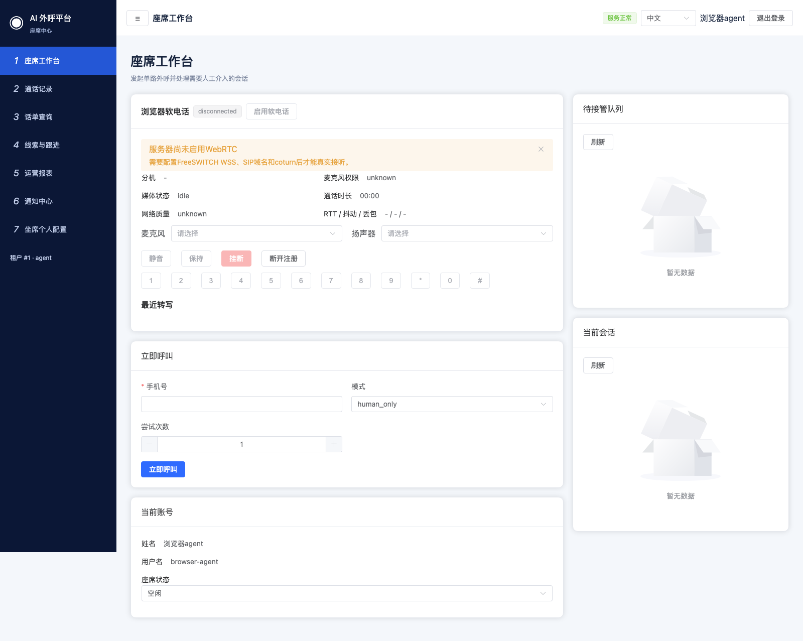
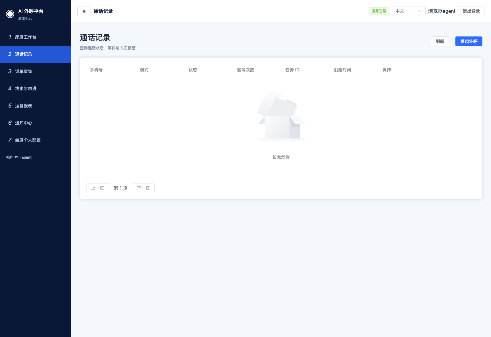
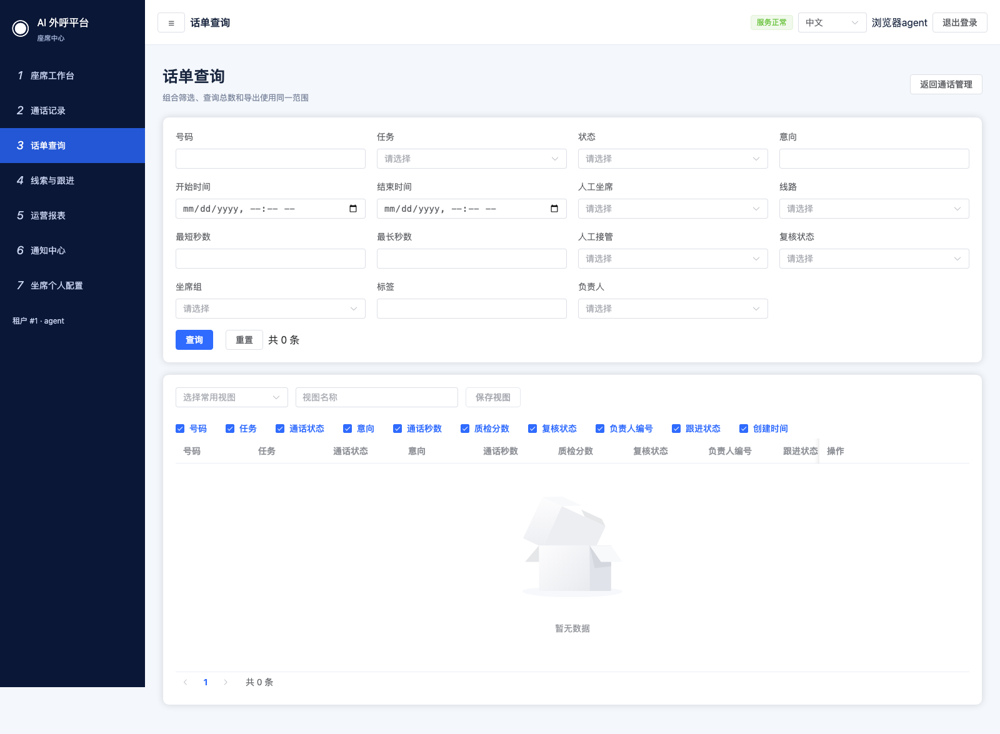
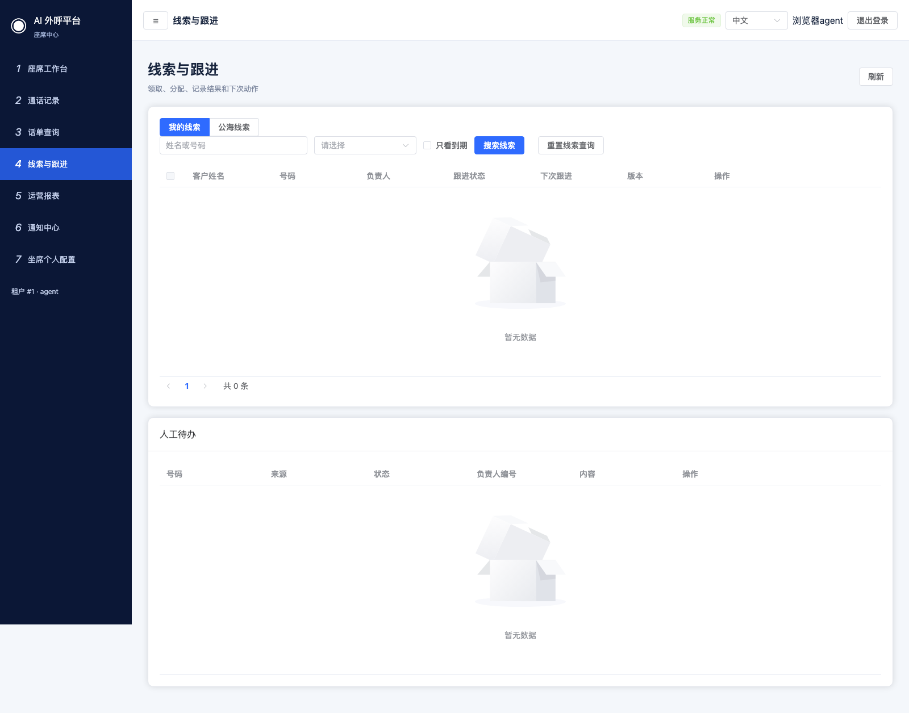
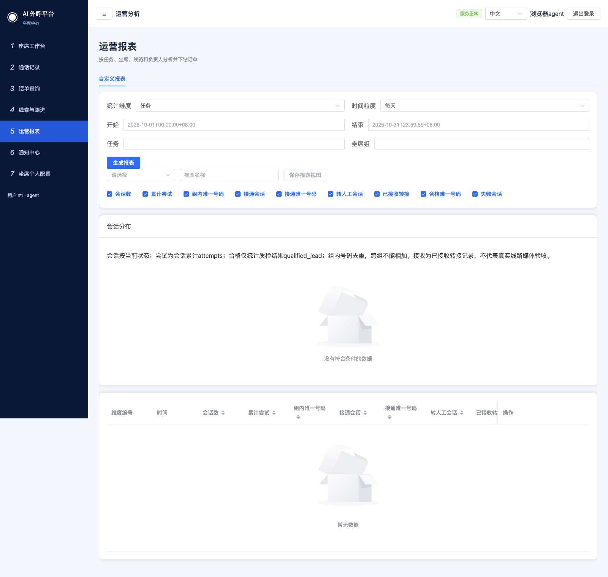
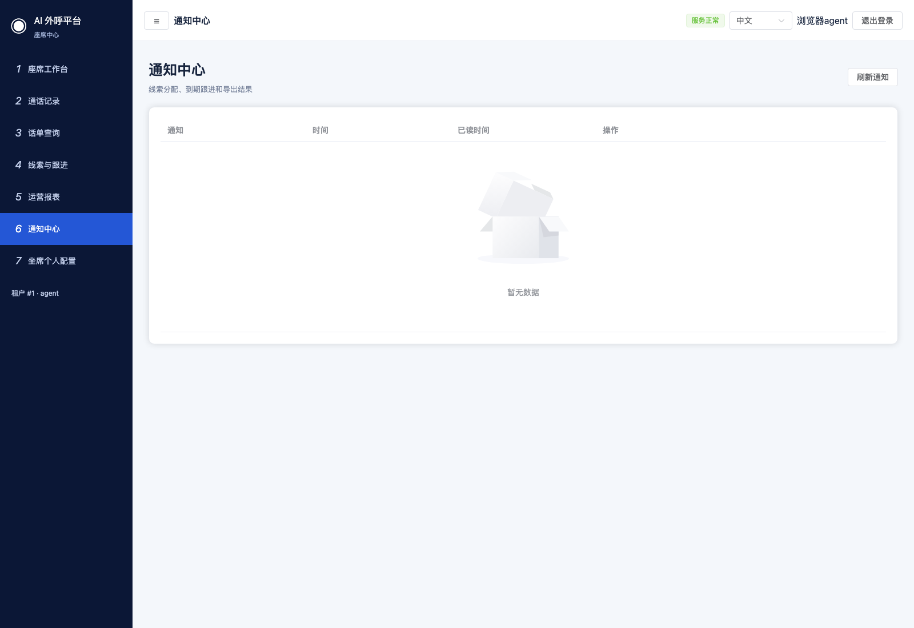
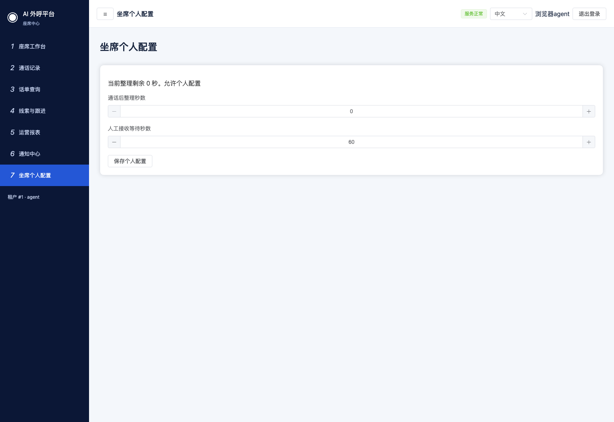

# 坐席操作

[返回目录](README.md) · [下一章：常见问题](06-troubleshooting.md)

## 1. 登录坐席端

入口：平台域名后接 `/agent/login`。

填写管理员开通的账号和密码，点击“登录”。成功后进入坐席工作台。管理员端和坐席端使用不同入口，普通坐席不能进入管理员页面。

## 2. 上岗前检查与状态切换

1. 核对个人信息与当前账号。
2. 查看“浏览器软电话”的提示。若提示“服务器尚未启用WebRTC”，联系管理员完成配置，不能据此开始真实接听。
3. 在“座席状态”选择空闲、忙碌或离线。空闲表示可承接，忙碌或离线会限制部分接待操作。
4. 修改后确认状态回显。出现状态更新失败提示时使用重试，先确认服务端状态再继续。
5. 通话后整理期间按页面倒计时处理记录，结束后再确认可接待状态。

本截图环境未启用 WebRTC，真实麦克风、耳机、注册、接听与音频未验证。

## 3. 人工外呼与转接队列

工作台提供“立即呼叫”、待转人工队列与当前通话区域。

1. 发起人工外呼前确认线路、客户授权、设备和坐席状态。
2. 在“立即呼叫”区域输入号码，选择模式和尝试次数，再点击“立即呼叫”。
3. 队列出现待接记录时，先阅读客户、任务、意向和摘要，再选择接受或拒绝并核对确认框。
4. 当前通话允许接管时使用对应入口；按钮禁用时先检查状态、是否已有人工会话及权限。
5. 通过通话状态和实际音频确认转接结果，不能仅凭“已接受”判断桥接成功。

本轮只验证了工作台入口与坐席状态保存；真实人工呼叫、接受／拒绝转接、WebRTC 和设备接听未验证。

## 4. 查看本人通话与话单

“通话记录”路径 `/agent/calls`，用于查看当前账号范围内的会话。

“话单查询”路径 `/agent/operations/calls`，用于按号码、时间、状态等条件组合查询。操作步骤与[运营章节](03-operations.md)一致；导出、完整号码和录音访问取决于授权。

看到脱敏号码或没有导出按钮时，先联系管理员确认权限。空列表可能表示当前范围内没有分配的数据。

## 5. 线索跟进

路径 `/agent/operations/leads`。

1. 在“我的线索”查看本人负责的客户；在授权的公海范围领取线索。
2. 打开“跟进详情”，更新阶段、记录内容与下次跟进时间。
3. 按需要填写人工补录、保存标签，最后在操作历史核对。
4. 使用“关联话单”回查客户对话。需要更换负责人或访问其他团队数据时联系管理员。

截图中的空列表是当前演示坐席没有分配线索的状态，不代表平台没有线索。

## 6. 报表、通知和个人设置

“运营报表”路径 `/agent/operations/reports`，只能查看授权范围内的数据。设置维度与时间条件后生成报表，按需要下钻话单。

“通知中心”路径 `/agent/operations/notices`，查看分配、跟进和导出等事项；点击“查看事项”进入对应页面。

“坐席个人配置”路径 `/agent/operations/workspace`。允许个人配置时设置通话后整理和人工接收等待时间，保存后刷新确认。团队统一管理时输入与保存按钮禁用。

## 7. 主管复核与退出

具备主管身份和相应数据范围的坐席可看到“质检复核”入口 `/agent/quality`。未出现入口时联系管理员核对授权。

下班前按实际情况切换离线，点击右上角“退出登录”，确认回到坐席登录页。
