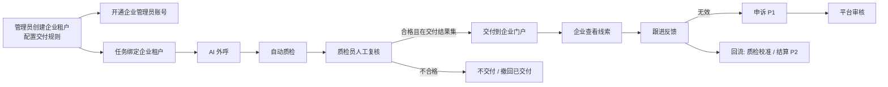
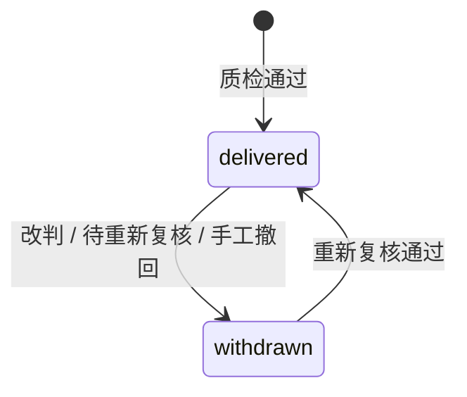
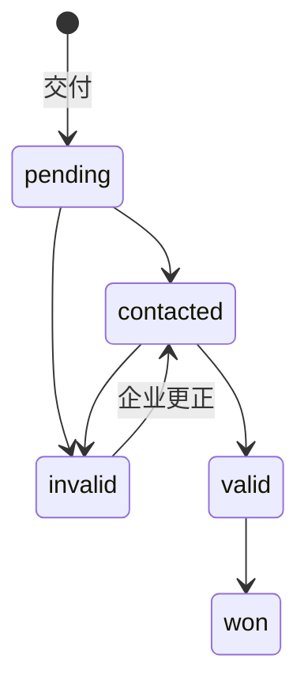

# B 端企业租户线索门户 — 产品方案与技术实现设计

| 项 | 内容 |
| --- | --- |
| 版本 | v1.0（2026-10-31） |
| 状态 | P0 + P1 已实现（分支 `feat/client-portal`），P2 未实现；实现与设计的差异见下方“实现说明” |
| 适用工程 | `ai-outbound-platform/outbound-mono`（Spring Boot + MyBatis + MySQL，Vue3 + Element Plus） |
| 取代 | 同目录 `B端企业客户线索门户_功能设计.md`（初稿） |

## 实现说明（与设计的差异）

- 管理接口统一挂在 `/api/v1/ops/clients/**` 与 `/api/v1/ops/campaigns/{id}/client`：`/api/v1/admin/**` 由过滤器强制管理员角色，交付专员无法访问；服务端按“管理员全部 / 交付专员按授权”判断。
- 回溯交付改为接口内同步分批（每批 500 条，返回 `last_id`/`has_more` 游标，前端循环调用），未接入 `taskoutbox`；每条记录先锁通话行再读质检结果，与人工复核同序，避免旧快照覆盖。
- 一通通话最多交付给一个企业：改绑后回溯不会把已交付给原企业的线索复制给新企业。
- 录音接口返回通话记录中的 `recording_url`，可否播放取决于部署的录音存储；未新增签名下载。
- 功能开关 `CLIENT_PORTAL_ENABLED` 默认 `true`：未创建企业租户、未绑定任务时交付逻辑不产生任何数据。
- 管理端左侧导航按业务链路重新分组（工作台 → 客户名单 → 话术与 AI → 外呼执行 → 质检与线索 → 企业交付 → 数据分析 → 组织与权限 → 系统设置），菜单名称不变。
- 验收记录见 [CLIENT-PORTAL-ACCEPTANCE.md](../CLIENT-PORTAL-ACCEPTANCE.md)。

---

# 第一部分 产品方案

## 1. 背景与目标

平台用 AI 外呼为 B 端企业客户筛选意向客户。目前线索只在平台内部流转（运营工作台“线索与跟进”），交付给企业靠人工导出发送，存在三个问题：交付慢、口径不一致（未复核的线索也可能被发出）、企业跟进结果无法回流。

**目标**

1. 平台在管理端为企业开通“企业租户”和登录账号，并把外呼任务绑定到企业租户。
2. 企业用户登录独立门户，只能看到**归属本企业**且**质检通过**的线索，实时可见，不需要人工导出。
3. 企业在门户里反馈跟进结果，回流平台，用于质检校准、申诉和结算。

**不做（本方案范围外）**：企业自助注册、企业自建外呼任务、在线支付充值。

## 2. 核心概念

| 概念 | 定义 |
| --- | --- |
| 平台租户 | 代码中的 `tenant`，是平台运营方自身的数据隔离单位，任务、号码、通话、质检都在其下 |
| **企业租户** | 购买线索的 B 端企业，建在平台租户之下（表 `client_org`）。不另开 `tenant`：否则平台在自身租户里跑的任务和质检数据无法归属给它 |
| 企业账号 | 企业租户下的登录账号（表 `client_user`），与平台员工账号完全隔离 |
| 任务绑定 | 外呼任务归属某个企业租户；该任务产生的线索归该企业 |
| 质检通过 | `review_state='reviewed'` 且 `needs_review=false` 且 `result_code` ∈ 企业交付结果集（默认 `{qualified_lead}`） |
| 交付线索 | 质检通过后写入企业视图的快照记录（表 `client_lead`） |
| 撤回 | 已交付线索因复核改判等原因不再符合交付条件，状态变为“已撤回”，企业可见撤回原因 |

## 3. 角色与权限

### 3.1 角色清单

| 侧 | 角色 | 阶段 | 账号来源 | 职责 |
| --- | --- | --- | --- | --- |
| 平台 | 平台管理员 | 现有 | `sys_user.role=admin` | 企业租户管理、开通账号、任务绑定、交付配置、撤回、申诉审核 |
| 平台 | 质检员（主管） | 现有 | `sys_user.is_supervisor` | 人工复核。复核通过即触发交付，等于在决定交付 |
| 平台 | 交付专员 / 客户经理 | P1 新增 | `sys_user.role=agent` + 企业授权表 | 只管理分配给自己的企业：开账号、绑任务、看交付、处理申诉 |
| 企业 | 企业管理员 | P0 新增 | `client_user.role=owner` | 查看本企业全部线索、跟进反馈；P1 起管理子账号、分配线索、导出、申诉、配置推送 |
| 企业 | 企业成员（销售） | P1 新增 | `client_user.role=member` | 只看分配给自己的线索，跟进反馈、提申诉 |
| 企业 | 企业只读 / 财务 | P2 新增 | `client_user.role=viewer` | 看板、对账单，看不到号码和线索明细 |
| 企业 | 企业 API 身份 | P2 新增 | 企业 API Key + HMAC | 拉取线索、回写跟进 |

交付专员不新增 `sys_user.role` 取值：现有很多接口只按“admin / 非 admin”判断，新角色值的行为不可控；改为在坐席账号上叠加企业授权。

### 3.2 权限矩阵（P0 + P1）

| 操作 | 平台管理员 | 交付专员 | 质检员 | 企业管理员 | 企业成员 |
| --- | :-: | :-: | :-: | :-: | :-: |
| 创建/停用企业租户 | ✓ | — | — | — | — |
| 修改交付配置 | ✓ | 授权企业 | — | — | — |
| 绑定/解绑任务 | ✓ | 授权企业 | — | — | — |
| 开通/停用企业管理员账号 | ✓ | 授权企业 | — | — | — |
| 人工复核（触发交付） | ✓ | — | ✓ | — | — |
| 撤回已交付线索 | ✓ | 授权企业 | — | — | — |
| 审核申诉 | ✓ | 授权企业 | — | — | — |
| 查看线索 | 全部 | 授权企业 | — | 本企业全部 | 分配给自己的 |
| 查看完整号码 | ✓ | ✓ | — | 企业配置允许时 | 企业配置允许且管理员授予 |
| 播放录音 | ✓ | ✓ | — | 同上 | 同上 |
| 跟进反馈 | — | — | — | ✓ | 自己的 |
| 创建子账号 / 分配线索 | — | — | — | ✓ | — |
| 导出 | ✓ | 授权企业 | — | 企业配置允许时 | — |
| 提申诉 | — | — | — | ✓ | 自己的 |

**权限上限原则**：查看完整号码、录音、导出这三项能力，平台在企业交付配置里设上限；企业管理员只能在上限内分配给成员，企业侧不能自行放大。

## 4. 业务规则

### 4.1 任务与企业租户绑定

- 一个任务同一时刻只归属一个企业租户；一个企业租户可绑定多个任务。
- 两个入口：新建/编辑任务时选择“归属企业租户”；企业详情“绑定任务”页签批量绑定、解绑。
- 任务列表增加“归属企业租户”列与筛选，支持筛出“未绑定”。
- 启动未绑定的任务时提示“该任务的线索不会交付给任何企业”，允许继续（内部测试等场景）。
- 改绑/解绑需二次确认，记录操作人、时间、原企业、新企业。
- 改绑/解绑**只影响之后的交付**，已交付线索保留原归属。
- 停用中的企业不能被新绑定；停用企业不自动解绑任务。
- 绑定时可选“交付历史线索”：勾选后回溯该任务绑定前已质检通过的线索；默认不勾选。

### 4.2 交付

| 场景 | 结果 |
| --- | --- |
| 自动质检为 `qualified_lead`，未人工复核 | 不交付（P1 可按企业开启“自动结果直接交付”） |
| 人工复核为交付结果集内的结果 | 交付，企业立即可见 |
| 同一通话重复复核为合格 | 不重复交付，更新快照中的结果字段 |
| 已交付后复核改判为不合格 | 撤回，原因“质检改判” |
| 已交付后自动重算导致 `needs_review=true` | 撤回，原因“待重新复核”；复核通过后恢复为已交付 |
| 平台管理员手工撤回 | 撤回，填写原因 |
| 去重窗口内同一号码再次合格 | 不新增线索，记录“重复命中”事件 |
| 任务未绑定 / 企业停用 / 合同到期 | 不交付，记录事件；恢复后由管理员手工回溯 |

**去重**：按“企业租户 + 号码”，窗口默认 30 天，可配置，0 表示不去重。跨企业不去重。

### 4.3 合规

- 号码默认脱敏（`138****1234`），完整号码需配置允许且每次查看写审计。
- 联系人被加入禁呼（`dnc`）或撤回授权（`consent_state=REVOKED`）后：该号码对应的线索强制脱敏、录音不可播放，页面提示“客户已撤回授权”。查询时实时判断，不依赖异步任务。
- 企业停用、合同到期、账号停用、强制下线后，已签发令牌立即失效。
- 企业门户所有查看明文号码、播放录音、导出、跟进修改均留痕，平台可查。
- 交付快照不随平台后续修改话术或重算而改变已呈现内容（撤回除外）。

## 5. 业务流程



## 6. 线索状态

两个独立维度：**交付状态**（平台控制）和**跟进状态**（企业控制）。





申诉（P1）：`none → submitted → accepted / rejected`，只有 `follow_state=invalid` 的线索可提交，申诉期默认交付后 7 天。

无效原因字典：空号/停机、非本人、无意向、重复线索、信息不符、其他（需备注）。

## 7. 功能清单与分期

### P0（本期，最小可用）

**管理端**
1. 企业租户列表、新建、编辑、启用/停用。字段：名称、编码、联系人、联系电话、合同起止日期、备注。
2. 交付配置（带版本号，并发修改返回 409）：交付结果集、号码展示（脱敏/允许查看完整号码）、可见字段（摘要、采集字段、转写、录音）、去重窗口。
3. 任务绑定：任务表单选择归属企业；企业详情批量绑定/解绑；任务列表列与筛选；绑定历史。
4. 企业账号：开通企业管理员（生成一次性初始密码，只显示一次）、重置密码、停用、强制下线。
5. 交付记录：按企业、任务、交付时间、交付状态、跟进状态查询；手工撤回；手工回溯。

**企业门户 `/client`**
1. 登录、退出、首次登录强制改密、修改密码。
2. 线索列表：顶部“新线索数”和各跟进状态计数；列为交付时间、来源任务、客户姓名、号码、结果、摘要首行、跟进状态、已读标记。
3. 筛选：交付日期、任务、跟进状态、交付状态、关键词（姓名 / 号码后四位）。
4. 线索详情抽屉：AI 摘要、采集字段、（配置允许时）转写、录音、查看完整号码；跟进表单；操作历史。
5. 跟进反馈：状态 + 无效原因 + 备注 + 下次跟进时间。

### P1（运营完善）
1. 企业成员子账号、线索分配（手动 / 按成员轮流）。
2. 申诉与平台审核。
3. 导出 CSV（企业配置开关、每日上限、审计）。
4. 企业看板：交付趋势、按任务分布、有效率、申诉率、平均首次跟进时长。
5. 新线索通知：站内角标、Webhook 推送（签名）、短信提醒。
6. 交付专员角色与企业授权；管理端交付看板；以企业视角只读预览。
7. 企业可选“自动质检结果直接交付”。

### P2（商业化与集成）
1. 结算：按有效线索计价、申诉成立扣减、月度对账单。
2. 企业 API：API Key + HMAC 拉取线索、回写跟进。
3. 企业只读/财务角色。
4. 安全：IP 白名单、短信二次验证、登录设备管理。
5. 数据保留：超期线索自动脱敏、录音不可访问。

## 8. 页面设计

### 8.1 管理端（菜单新增“企业租户”）

- **企业租户列表**：名称、编码、状态、合同到期日、绑定任务数、近 7 天交付数、账号数；筛选状态、关键词；新建按钮。
- **企业详情**（页签）：
  - 基本信息：可编辑，启用/停用。
  - 交付配置：表单，显示当前版本号和最后修改人。
  - 绑定任务：已绑定任务列表（任务名、状态、绑定时间、绑定人）；“绑定任务”弹窗多选未绑定任务，可勾选“交付历史线索”。
  - 账号：账号列表；开通弹窗，成功后显示一次性密码（带复制按钮和“关闭后不再显示”提示）。
  - 交付记录：线索表格，可撤回、可查看事件历史；顶部“手工回溯”按钮。
- **任务页改动**：列表新增“归属企业租户”列和筛选；新建/编辑表单新增下拉；任务详情显示绑定历史。

### 8.2 企业门户

- 独立登录页，标题使用平台品牌，不出现任何平台运营菜单。
- 布局：左侧导航（线索、修改密码；P1 增加看板、成员）；顶部显示企业名称和账号。
- 线索页：计数卡片 → 筛选栏 → 表格 → 详情抽屉。未读线索加粗。
- 移动端适配列表和详情（销售常用手机查看）。

## 9. 非功能要求

| 项 | 要求 |
| --- | --- |
| 隔离 | 企业令牌只能访问企业接口；所有查询服务端强制带 `tenant_id + client_id` |
| 实时性 | 复核提交后，企业刷新即可见（同一事务写入） |
| 性能 | 单企业 100 万条线索时列表 P95 < 300ms（keyset 分页 + 复合索引） |
| 审计 | 明文号码、录音、导出、跟进、账号操作全部留痕，保留期不少于 1 年 |
| 可用性 | 与主系统同进程部署，遵守现有单实例约束 |

## 10. 运营指标

交付量、交付到首次查看时长、首次跟进时长、有效率（valid+won / 已跟进）、无效原因分布、撤回率、申诉率与申诉成立率。用于考核质检质量和话术效果。

---

# 第二部分 技术实现设计

## 11. 现状与约束（来自代码）

| 现状 | 位置 | 设计约束 |
| --- | --- | --- |
| 员工账号 `sys_user`，角色 `admin`/`agent`；令牌 HS256，claims `sub/uid/tenant_id/role/tv/exp` | `auth/*`、`Crypto.token()` | 企业账号独立表、令牌加 `typ` 区分 |
| `/api/**` 统一走 `JwtFilter`；`/api/v1/admin/**` 对员工令牌强制 admin | `JwtSecurityConfiguration`、`JwtFilter` | 新增 `/api/v1/client/**` 独立过滤器 |
| `Identity.user()==null` 被当作**租户 API Key**，GET 请求不校验 scope | `JwtRealm.authenticate()` | **企业身份绝不能复用 `user=null` 的 Identity**，否则可读全租户数据。必须引入独立主体类型并在路由层隔离 |
| 质检：`CallAnalysis.calculate()` 写自动结果；`review()` 人工复核；两者都调用 `publish()` | `operations/controller/CallAnalysis.java` | `publish()` 是交付唯一挂点 |
| 任务接口 `@AdminPermission("campaigns:write")`，入参经 `contract.input` 严格校验 | `campaign/controller/Campaigns.java` | 不改任务契约，绑定走独立接口 |
| 迁移只追加，V1—V3 不改；最新 V28；表结构快照 `contracts/tables.json` 参与测试 | `db/migration`、`contracts` | 新增 V29（P0）、V30（P1），同步更新 tables.json 及表数量断言 |
| 号码脱敏 `OperationsPhoneMask`；审计 `system/service/Audit`；持久任务 `job/service/Outbox`；录音 `RecordingStorage` | 各模块 | 复用 |
| 单实例、JVM 内锁 `PlatformLock` | README | 交付并发用行锁 + 唯一键保证，不引入分布式锁 |

## 12. 模块划分

新增包 `com.duozhi.outbound.client`：

```
client/
  controller/
    ClientAdmin.java           # /api/v1/ops/clients/**、/api/v1/ops/campaigns/{id}/client
    ClientPortal.java          # /api/v1/client/**（登录、线索、成员、导出、看板）
  service/
    ClientAccounts.java        # 企业与账号、密码、强制下线
    ClientBindings.java        # 任务绑定、绑定历史、回溯任务
    ClientDelivery.java        # 交付/撤回/去重核心逻辑
    ClientSettings.java        # 交付配置版本读取与校验
    ClientLeadQuery.java       # 列表、详情、脱敏、可见字段裁剪
  security/
    ClientJwtFilter.java       # 只处理 /api/v1/client/**
    ClientPrincipal.java       # 企业身份（与 Identity 分离）
  dao/
    ClientMapper.java + resources/mapper/client/dao/ClientMapper.xml
frontend/src/
  client/ClientShell.vue  client/session.js
  pages/ClientLogin.vue  ClientLeads.vue  ClientPassword.vue
  pages/Clients.vue  ClientDetail.vue           # 管理端
```

## 13. 数据模型

### 13.1 V29（P0）

```sql
-- V29__client_portal.sql  仅新增表，不修改既有表
CREATE TABLE client_org (
  id BIGINT NOT NULL AUTO_INCREMENT PRIMARY KEY,
  tenant_id INT NOT NULL,
  code VARCHAR(64) NOT NULL,
  name VARCHAR(200) NOT NULL,
  contact_name VARCHAR(100) NULL,
  contact_phone VARCHAR(32) NULL,
  contract_start DATE NULL,
  contract_end DATE NULL,
  status VARCHAR(16) NOT NULL DEFAULT 'active',          -- active / disabled
  remark VARCHAR(500) NULL,
  revision INT NOT NULL DEFAULT 0,
  created_by INT NOT NULL,
  created_at DATETIME(3) NOT NULL DEFAULT CURRENT_TIMESTAMP(3),
  updated_at DATETIME(3) NOT NULL DEFAULT CURRENT_TIMESTAMP(3),
  UNIQUE KEY uq_client_org_code (tenant_id, code),
  KEY ix_client_org_tenant (tenant_id, status)
) ENGINE=InnoDB DEFAULT CHARSET=utf8mb4;

CREATE TABLE client_setting (               -- 不可变版本，读最新 revision
  tenant_id INT NOT NULL,
  client_id BIGINT NOT NULL,
  revision INT NOT NULL,
  config_json JSON NOT NULL,
  created_by INT NOT NULL,
  created_at DATETIME(3) NOT NULL DEFAULT CURRENT_TIMESTAMP(3),
  PRIMARY KEY (tenant_id, client_id, revision)
) ENGINE=InnoDB DEFAULT CHARSET=utf8mb4;

CREATE TABLE client_user (
  id BIGINT NOT NULL AUTO_INCREMENT PRIMARY KEY,
  tenant_id INT NOT NULL,
  client_id BIGINT NOT NULL,
  username VARCHAR(200) NOT NULL,
  password_hash VARCHAR(255) NOT NULL,
  full_name VARCHAR(100) NOT NULL,
  phone VARCHAR(32) NULL,
  role VARCHAR(16) NOT NULL DEFAULT 'owner',             -- owner / member / viewer
  grants_json JSON NOT NULL,                             -- 成员细项权限（P1）
  enabled BOOLEAN NOT NULL DEFAULT TRUE,
  must_change_password BOOLEAN NOT NULL DEFAULT TRUE,
  token_version INT NOT NULL DEFAULT 0,
  failed_login_attempts INT NOT NULL DEFAULT 0,
  locked_until DATETIME(3) NULL,
  last_login_at DATETIME(3) NULL,
  created_at DATETIME(3) NOT NULL DEFAULT CURRENT_TIMESTAMP(3),
  updated_at DATETIME(3) NOT NULL DEFAULT CURRENT_TIMESTAMP(3),
  UNIQUE KEY uq_client_user_name (username),
  KEY ix_client_user_org (tenant_id, client_id)
) ENGINE=InnoDB DEFAULT CHARSET=utf8mb4;

CREATE TABLE client_campaign (              -- 当前绑定，一任务一行
  tenant_id INT NOT NULL,
  campaign_id INT NOT NULL PRIMARY KEY,
  client_id BIGINT NOT NULL,
  deliver_history BOOLEAN NOT NULL DEFAULT FALSE,
  revision INT NOT NULL DEFAULT 0,
  bound_by INT NOT NULL,
  bound_at DATETIME(3) NOT NULL DEFAULT CURRENT_TIMESTAMP(3),
  KEY ix_client_campaign_org (tenant_id, client_id),
  CONSTRAINT fk_client_campaign_campaign FOREIGN KEY (campaign_id) REFERENCES campaign (id)
) ENGINE=InnoDB DEFAULT CHARSET=utf8mb4;

CREATE TABLE client_campaign_log (
  id BIGINT NOT NULL AUTO_INCREMENT PRIMARY KEY,
  tenant_id INT NOT NULL,
  campaign_id INT NOT NULL,
  from_client_id BIGINT NULL,
  to_client_id BIGINT NULL,
  actor_id INT NOT NULL,
  created_at DATETIME(3) NOT NULL DEFAULT CURRENT_TIMESTAMP(3),
  KEY ix_client_campaign_log (tenant_id, campaign_id, id)
) ENGINE=InnoDB DEFAULT CHARSET=utf8mb4;

CREATE TABLE client_lead (
  id BIGINT NOT NULL AUTO_INCREMENT PRIMARY KEY,
  tenant_id INT NOT NULL,
  client_id BIGINT NOT NULL,
  campaign_id INT NOT NULL,
  call_session_id CHAR(36) NOT NULL,
  contact_id INT NULL,
  dedup_key CHAR(64) NOT NULL,                           -- sha256(tenant|client|phone)
  phone_masked VARCHAR(32) NOT NULL,                     -- 完整号码不落此表，按需从 contact/callsession 读取
  contact_name VARCHAR(200) NULL,
  result_code VARCHAR(64) NOT NULL,
  intent VARCHAR(100) NOT NULL,
  summary TEXT NOT NULL,
  slots_json JSON NOT NULL,
  status VARCHAR(16) NOT NULL DEFAULT 'delivered',       -- delivered / withdrawn
  withdraw_reason VARCHAR(32) NULL,                      -- qc_changed / review_pending / manual
  withdraw_note VARCHAR(500) NULL,
  follow_state VARCHAR(16) NOT NULL DEFAULT 'pending',
  invalid_reason VARCHAR(32) NULL,
  follow_note VARCHAR(1000) NULL,
  next_follow_at DATETIME(3) NULL,
  assignee_id BIGINT NULL,                               -- P1
  dispute_state VARCHAR(16) NOT NULL DEFAULT 'none',     -- P1
  first_viewed_at DATETIME(3) NULL,
  delivered_at DATETIME(3) NOT NULL,
  updated_at DATETIME(3) NOT NULL DEFAULT CURRENT_TIMESTAMP(3),
  revision INT NOT NULL DEFAULT 0,
  UNIQUE KEY uq_client_lead_call (client_id, call_session_id),
  KEY ix_client_lead_list (tenant_id, client_id, delivered_at, id),
  KEY ix_client_lead_follow (tenant_id, client_id, follow_state, delivered_at),
  KEY ix_client_lead_dedup (tenant_id, client_id, dedup_key, delivered_at),
  KEY ix_client_lead_campaign (tenant_id, campaign_id)
) ENGINE=InnoDB DEFAULT CHARSET=utf8mb4;

CREATE TABLE client_lead_event (            -- 历史 + 审计 + 申诉
  id BIGINT NOT NULL AUTO_INCREMENT PRIMARY KEY,
  tenant_id INT NOT NULL,
  client_id BIGINT NOT NULL,
  lead_id BIGINT NULL,                                   -- 账号类事件可为空
  actor_kind VARCHAR(16) NOT NULL,                       -- client / staff / system
  actor_id BIGINT NULL,
  action VARCHAR(32) NOT NULL,                           -- delivered / withdrawn / viewed / phone_revealed / recording_played / follow / dup_hit / login ...
  detail_json JSON NOT NULL,
  event_key VARCHAR(160) NOT NULL,                       -- 幂等键
  created_at DATETIME(3) NOT NULL DEFAULT CURRENT_TIMESTAMP(3),
  UNIQUE KEY uq_client_lead_event (tenant_id, event_key),
  KEY ix_client_lead_event_lead (tenant_id, lead_id, id),
  KEY ix_client_lead_event_org (tenant_id, client_id, created_at)
) ENGINE=InnoDB DEFAULT CHARSET=utf8mb4;
```

`client_setting.config_json` 结构：

```json
{
  "deliver_results": ["qualified_lead"],
  "auto_deliver": false,
  "phone_reveal": false,
  "visible": {"summary": true, "slots": true, "transcript": false, "recording": false},
  "dedup_days": 30,
  "export": {"enabled": false, "daily_limit": 0},
  "dispute_days": 7
}
```

### 13.2 V30（P1）

- `client_staff_scope(tenant_id, user_id, client_id, PK(tenant_id,user_id,client_id))`：交付专员授权。
- `client_notice(...)`：企业站内通知（结构参照 `ops_notice`）。
- 申诉复用 `client_lead.dispute_state` + `client_lead_event`，不单独建表。

### 13.3 说明

- **不存完整号码**：完整号码通过 `contact_id` 读 `contact.phone`（无联系人时读 `callsession.phone`），避免引入新的加密密钥和第二份个人信息副本。
- `client_campaign.campaign_id` 外键指向 `campaign`；企业相关表之间不加外键，保持与 V4 一致的写法，由服务层校验同租户。
- 迁移后更新 `contracts/tables.json` 和表数量断言（V29 +7 张）。

## 14. 认证与隔离

### 14.1 令牌

`Crypto` 新增 `clientToken(Map user)`：

```json
{"typ": "client", "sub": "<username>", "cuid": 12, "cid": 3, "tenant_id": 1, "tv": 0, "exp": 1767225600}
```

TTL 使用独立配置 `CLIENT_JWT_TTL_SECONDS`（默认 28800）。签名密钥沿用 `JWT_SECRET`，靠 `typ` 和不同主键字段（`cuid` 而非 `uid`）区分。

### 14.2 过滤链

```java
// JwtSecurityConfiguration.shiroFilterFactoryBean 中，放在 "/api/**" 之前
chain.put("/api/v1/client/auth/login", "noSessionCreation,anon");
chain.put("/api/v1/client/**", "noSessionCreation,clientJwt");
chain.put("/client", "noSessionCreation,anon");      // SPA 静态路由
chain.put("/client/**", "noSessionCreation,anon");
```

- **`ClientJwtFilter`**（新）：只接受 `Authorization: Bearer` 且 `typ=client` 的令牌；拒绝 `x-api-key`。校验签名、`exp`、`client_user.enabled`、`token_version`、`client_org.status=active`、合同未过期、平台租户启用。通过后放入 `request.setAttribute("client_principal", ClientPrincipal)`。**不设置** `identity` 属性。
- **`JwtRealm`（改）**：员工分支遇到 `typ=client` 直接 401，防止企业令牌进入 `/api/**` 的其他接口。
- **员工令牌 / API Key 访问 `/api/v1/client/**`**：`ClientJwtFilter` 返回 403。

### 14.3 ClientPrincipal

```java
public record ClientPrincipal(long tenant, long clientId, long userId, String role, Map<String,Object> grants) {
    public static ClientPrincipal from(HttpServletRequest r) { ... 401 if absent ... }
    public void owner() { if (!"owner".equals(role)) throw new ApiError(403, "client owner required"); }
}
```

刻意不复用 `Identity`：`Identity.user()==null` 在现有代码中代表租户 API Key，可读全租户数据。

### 14.4 登录

`ClientAccounts.login()` 复刻 `AuthService.login()`：PBKDF2 校验、`AUTH_MAX_FAILED_ATTEMPTS` / `AUTH_LOCKOUT_SECONDS` 锁定，额外校验企业状态与合同期。`must_change_password=true` 时令牌只允许访问 `/me`、`/auth/password`、`/auth/logout`（由 `ClientJwtFilter` 判断）。登录、改密、登录失败写 `client_lead_event`（`lead_id=null`）。

### 14.5 失效

| 动作 | 实现 |
| --- | --- |
| 强制下线 / 重置密码 / 停用账号 | `client_user.token_version+1` 或 `enabled=false` |
| 停用企业 / 合同到期 | 每次请求查 `client_org`，无需逐个吊销 |
| 退出 | `token_version+1`（与员工退出一致） |

## 15. 任务绑定实现

- **接口**：`PUT /api/v1/ops/campaigns/{campaignId}/client`，body `{"client_id": 3 | null, "deliver_history": false, "revision": 0}`。
- **事务**：锁任务行（`Store.require` + `FOR UPDATE`）→ 校验任务、企业同租户且企业 `active` → upsert/delete `client_campaign`（revision 不符返回 409）→ 写 `client_campaign_log` → `deliver_history=true` 时提交回溯任务。
- **任务表单**：前端 `Campaigns.vue` 保存任务成功后再调用绑定接口；绑定失败时提示“任务已保存，绑定失败”并保留选择可重试。不改动任务原有契约和 `Campaigns` 控制器。
- **任务列表列**：新增 `GET /api/v1/ops/clients/bindings?campaign_ids=1,2,3` 批量返回绑定映射，前端合并显示；“未绑定”筛选在前端对当前页处理，后续若需要服务端筛选再扩展任务查询。
- **启动提示**：前端在启动按钮处读取绑定映射，未绑定时弹确认框；服务端不拦截。

## 16. 交付引擎

### 16.1 挂点

```java
// CallAnalysis.publish(call, record) 末尾，仍在同一事务内
clientDelivery.sync(call, record);
```

`calculate()`（自动质检/重算）和 `review()`（人工复核）都会经过 `publish()`，因此复核、改判、重算导致 `needs_review` 变化都能被覆盖。

### 16.2 sync 逻辑

```text
sync(call, analysis):
  binding = client_campaign where campaign_id = call.campaign_id        # 无绑定 → return
  existing = client_lead where client_id = binding.client_id and call_session_id = call.id
  org = client_org FOR UPDATE                                            # 同企业交付串行化，保证去重正确
  setting = 最新 client_setting
  qualified = analysis.result_code ∈ setting.deliver_results
              and not analysis.needs_review
              and (analysis.review_state = 'reviewed' or setting.auto_deliver)
  if org.status != active or 合同过期:
      if not existing: 记录 skipped 事件; return
  if qualified:
      if existing:
          更新快照字段；若 status=withdrawn → delivered（事件 redelivered）
      else:
          若去重窗口内已有同 dedup_key 的 delivered → 记录 dup_hit 事件; return
          insert client_lead(status=delivered, delivered_at=now)，事件 delivered
  else if existing and existing.status = delivered:
      status = withdrawn, reason = needs_review ? review_pending : qc_changed，事件 withdrawn
```

- 幂等：`uq_client_lead_call` 唯一键 + 事件 `event_key = "<action>:<lead>:<analysis_version>"`。
- 快照字段：`result_code`、`intent`、`summary`、`structured_json.slots`、`contact.name`、`phone_masked`（复用 `OperationsPhoneMask` 的脱敏规则）。
- 改绑后：`existing` 按“当前绑定企业”查找；老企业的线索不会被新企业的 sync 修改。老企业已交付线索若后续被改判，在 `sync` 中额外按 `call_session_id` 查出所有企业的 `client_lead` 统一执行撤回（撤回对所有归属生效，交付只对当前绑定生效）。

### 16.3 回溯

- 触发：绑定时勾选“交付历史线索”，或管理端“手工回溯”。
- 实现：接口内按 `callanalysis.id` 游标每批 500 条同步执行 `sync`，返回 `last_id` / `has_more` 供前端续跑；可重复执行（幂等）。

### 16.4 合规联动（读时判断）

列表/详情查询 `LEFT JOIN contact`：`contact.dnc = true or consent_state = 'REVOKED'` 时，强制返回脱敏号码、隐藏录音、增加标记 `consent_revoked=true`。不需要监听联系人变更事件。

## 17. 接口设计

### 17.1 管理端（`/api/v1/ops`，平台管理员全部企业；交付专员按 `client_staff_scope` 授权过滤）

| 方法 | 路径 | 说明 |
| --- | --- | --- |
| GET | `/ops/clients?status=&keyword=&cursor=` | 企业列表 |
| POST | `/ops/clients` | 新建 |
| GET / PUT | `/ops/clients/{id}` | 详情 / 修改、启停（带 revision） |
| GET / PUT | `/ops/clients/{id}/settings` | 交付配置（PUT 带 `revision`，旧版本 409） |
| GET | `/ops/clients/{id}/campaigns` | 已绑定任务 |
| POST | `/ops/clients/{id}/campaigns` | 批量绑定 `{"campaign_ids":[...],"deliver_history":false}` |
| DELETE | `/ops/clients/{id}/campaigns/{campaignId}` | 解绑 |
| GET / PUT | `/ops/campaigns/{campaignId}/client` | 任务侧查看/设置归属 |
| GET | `/ops/campaigns/{campaignId}/client/log` | 绑定历史 |
| GET | `/ops/clients/bindings?campaign_ids=` | 批量绑定映射 |
| GET / POST | `/ops/clients/{id}/users` | 账号列表 / 开通（响应含一次性 `initial_password`） |
| PUT | `/ops/clients/{id}/users/{uid}` | `{"action":"disable|enable|reset_password|revoke"}` |
| GET | `/ops/clients/{id}/leads` | 交付记录 |
| GET | `/ops/clients/{id}/leads/{leadId}/events` | 线索事件 |
| POST | `/ops/clients/{id}/leads/{leadId}/withdraw` | 手工撤回 `{"note":"..."}` |
| POST | `/ops/clients/{id}/backfill` | 手工回溯 `{"campaign_id":..}` |

### 17.2 企业端（`/api/v1/client`，仅企业令牌）

| 方法 | 路径 | 说明 |
| --- | --- | --- |
| POST | `/client/auth/login` | `{"username","password"}` → `{"access_token","must_change_password","client":{...}}` |
| POST | `/client/auth/logout` | 退出 |
| POST | `/client/auth/password` | `{"old_password","new_password"}`，密码强度≥10 位含字母数字 |
| GET | `/client/me` | 账号、企业名称、可见字段与能力（前端据此显示按钮） |
| GET | `/client/leads` | 参数：`from,to,campaign_id,follow_state,status,keyword,cursor,limit≤100` |
| GET | `/client/leads/summary` | `{"unread":12,"pending":30,"contacted":8,...}` |
| GET | `/client/leads/{id}` | 详情；首次查看写 `first_viewed_at` + `viewed` 事件 |
| POST | `/client/leads/{id}/phone` | 返回完整号码；需配置允许且未撤回授权；写 `phone_revealed` 事件；限流 60 次/小时/账号 |
| GET | `/client/leads/{id}/recording` | 返回短时签名地址（复用 `RecordingStorage`，有效期 5 分钟）；写事件 |
| GET | `/client/leads/{id}/transcript` | 配置允许时返回转写（读 `speechturn`，号码做文本脱敏） |
| PUT | `/client/leads/{id}/follow` | `{"follow_state","invalid_reason","note","next_follow_at","revision"}`，冲突 409 |

**响应示例 `GET /client/leads`**

```json
{
  "items": [{
    "id": 1024, "delivered_at": "2026-10-31 10:21:03", "campaign": {"id": 7, "name": "双十一回访"},
    "contact_name": "王先生", "phone": "138****1234", "result_code": "qualified_lead",
    "intent": "qualified_lead", "summary_head": "客户表示近期有购车计划……",
    "status": "delivered", "follow_state": "pending", "unread": true, "consent_revoked": false, "revision": 0
  }],
  "next_cursor": "MjAyNi0xMC0zMSAxMDoyMTowM3wxMDI0"
}
```

- 越权访问其他企业线索统一返回 404（不暴露存在性）。
- 列表 keyset 分页按 `(delivered_at desc, id desc)`，与运营报表一致。
- 新增 `contracts/openapi-client.json`，所有入参/出参经现有契约校验。

## 18. 前端实现

- **路由**（`router.js`）：新增 `/client/login`（`ClientLogin.vue`）与 `/client`（`ClientShell.vue`，子路由 `leads`、`password`）。路由守卫：`meta.client=true` 的页面只读企业会话。
- **会话**：`client/session.js`，sessionStorage key `ai-platform-client-token`，与员工 `ai-platform-access-token` 分开；`must_change_password` 时强制跳转改密页。复用 `api.js` 的 `apiRequest`。
- **企业页面**：`ClientLeads.vue`（计数卡片 + 筛选 + `el-table` + 详情 `el-drawer`），筛选条件写入 URL query（沿用 `page-query.js`）。移动端宽度下表格切换为卡片列表。
- **管理端页面**：`Clients.vue`（列表）、`ClientDetail.vue`（五个页签）；`adminNavigation` 增加 `['clients', '企业租户', 'Clients']`；`Campaigns.vue` 增加列、筛选、表单下拉和启动确认。
- 构建沿用 Maven `generate-resources` 打包进 Jar，无新增部署单元。

## 19. 安全清单

| 风险 | 措施 |
| --- | --- |
| 企业令牌访问平台接口 | `JwtRealm` 拒绝 `typ=client`；企业身份不进入 `Identity` |
| 员工令牌 / API Key 访问企业接口 | `ClientJwtFilter` 403 |
| 跨企业越权 | 所有 Mapper 语句必须带 `tenant_id` 和 `client_id` 参数；集成测试逐接口覆盖 |
| 批量拉取号码 | 明文号码单条接口 + 限流 + 审计；列表永不返回明文 |
| 撞库 | 登录失败锁定；登录接口按 IP 限流 |
| 初始密码泄露 | 一次性展示、强制首次改密 |
| 录音外泄 | 短时签名地址；授权撤回后不签发 |
| 转写中夹带号码 | 转写返回前做号码文本脱敏 |

## 20. 迁移、发布与回退

1. 按现有流程：停旧进程 → 备份 MySQL → 新版本启动执行 V29 → 验证。
2. V29 只新增表，不影响现有功能；未创建企业、未绑定任务时 `sync` 直接返回，行为与现在一致。
3. 功能开关 `CLIENT_PORTAL_ENABLED`（默认 true）：关闭时 `/api/v1/client/**` 返回 404、`sync` 不执行。
4. 回退：停新进程，旧版本启动即可（旧版本忽略新增表）；不删除新增表，避免丢失交付与跟进记录。

## 21. 测试计划

| 层级 | 用例 |
| --- | --- |
| 单元 | `ClientDelivery` 判定矩阵（§4.2 每一行）；去重窗口边界；配置校验；脱敏 |
| 集成 `ClientPortalHttpIT`（Testcontainers MySQL/Redis） | 隔离：A/B 企业互访 404；企业令牌访问 `/api/v1/calls`、`/api/v1/ops/*`、`/api/v1/admin/*` 401/403；员工令牌和 API Key 访问 `/api/v1/client/*` 403 |
| | 交付：未复核不交付 → 复核交付 → 重复复核不重复 → 改判撤回 → 重算撤回 → 再复核恢复 |
| | 绑定：改绑后新线索归新企业、旧线索不迁移；解绑后不再交付；回溯幂等 |
| | 失效：停用企业 / 合同到期 / 停用账号 / 强制下线 / 改密后旧令牌 401 |
| | 合规：DNC/撤回授权后号码脱敏、录音拒绝；明文号码限流与审计 |
| | 并发：同企业同号码两通通话同时复核，仅交付一条 |
| 浏览器 `client-browser.mjs`（Playwright） | 管理员建企业 → 开账号 → 任务绑定 → 复核 → 企业登录改密 → 看到线索 → 跟进 → 管理端看到反馈 |
| 回归 | `mvn -B verify` 全量通过，原 admin/agent 测试不受影响 |

## 22. 工作量估算（单人日）

| 模块 | P0 |
| --- | --- |
| 数据库迁移、Mapper、契约 | 2 |
| 认证与隔离（令牌、过滤器、Realm 改造） | 2 |
| 企业/账号/配置/绑定管理接口 | 3 |
| 交付引擎 + 回溯任务 | 3 |
| 企业端接口（列表、详情、号码、录音、跟进） | 2.5 |
| 管理端页面 + 任务页改造 | 3 |
| 企业门户页面 | 3 |
| 集成测试 + 浏览器测试 + 回归 | 4 |
| **合计** | **约 22.5 人日** |

P1 预计再增加 15—18 人日（子账号与分配、申诉、导出、看板、通知、交付专员）。

## 23. 风险与待确认

| # | 问题 | 当前假设 |
| --- | --- | --- |
| 1 | 是否存在一个任务同时服务多个企业 | 不存在，一任务一企业 |
| 2 | 是否必须人工复核才交付 | 是；P1 提供企业级“自动结果直接交付”开关 |
| 3 | 企业能否看完整号码、听录音 | 默认不能，按企业配置开启 |
| 4 | 去重口径与窗口 | 同企业同号码 30 天；跨企业不去重 |
| 5 | 是否按有效线索结算、申诉期多长 | P2 结算；申诉期 7 天 |
| 6 | 企业是否一开始就需要多个销售账号 | P0 只开企业管理员；若需要则把子账号提前到 P0（+4 人日） |
| 7 | 企业门户是否需要独立域名 / 品牌定制 | 同域名 `/client` 路径 |
| 8 | 与企业签订的数据处理协议是否允许交付完整号码 | 需法务确认后再开放 `phone_reveal` |
